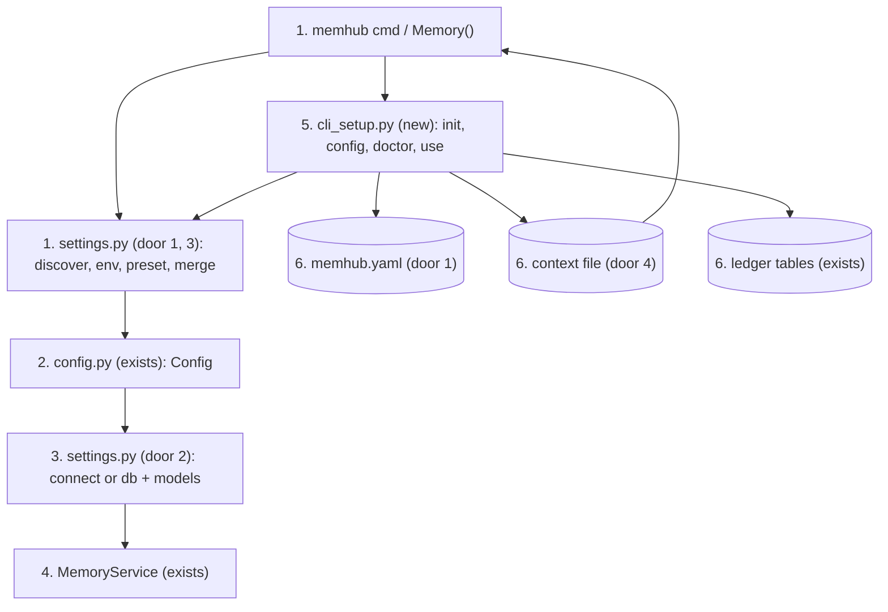
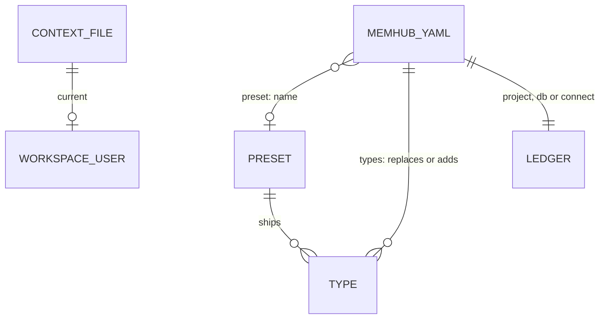

# Configure once: CLI and code (PR 2 of #1)

**Approved**: 2026-11-11 - user: "Ok, lets implement. Use the stacked PR from our last branch."

## Problem

Every `memhub` command needs `-c memhub.yaml`, and that yaml must describe the database, both
models, the extractor and the judge (28 to 175 lines in `examples/`), even for an app that already
holds a connection pool and LangChain models. `Memory(db=, embedder=)` ignores any yaml and any
environment variable (PR 1 gives it built-in defaults only), so the same project is configured twice,
once for the app and once for the CLI and jobs. Nothing writes the yaml, creates the tables and checks
the embedding model in one step, and there is no way to see which value a setting came from. Evidence:
PRD "Problem and goal" (yaml line counts, `-c` on every command); none beyond that.

When this ships, a developer runs `memhub init --preset support ...` once in a folder, then
`memhub add` / `memhub search` work with no `-c`, `Memory()` in Python loads the same yaml, an env var
or a `Memory(...)` argument overrides any key, and `memhub config show` says where each value came from.

## Shape

Reuses `Settings` and its sub-models (renamed `Config`, kept as an alias), `read_config`'s `${VAR}`
interpolation, `Memory` (PR 1) with its `ConnectionSource`s, and the existing `MemoryStore.init`
for the tables. The rules that change an outcome (layer order, discovery, presets, `types:` merge,
secrets, `connect:` and `models:` object building, context precedence, doctor verdicts) run in
`settings.py` and `cli_setup.py` as plain functions that `pytest` calls with `tmp_path`, `monkeypatch`
(cwd, `HOME`, env) and the fakes in `tests/fakes.py`; `cli.py` only parses flags.

1. `memhub <cmd>` or `Memory(config=, overrides=)` -> `settings.py` (door 1, 3) - finds the yaml (`-c`, else `./memhub.yaml`, `$MEMHUB_CONFIG`, `~/.config/memhub/memhub.yaml`), reads it raw, reads the `MEMHUB_*` env, loads the named preset (door 5), merges the layers, records each key's source, validates into `Config`
2. `settings.py` -> `config.py` (exists) - `Config` (was `Settings`) validates; `${VAR}` interpolated at read; the raw form kept for `save` / `config set`
3. `settings.py` (door 2) - builds `db`, `llm`, `embedder`: calls `connect: "module:function"` and takes `{db, llm, embedder, judge?}`, else `db:` URL plus `models:` through `init_chat_model` / `init_embeddings` (legacy `llm:` / `embeddings:` blocks through `build_chat_model` / `build_embeddings`); objects passed to `Memory(...)` win
4. `cli.py` (exists) -> `MemoryService` (exists) - every existing command gets its service from step 1-3; workspace and user come from flag, env or the context file (door 4)
5. `cli_setup.py` (new) - `init` (probe embed, `MemoryStore.init`, write the yaml), `config show|set`, `doctor`, `use`
6. out: `memhub.yaml`, ledger tables (exists, unchanged), `~/.config/memhub/context` (door 4), printed values and exit codes

**Changes underneath**

| Front | What changes |
| --- | --- |
| domain | `Memory(config=None)` meant "built-in defaults" (PR 1); it now means "discover the yaml, apply env". `config=<dict or Config>` reads no file. Every `Memory(db=...)` in a folder holding a `memhub.yaml` (this repo has one) now reads it: the existing tests isolate with an autouse fixture (chdir to `tmp_path`, `HOME`, no `MEMHUB_*`) |
| domain | `Settings` is now an alias of `Config`; `memory._settings` and `default_config` move to the defaults layer in `settings.py` |
| domain | `memhub init` with no `-c` and setup flags writes the yaml; with `-c FILE`, or with no flags and a yaml found, it creates the tables from that file exactly as today |
| stored data | nothing to migrate: no table or column changes; two new user files (`memhub.yaml` from `init`, `~/.config/memhub/context` from `use`) |
| readers | `add`, `list`, `search`, `queue`, `areas`, `page` read workspace and user from the context file or env when no flag is given; PR 7's MCP server will read the same file |

New: `memhub.yaml` (file), `PRESET` files in the package (door 5), `CONTEXT_FILE` (door 4); no table or column. One-way constraints: none stored in the database.

## Surface

None - no route. The commands `init`, `config show|set`, `doctor`, `use` and the now-optional `-c` are consumed by people at a terminal; their flags, output lines and exit codes (0 ok, 1 any failure) are criteria 28 to 57.

## Landing

| One-way door | Literal shape | Alternative rejected |
| --- | --- | --- |
| 1. yaml keys users commit | `project: minds`, `db: postgresql://u:${PGPASSWORD}@h/d` xor `connect: "pkg.mod:build"`, `models: {chat: "openai:gpt-4.1-mini", judge: "...", embeddings: "openai:text-embedding-3-small"}`, `preset: support`, `scopes: [user, workspace]`, `types: {ticket: {...}, account: null}`. `project`, `db` are aliases of `project_prefix`, `database_url`; every old key stays | renaming the old keys: breaks the 3 examples and every project yaml (R5 / N1) |
| 2. the `connect:` contract | `def build() -> dict` called with no arguments; returns `{"db": ..., "embedder": ..., "llm": ... (optional), "judge": ... (optional)}` | a returned object with attributes: the TDD fixes a dict, and minds' `build()` (PR 8) is written against it |
| 3. env scheme and discovery | `MEMHUB_<KEY>` lower-cased, nested with `__`, value parsed as yaml; not config keys: `MEMHUB_CONFIG`, `MEMHUB_CLI_ROLES`, `MEMHUB_WORKSPACE`, `MEMHUB_USER`; yaml looked up in `./memhub.yaml`, `$MEMHUB_CONFIG`, `~/.config/memhub/memhub.yaml`, first found wins, no merging of files | an allow-list of env keys: the TDD says nested keys with `__`; merging several yaml files: no way to tell where a value came from |
| 4. context file | `~/.config/memhub/context`, JSON `{"workspace": "acme", "user": "anna"}` (`user` may be null) | a second yaml or env only: the TDD names this path; PR 7 reads it |
| 5. presets shipped in the package | `memhub/presets/{maintenance,support,assistant}.yaml`, selected by `preset: <name>`; they hold types and policy only, never `project`, `db`, `connect`, `models`, `llm`, `embeddings`, `sources`, `database_schema`, `workspace_default` | presets as Python: the PRD fixes yaml files, and a `types:` block must be able to read and edit them |

- Nothing else in this change is hard to reverse

## Criteria

### S1: Layers, discovery and aliases (P1)

One `Config` comes out of defaults, preset, yaml, env and code, found without `-c`.

**Acceptance Criteria**

1. The system SHALL resolve each key from the highest layer that sets it, in the order defaults < preset < `memhub.yaml` < `MEMHUB_*` env < `config=` / `overrides=` in code
   - `reconcile.duplicate` unset → 0.92; yaml 0.9 → 0.9; plus env `MEMHUB_RECONCILE__DUPLICATE=0.95` → 0.95; plus `overrides={"reconcile": {"duplicate": 0.97}}` → 0.97
2. WHEN two layers set different keys of the same block THEN the system SHALL keep both; a scalar or a list is replaced whole
   - yaml `ttl: {temporary: 7d}` → `temporary` 7 days and `ongoing` still 365 days; yaml `scopes: [user]` over preset `scopes: [user, workspace]` → `[user]`
3. WHEN `config` is None THEN the system SHALL read the first file that exists among the yaml in the current folder, then the file named by the env var MEMHUB_CONFIG, then the one under the home config folder, and no other
   - all three exist → the current folder's; only the env one and the home one → the env one; only home → home
4. IF no yaml exists anywhere THEN `Memory(db=, embedder=)` SHALL run on the built-in defaults as in PR 1
5. IF `$MEMHUB_CONFIG` names a file that does not exist THEN the system SHALL raise `ConfigError` naming the path, not fall through to the next place
6. WHEN `config=<path>` THEN the system SHALL read that file and run no discovery, and raise `ConfigError` naming the path if it is missing; WHEN `config=<dict or Config>` THEN it SHALL read no file, and env and `overrides=` still apply
   - `config={"project": "a"}` in a folder with `./memhub.yaml` → project `a`, file ignored; same with `MEMHUB_PROJECT=b` → still `a` (code beats env)
7. WHEN `MEMHUB_<KEY>[__...]` is set THEN the system SHALL set that lower-cased key path to the value parsed as yaml
   - `MEMHUB_PRESET=support` → `preset: "support"`; `MEMHUB_DB` set to a db URL → `database_url`; `MEMHUB_INGESTION__MAX_CANDIDATES=5` → int 5; `MEMHUB_SCOPES='[user, workspace]'` → a list
8. The system SHALL NOT treat `MEMHUB_CONFIG`, `MEMHUB_CLI_ROLES`, `MEMHUB_WORKSPACE`, `MEMHUB_USER` as config keys, and SHALL ignore an env var whose first segment names no key
   - `MEMHUB_FOO=1` → resolves as without it; `MEMHUB_CONFIG` set → no key `config`
9. IF an env var targets `types` (`MEMHUB_TYPES__FACT__TYPE_PRIOR=0.9`) THEN the system SHALL raise `ConfigError` naming the variable and saying types are set in the yaml or `overrides=`
10. WHEN a layer uses `project` or `db` THEN the system SHALL treat them as `project_prefix` and `database_url`; IF one layer holds both an alias and its canonical key THEN `ConfigError` naming both
    - yaml `database_url: A`, env `MEMHUB_DB=B` → `B`; yaml `project: x` and `project_prefix: y` → error
11. The system SHALL keep every key today's yaml accepts valid: `examples/habitantes`, `examples/maintenance`, `examples/support` and `memhub.example.yaml` load as `Config` with the same `project_prefix`, `types` keys and `sources` keys as before; `Settings is Config` and `from memhub import Config` works
12. WHEN a yaml lacks `database_url`, `llm` and `embeddings` THEN it SHALL still load as `Config`: yaml `project: p` + `preset: assistant` only → loads

### S2: Presets and `types:` (P1)

`preset: support` gives a working type set; `types:` edits it.

**Acceptance Criteria**

13. WHEN `preset: <name>` is set in the yaml, env or code THEN the system SHALL load the packaged preset file of that name as the layer under the yaml, taking the name from the highest layer that sets it; IF the name is unknown THEN `ConfigError` listing `assistant, maintenance, support`
14. WHEN the yaml's `types:` names a type the preset defines THEN that type SHALL be the yaml's, whole; a new name SHALL be added; `name: null` SHALL remove the preset's type (AD-006)
    - preset `support` + `types: {ticket: {fields: {symptom: str}}}` → `ticket` has only `symptom` and the preset's `account` is kept; `types: {account: null}` → no `account`; `types: {faq: {fields: {q: str}}}` → `faq` added
15. WHEN a preset is loaded THEN it SHALL contain none of `project_prefix`, `project`, `database_url`, `db`, `connect`, `models`, `llm`, `embeddings`, `sources`, `database_schema`, `workspace_default`, and `{preset, project: "p"}` SHALL build a registry
16. The preset `maintenance` SHALL define `incident` (a yaml-declared type with `equipment`, `fault_code`, `fix`, scope `workspace`); `support` SHALL define `account`, `preference`, `ticket`, `fact` as in `examples/support`; `assistant` SHALL define `profile`, `preference`, `fact`, `episode`, `case`, `skill` with scopes `[user]` as in `examples/habitantes` (AD-008); the extraction and ingestion policy blocks of each example SHALL be in its preset
17. The presets SHALL be reachable with `importlib.resources` from an installed `memhub`, not from the repo tree

### S3: `connect:`, `models:` and `Memory()` (P1)

The CLI, jobs and `Memory()` get db and models the app's way.

**Acceptance Criteria**

18. WHEN the yaml has `connect: "pkg.mod:fn"` THEN the system SHALL import `pkg.mod` (the yaml's folder and the cwd importable), call `fn()` with no arguments once per command or `Memory`, and use the returned `db`, `embedder`, `llm`, `judge`
19. IF `connect` is not `module:function`, the module or function does not exist, it is not callable, it returns a non-dict, or the dict lacks `db` or `embedder` THEN the system SHALL raise `ConfigError` naming `connect` and the problem, with no connection opened
    - `"nocolon"` → error; `"os:nothing"` → error; `fn` returns `{"db": pool}` → error naming `embedder`
20. WHEN there is no `connect:` THEN the system SHALL build the db from `db:` / `database_url`, the chat model from `models.chat` with `init_chat_model`, the embedder from `models.embeddings` with `init_embeddings`; `models.judge` SHALL default to the chat model
21. WHEN the yaml also has legacy `llm:` / `embeddings:` blocks THEN those SHALL win over `models:` and build through `build_chat_model` / `build_embeddings` as today
22. IF neither `connect`, `db` nor `database_url` is set when a db is needed THEN the system SHALL raise `ConfigError` saying to set `connect`, `db` or `MEMHUB_DB`; IF no embedder source exists THEN it SHALL raise `ConfigError` naming `connect`, `models.embeddings` and `embeddings`
23. WHEN `Memory(...)` receives `db`, `llm`, `embedder` or `judge` THEN each passed object SHALL win over the same entry from `connect:`, `db:` or `models:`, and `connect:` SHALL NOT be called when both `db` and `embedder` are passed
    - `Memory(db=pool_a)` with `connect:` returning `pool_b` → uses `pool_a`
24. WHEN `Memory()` is called with no arguments and a yaml with `connect:` (or `db:` and `models.embeddings`) THEN `init`, `add` and `search` SHALL work as with explicit arguments
25. IF `Memory()` finds no yaml and no `MEMHUB_DB` THEN the system SHALL raise `ConfigError` listing the three discovery places of criterion 3
26. WHILE the db came from `connect:` the system SHALL leave it open after every `Memory` call and CLI command (AD-004)
27. WHEN `Memory(..., overrides={"preset": "maintenance"})` is called THEN the system SHALL accept `overrides` and apply it as the top layer of S1

### S4: `memhub init` (P1)

One command writes the yaml, creates the tables and fixes the embedding dims.

**Acceptance Criteria**

28. WHEN `memhub init --project P --db URL --embeddings prov:model --preset support` runs with no yaml in the folder THEN the system SHALL write `./memhub.yaml` with `project`, `db`, `models.embeddings`, `preset` and `scopes` (the preset's), create the tables, print `initialized 
_memory / 
_memory_runs`, and exit 0; the file SHALL load as `Config` with `project_prefix == P`
29. WHEN `--db` carries a literal password THEN the system SHALL accept it and write the URL as given (AD-007)
    - a local docker URL with user and password `memhub` → written unchanged, exit 0
30. WHEN `--connect pkg.mod:fn` is given THEN the yaml SHALL have `connect:` and no `db` or `models` key; IF `--connect` and `--db` are both given THEN exit 1 naming both and write nothing
31. WHEN `--chat prov:model` is given THEN the yaml SHALL have `models.chat`; without it there SHALL be no `models.chat`
32. WHEN a value is missing and stdin is a terminal or has input THEN the system SHALL prompt for it: project (default: the folder name made a valid identifier), db or connect, embeddings (not asked with `--connect`), chat (may stay empty), preset (default `assistant`); a value given by flag SHALL NOT be asked again
33. WHEN init runs THEN the system SHALL validate the flags, build the embedder, embed one text, create the tables, and only then write the yaml
34. IF the probe embed fails, the db is unreachable, or the probe's dims differ from the dims stored in an existing ledger (`EmbeddingMismatch`) THEN exit 1 with the message, and `./memhub.yaml` SHALL not exist afterwards
35. IF `--preset` is unknown or `--project` is not a valid identifier THEN the system SHALL exit 1 before any connection, naming the valid presets or the identifier rule
36. IF `./memhub.yaml` exists and a setup flag is given THEN exit 1 and leave the file untouched, unless `--force`; WHEN `--force` runs again with the same flags THEN the tables SHALL stay untouched and the yaml be rewritten
37. WHEN `init -c FILE` runs, or `init` runs with no flags and a yaml is found, THEN the system SHALL create the tables from that file and leave the file untouched, as today; WHEN no flags are given and no yaml is found THEN it SHALL prompt as in 32

### S5: `config show`, `config set`, `save` and secrets (P1)

Where a value came from, a validated edit, and no secret in a file.

**Acceptance Criteria**

38. WHEN `memhub config show` runs THEN the system SHALL print one line `KEY  VALUE  SOURCE` per leaf key that a layer above the defaults sets, with dotted paths and SOURCE one of `default`, `preset`, `yaml`, `env`, `code`; `--all` SHALL also print the keys left at their defaults
    - yaml `project: minds`, `MEMHUB_PRESET=support` → `project  minds  yaml`, `preset  support  env`, `ingestion.max_candidates  5  preset`; only with `--all`: `terms.max_aliases  5  default`
39. WHEN a printed value belongs to a key named `password`, `api_key`, `token` or `secret`, or is a URL with a password THEN the system SHALL print `***` in its place
40. WHEN `memhub config set KEY VALUE` runs THEN the system SHALL parse VALUE as yaml, set the dotted KEY in the yaml in use (`-c`, else discovered), validate the whole result as `Config`, write it, and keep every other key and every `${VAR}` reference as written
    - `config set ingestion.max_candidates 5` → file has `max_candidates: 5`; `config set scopes "[user]"` → a list
41. IF the new file would not validate THEN the system SHALL exit 1 naming the key and leave the file byte-for-byte unchanged; IF no yaml is found THEN it SHALL exit 1 saying to run `memhub init`
    - `config set ingestion.max_candidates abc` → exit 1, unchanged
42. IF the last segment of KEY is `password`, `api_key`, `token` or `secret` and VALUE is not exactly one `${VAR}` reference THEN the system SHALL exit 1 naming `${VAR}` and leave the file unchanged
    - `config set models.api_key sk-123` → exit 1; `config set models.api_key '${OPENAI_API_KEY}'` → written
43. WHEN `Config.save(path)` runs THEN the system SHALL write the keys set above the defaults as yaml that loads back to an equal `Config`, and a value that came from a `${VAR}` in the loaded yaml SHALL be written as that `${VAR}`
44. IF a key named `password`, `api_key`, `token` or `secret` holds a literal value when `Config.save` runs THEN `ConfigError` naming the key path and no file SHALL be written
    - `Config(... types ... params={"api_key": "sk-1"}).save(p)` → error, `p` absent; same loaded from yaml `params: {api_key: ${K}}` → written as `${K}`

### S6: `memhub doctor` (P1)

**Acceptance Criteria**

45. WHEN `memhub doctor` runs THEN the system SHALL print one line per check `ok|warn|fail|skip  <check>  <detail>` for `config`, `db`, `chat`, `embedder`, `dims`, `schema`, and exit 1 if any line is `fail`, else 0
46. IF the db does not answer `SELECT 1` THEN `fail db` with the error, the checks that need it SHALL print `skip`, exit 1
47. WHEN the embedder answers `embed_query` THEN the system SHALL print `ok embedder` with the dims; WHEN the dims differ from the dims stored in the ledger THEN it SHALL print `fail dims` naming both numbers and `memhub reembed`
48. WHEN a chat model is configured THEN `chat` SHALL invoke it once and report `ok` or `fail`; WHEN none is configured THEN `skip chat` saying ingest needs one, not `fail`
49. WHEN either ledger table or the stored embedding meta is missing THEN the system SHALL print `fail schema` saying to run `memhub init`, otherwise `ok schema` (AD-009; the numbered DB schema version is PR 6)
50. WHEN the db came from `connect:` and is a pool whose `max_lifetime` is unset, 0 or >= 3600 THEN the system SHALL print `warn pool` naming the value and recommending less than 3600 (AD-010), and the exit code stays 0
    - `max_lifetime=3000` → no warning; default pool (3600) → warn; a URL or a single connection → no `pool` line

### S7: `memhub use`, context and `-c` optional (P1)

**Acceptance Criteria**

51. WHEN `memhub use acme --user anna` runs THEN the system SHALL create `~/.config/memhub/context` with `{"workspace": "acme", "user": "anna"}`, print `workspace=acme user=anna`, and exit 0; WHEN `--user` is omitted THEN `"user"` SHALL be null
52. WHEN `add`, `list`, `search`, `queue`, `areas` or `page` gets no `--ws` / `--user` THEN the system SHALL take them from the flag, else `MEMHUB_WORKSPACE` / `MEMHUB_USER`, else the context file, else (workspace only) the yaml's `workspace_default`
    - context `acme` / `anna`, env `MEMHUB_USER=bob`, no flags → user `bob`, workspace `acme`; `--user carol` → `carol`
53. The system SHALL NOT take `delete --user` from the flag-less environment, env or context: erasing a user needs the explicit `--user`
    - context user `anna`, `memhub delete` with no id and no `--user` → exit 1 "pass either an id or --user", nothing erased
54. IF the context file is not valid JSON THEN the system SHALL exit 1 naming the file, not ignore it
55. WHEN a command other than `init` gets no `-c` THEN the system SHALL discover the yaml as in 3; WHEN it gets `-c FILE` THEN that file only; IF no yaml is found THEN exit 1 naming the three places and `memhub init`
56. WHEN the yaml was read from a discovered path THEN the system SHALL resolve a source's relative `path` against that yaml's folder, as with `-c`
57. IF the yaml lacks `database_url` / `db` / `connect`, `embeddings` / `models.embeddings` THEN the CLI SHALL exit non-zero naming the missing key, as today

### S8: Quickstart, end to end and nothing existing breaks (P1)

**Acceptance Criteria**

58. The system SHALL pass today's test suite after only the isolation fixture of "Changes underneath" and tests of default `-c` handling change (N1)
59. The README SHALL have a Quickstart with `memhub init --preset`, `memhub add`, `memhub search` and `Memory()`, and every `memhub <command>` it shows SHALL answer `--help` with exit 0
60. WHEN `tests/e2e/test_pr2_init.py` runs `memhub init --preset support --project 
 --connect tests.e2e.pr2_app:build` in an empty folder, then `memhub add` and `memhub search` with no `-c`, then `Memory()` in Python on the same folder THEN each step SHALL succeed and `Memory().search(...)` SHALL return the memory `memhub add` wrote

## Out of scope

| Excluded | Why |
| --- | --- |
| Numbered DB schema version in `doctor` | PR 6 introduces it (AD-009) |
| SQLite and `memory://` in `db:` | PR 3 and PR 4; a non-Postgres URL fails as a bad URL today |
| `memhub mcp` reading the context file | PR 7 |
| Keeping comments in `memhub.yaml` after `config set` | no round-trip yaml library is a dependency; the key order and values are kept |
| `memhub use` with no arguments (show the context) | not asked; `cat ~/.config/memhub/context` |
| Merging several yaml files | discovery takes the first (door 3) |
| Env overrides of `types` | a partial type cannot validate (criterion 9) |
| `${VAR}` resolution of secrets at use time instead of load time | existing behaviour; `save` / `config set` keep the reference |

## Assumptions

| Assumption | Chosen default | Rationale | Confirmed? |
| --- | --- | --- | --- |
| `types:` on top of a preset | replace by name whole, add, `null` removes | user chose "Replace that type whole" (AD-006) | y |
| URL with a literal password in `init --db` | accepted, written as given | user chose it (AD-007) | y |
| `assistant` preset base | `examples/habitantes` types and policy, scopes `[user]`, without `term` (workspace-only) | AD-008; scopes follow "user-scope chatbot" | y |
| Doctor schema check and pool warning | AD-009, AD-010 | user chose both | y |
| `config=<dict or Config>` reads no file | env and `overrides=` still apply | an explicit config is self-contained; keeps the PR 1 tests independent of a `memhub.yaml` in cwd | n |
| Discovery order | `./`, `$MEMHUB_CONFIG`, home, as the TDD lists it | binding source order, though an env path below `./` surprises | n |
| `connect:` call | no arguments, once per command or `Memory` | the TDD shows `build()` with none | n |
| `models:` vs legacy blocks | legacy `llm:` / `embeddings:` win when present | they carry `base_url`, `api_key_env`, `params` a string cannot | n |
| `models.chat` feeds extractor and judge | `models.judge` overrides the judge only | the PRD names `chat` and `embeddings` only | n |
| `init` writes `scopes` | the preset's scopes, as in the TDD sample | follows the sample file | n |
| `init` with no `--preset` | `assistant` | the most generic preset | n |
| `init` project default | folder name, lower-cased, non-identifier characters to `_` | the prefix must be a SQL identifier | n |
| Dims are not written to the yaml | stored in the ledger meta by `init` | `Memory` already probes and checks them (PR 1) | n |
| `config set` rewrites the yaml | keys and `${VAR}` kept, comments lost | no comment-preserving yaml dependency | n |
| `config show` source for a preset key | `preset` | the layer that supplied it | n |
| Context file written whole by `use` | `--user` omitted clears the user | predictable: the file equals the last command | n |
| `doctor` chat check | one `invoke("ping")` call | the cheapest proof the model answers | n |
| `use` / env user on `list` and `search` | narrows the result to that user | what `use` is for; `delete --user` is the exception (53) | n |

**Open questions:** none - all resolved or logged above.

## Differences from the source

| Source shows | Product shows | Confirmed |
| --- | --- | --- |
| PRD success criterion and N2: "a config written by `init` contains no secret values" | a literal password inside the `--db` URL is written as given; only keys named `password`, `api_key`, `token`, `secret` are refused | y - AD-007 |
| Issue: `doctor` checks "schema version" | checks the ledger tables and the stored embedding model/dims; the numbered version comes with PR 6 | y - AD-009 |
| Issue: `doctor` "warns on pools with no `max_lifetime`" | warns when `max_lifetime` is unset, 0 or >= 3600 | y - AD-010 |

## Sources

- Issue "Configure once: CLI and code" (PR 2 of #1), the request - binding - deliverables, files, acceptance
- PRD + TDD "memhub - Pluggable memory package - Integration" (Notion, read 2026-11-11), sections *Config and CLI*, R6-R9, N2 - binding - resolution order, yaml keys, commands, secrets
- `.specs/features/memory-facade/plan.md` (PR 1) and `.specs/STATE.md` AD-001 to AD-005 - binding - `Memory`, `ConnectionSource`, optional `database_url` / `llm` / `embeddings`
- `examples/{habitantes,maintenance,support}/memhub.yaml`, `memhub.example.yaml` - binding - what the presets are built from and what stays valid
