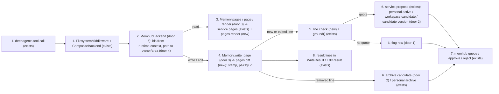
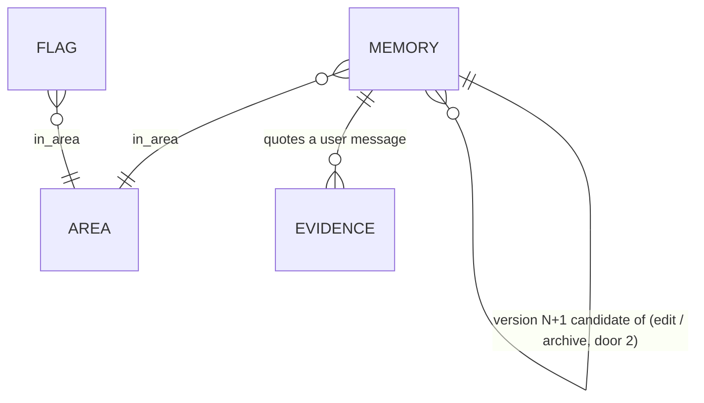
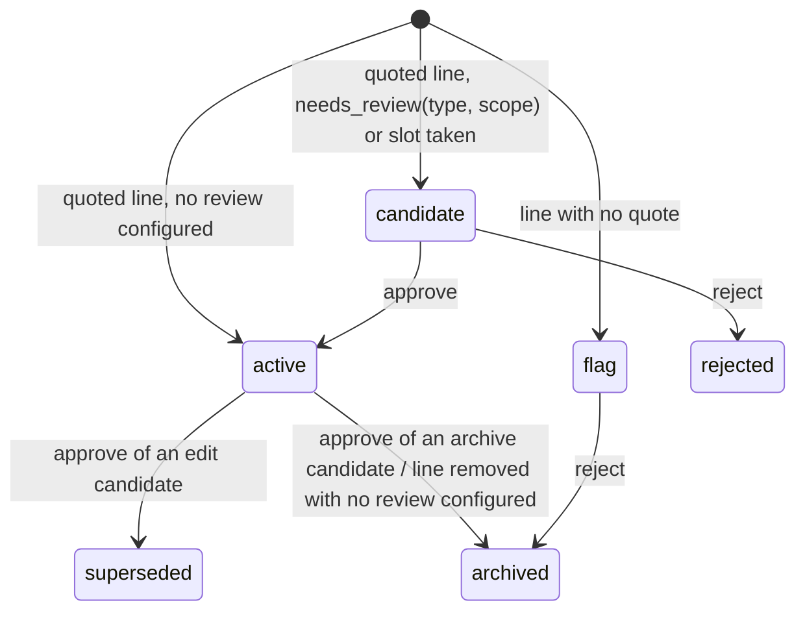

# deepagents backend: memhub as the reviewed store under /memories/

**Approved**: 2026-11-22 - user: "ok agree"

## Problem

A deepagents agent keeps long-term memory as files: `CompositeBackend` routes `/memories/` to a `StoreBackend`, and every run writes straight into that store. For one user's own notes that is enough. For the team it is not: any run writes into the shared namespace, nothing checks the text against what the user said, nobody reviews it, and the store keeps no history, so one wrong inference or one prompt injection becomes "team knowledge" for everyone. memhub has the checks (a verbatim user quote, a review queue, history), but a deepagents user can only reach them by giving up the `/memories/` file idiom for memhub's own tools.

Evidence: issue #41, which states this from deepagents' design; it gives no incident. The user adds the case it serves: "personal memories doesn't need authorization and can be written to /memories/users/<id>. Memories for the team can be written to /memories/<workspace_id>/, like symptoms that can become team wide. Everything the agent can learn for the whole team is important."

When this ships, a deepagents agent mounts `MemhubBackend` on `/memories/` and keeps using `ls`, `read_file`, `grep`, `write_file` and `edit_file`. It reads rendered pages of active memories that explain themselves; what it writes under its user's folder is saved at once when the user's own words back it; what it writes under the workspace folder waits in `memhub queue` for a person; and what nobody said is kept as a flag for a reviewer, never as memory. Every write answers with what happened to each line.

## Shape

This reuses the area pages (`service.pages` / `service.page`), `propose` with `approve=` and its owner rules (AD-057), candidate versions and `approve` / `reject`, the rejected-repeat guard (AD-043), the `/remember` extraction pattern and `ground()`'s quote check, and the review queue; the only new stored thing is two row shapes (doors 1-2). The rules that change an outcome - which rows a page shows, how a line is tagged, how a written page becomes changes, quote or flag, candidate or active - run in `memhub` (`src/memhub/pages.py` and the service), reached by unit tests and the storage contract suite with a scripted model; the example under `examples/deepagents_backend/` only maps the backend protocol onto `Memory` and holds no rule.

1. a deepagents tool call (`ls`, `read_file`, `grep`, `glob`, `write_file`, `edit_file`, `delete`) -> `FilesystemMiddleware` and `CompositeBackend` (exist, deepagents 0.7.41) - strip `/memories/` and hand the rest of the path to the route's backend.
2. `MemhubBackend` (door 5) - resolves `workspace_id` / `user_id` from `get_runtime().context` (values or resolvers, as `MemoryMiddleware`); maps the user folder and the team folder (templates, door 4) to an owner, area and subject (door 4); any other folder is "not found".
3. reads -> `Memory.pages` / `Memory.page` / `Memory.render` (door 3) -> `service.pages` / `service.page` (exist) and `pages.render` (new) - active, non-stale rows of the area, one tagged line each, subject summaries over `render.summarize_over`, the caller's own candidates under `## Pending review`; `grep` and `glob` run literally over the rendered pages.
4. `write_file` / `edit_file` -> `MemhubBackend` applies an edit to the current render (a write takes the text as given) -> `Memory.write_page` (door 3) -> `pages.diff` (new) - checks the stamp (a `write` only), parses lines, and pairs them by id with the current page: new, edited, removed, id changed, or ignored (header, summaries, pending section).
5. each new or edited line -> the line check (new, in `pipeline/`, modelled on `pipeline/remember.py`) - one model call on the line plus the last `ingestion.remember_context` user messages read from the graph state; `ground()` (exists) keeps it only with a verbatim user quote.
6. `service.propose` (exists, gains `area` and a candidate version of an active memory, door 2) - the folder sets the scope only; whether the change waits is `Config.needs_review(type, scope)` (exists, the project's `review` config), plus a taken slot, exactly as `route()` decides for extracted memories. Waits: a candidate (or an archive candidate, door 2). Does not wait: active with `reviewed_by = "auto"` (AD-055), or `service.archive` (exists) for a removal. No quote: a `flag` row (door 1).
7. `service.approve` / `service.reject` and `memhub queue` / `approve` / `reject` (exist) - approving a candidate version supersedes the active row, an archive candidate archives it; a flag cannot be approved and `reject` archives it.
8. out: `WriteResult` / `EditResult` carrying one result line per change (`saved`, `pending review`, `flag`, `refused`); the next `read_file` shows the caller's pending lines.

**Changes underneath**

| Front | What changes |
| --- | --- |
| domain | `status` gains `flag` (AD-061): never active. Today's readers that branch on status: `uow.memories.queue` (Postgres, SQLite, in-memory: `status = 'candidate'`), `service.approve` / `reject`, `Memory._candidate`, `memhub queue` / `approve` / `reject`, `get_all(status=)`, `delete_user` (erases flags too, as every row of the user) |
| domain | a `candidate` may now carry `payload["_action"] = "archive"` (AD-062); readers: `service.approve` (archives instead of activating), `memhub queue` (shows it as `archive #<id>`), `Memory.queue` |
| domain | `propose` may now write a candidate version of an active memory (same `memory_id`, version N+1); today only reconcile writes those. Readers: `service.approve`, `history` |
| stored data | nothing to migrate: `status` is free text in every backend, `payload` is JSON |
| readers | `memhub queue` and `Memory.queue` list flags and archive candidates; `search`, `get_all(status="active")` and injection read active rows only, unchanged; `pages` and the injected page (`page_for_query`) unchanged |

New: the `flag` row (a `MEMORY` row with `status = 'flag'`, door 1) and the archive candidate (door 2). One-way constraints: a flag is never `active`; an archive candidate keeps the active row's payload plus `_action`.

## Surface

Python API and the example's backend; there is no HTTP route. The codes in Status only name each outcome class so that checks.md can join them, as in the earlier plans: 200 ok, 404 `NotFound` (an unknown area or subject, or another owner's - the same answer for both), 409 a stale whole-file write, 422 `ValidationError` / a refused operation.

| Route | In | Out | Status | Who |
| --- | --- | --- | --- | --- |
| `Memory.render(area, *, user_id=None, subject=None, ...)` | ids as every `Memory` call (AD-001); `user_id` set = that user's page, unset = the workspace's | the page text (door 3) | 200 `str`; 404 `NotFound` for an unknown area or subject | the caller for their own pages and their workspace's; another user's page is `NotFound` |
| `Memory.pages(...)` / `Memory.page(area, ...)` | ids; `personal: bool` | the existing page dicts of `service.pages` / `service.page` | 200; 404 `NotFound` for an unknown area | as above |
| `Memory.write_page(area, text, *, personal, messages, edit=False, subject=None, ...)` | the written page text, the recent messages, whether it is a whole-file write | `list[PageChange]`: `{kind: saved / pending / flag / refused, id, text, reason}` | 200 `list[PageChange]`; 409 `ValidationError` for a stale stamp on a whole-file write; 404 `NotFound` for an unknown area or another owner | as above |
| `MemhubBackend(memory, *, workspace_from, user_from, user_folder="users/{user_id}", team_folder="team/{workspace_id}")` (example) | deepagents' `BackendProtocol` calls on the stripped path | `LsResult`, `ReadResult`, `GrepResult`, `GlobResult`, `WriteResult`, `EditResult`, `DeleteResult` | 200 `error=None`; 404 `error="not found"`; 409 `error="page changed since you read it: read it again"`; 422 `error="areas come from memory.md: edit lines in an existing page"` | the runtime's user, on `users/<own id>/` and `<own workspace>/` only |

Built (additive): AD-001 makes `user_id` the caller on every `Memory` call, so `Memory.render`, `pages`, `page` and `write_page` choose the folder with `personal: bool = True` (the caller's own memory) or `False` (the workspace's); `area=None` renders the folder's README. `MemhubBackend` also takes `roles` and `messages_from` (where the conversation is read; default the graph state).

## Landing

| One-way door | Literal shape | Alternative rejected |
| --- | --- | --- |
| 1. the flag row | a memory row, `status = 'flag'`, `scope` and owner from the folder, `content` = the agent's line, `evidence = [{"kind": "trace", "thread_id": "<thread>", "run_id": "<run>"}]`, linked `in_area` to the page's area, `created_by` = the user id | a separate flags table: needs a migration in two backends and a second queue listing (AD-061) |
| 2. edit and archive proposals | a `candidate` with the active row's `memory_id` and `version + 1`; an archive proposal's payload is the active payload plus `"_action": "archive"` | a new memory with `conflicts_with`: a second `memory_id` for one fact; a removal as a flag: nothing could archive through the queue (AD-062) |
| 3. the page format and the public `Memory` calls | header `# Memory: <area title> (<owner>)`, `<!-- memhub · rendered <ISO UTC> · stamp <12 hex of sha256 of the body> · read-only view, rebuilt from the database -->`, `## How to read this` (fixed text), `## Memory` with `#<8 hex> [<tag>] <text> (<observed date>)` with tag `reviewed`, `inferred`, `said` or `added` - a `[said]` line quotes the user `"…"`, summary lines `#s_<subject slug> (<n> memories) <subject>: … → <area>/<subject slug>.md`, `## Pending review (yours, not usable yet)` with `- [pending] <text>. Proposed <date>.` / `- [flag] …`; `Memory.render`, `pages`, `page`, `write_page` | the issue's `#m_812`: memory ids are UUIDs, the full one costs ~4x the tokens per line (user chose the 8-hex prefix) |
| 4. the folder layout | virtual paths, nothing stored: `MemhubBackend(..., user_folder="users/{user_id}", team_folder="team/{workspace_id}")` - the app may pass any templates; under each, `README.md`, `<area key>.md`, `<area key>/<subject slug>.md`; `ls /` shows only the caller's two folders | fixed `me/` and `team/`, or fixed `users/<id>/`: the user said the folders "are just an example"; the app chooses them |
| 5. a new dependency and the example's place | `deepagents>=0.7.41,<0.8` in a new `deepagents` extra and `dev`; `examples/deepagents_backend/memhub_backend.py` imports only names in `memhub.__all__`; `src/memhub` imports no deepagents | the backend inside `src/memhub`: a deepagents dependency in core, against #30's direction |

- Nothing else in this change is hard to reverse

## Criteria

### S1: an agent reads its memory as pages (P1)

A `MemhubBackend` on `/memories/` lists and renders the caller's and the workspace's active memories.

**Acceptance Criteria**

1. WHEN the agent walks `/memories/` with `ls` THEN the backend SHALL show only the caller's user folder and team folder, rendered from the templates with the runtime's ids, one path segment per level
   - defaults, `u1` in `w1`: `ls /memories/` → `team/`, `users/`; `ls /memories/team/` → `w1/`; `ls /memories/users/` → `u1/`; with `team_folder="shared"` → `ls /memories/` shows `shared/`, `users/`
2. WHEN the agent calls `ls` on the user folder or the team folder THEN the backend SHALL list `README.md` plus one `<area key>.md` per area of that owner with at least one active row
   - user `u1` with areas `travel` (3 rows) and `work` (0 rows) → `README.md`, `travel.md`; a workspace with no area → `README.md` only
3. IF the path names another user's folder, another workspace, or an area that does not exist THEN the backend SHALL answer with the same "not found" error and no content
   - `ls /memories/users/u2/` called as `u1` → `not found`, identical to `ls /memories/users/nobody/`; `ls /memories/team/w2/` called in `w1` → `not found`
4. WHEN the agent reads `<area>.md` THEN the page SHALL open with the title line, the comment with `rendered` and `stamp`, and the `## How to read this` section in AD-063's fixed text
5. The page SHALL show each active, non-stale row of the area as one line `#<8 hex> [<tag>] <text> (<observed date>)`, newest first, and SHALL never show a candidate, rejected, superseded, archived or flag row as a memory line
   - an area with one active, one candidate, one rejected and one superseded row → one `## Memory` line
6. The tag SHALL be `[reviewed]` when `reviewed_by` is a person (not `auto`, not empty), else `[inferred]` when `assertion = inferred`, else `[said]` when the row has a user quote, else `[added]`
   - approved by `alice` with a quote → `[reviewed]`; `auto` with a quote → `[said]` and the quote in `"…"`; plain `add("text")` → `[added]`
7. The line id SHALL be the first 8 hex characters of the `memory_id`, lengthened to the shortest prefix that is unique on that page when two lines collide
8. WHILE an area has more than `render.summarize_over` (default 30) active lines the page SHALL show lines with no subject in full and one `#s_<subject slug> (<n> memories) …  → <area>/<subject slug>.md` line per subject
   - 30 lines → all in full; 31 lines, 12 about `flights` → one `#s_flights (12 memories)` line and the 19 others in full
9. WHEN the agent reads `<area>/<subject slug>.md` THEN the backend SHALL render every active line of that area about that subject, whatever its count
10. WHEN the agent reads `README.md` THEN it SHALL show the same header and `## How to read this` plus one line per area with its title and count of active lines
11. WHILE the caller has candidates or flags of their own in the area the page SHALL list them under `## Pending review (yours, not usable yet)` as `- [pending] <text>. Proposed <date>.` or `- [flag] <text>. Noted <date>.`, and another user's SHALL never appear
12. WHEN the agent calls `grep` with a pattern under `/memories/` THEN the backend SHALL return each rendered page line containing that literal substring, with its path and line number
    - `grep "CDG"` → the `travel.md` line holding `CDG`; `grep "C.G"` → nothing (literal, not regex)
13. WHEN the agent calls `glob` THEN the backend SHALL match the pattern against the virtual paths of criteria 1-2 and 9
14. The backend's `read` SHALL honour `offset` and `limit` and set `start_line`, `end_line`, `total_lines` and `next_offset` as deepagents 0.7.41's `ReadResult` requires
15. The `Memory.render(area, user_id=...)` call SHALL return the same text the backend serves for that page, and `Memory.pages()` / `Memory.page()` SHALL return what `service.pages` / `service.page` return for the caller

### S2: a team line the user said (P1)

What the agent writes in the team folder needs the user's own words, and waits for a person when the project's review config says so.

**Acceptance Criteria**

16. WHEN the agent writes a new line with no id under the team folder's `<area>.md`, a recent user message holds a verbatim quote supporting it, and `needs_review(type, "workspace")` is true THEN memhub SHALL create one workspace `candidate` in that area with that quote as evidence, and the write result SHALL read `pending review: <text>`
    - project default `review: workspace` → candidate; the line's type set `review: false` → active, `saved #<8 hex>: <text>`
17. WHEN such a line is a candidate THEN the system SHALL show it in `memhub queue` and in the writer's `## Pending review` on the next read, and as a `## Memory` line only after `memhub approve`
18. The quote check SHALL read the last `ingestion.remember_context` messages of the agent's graph state and SHALL accept only a quote found verbatim in a user message
    - the user said "our pumps fail above 40°C" and the line is `Pumps fail above 40°C` → candidate; the quote appears only in an assistant message → flag
19. IF a new line is close to a candidate a reviewer rejected for the same owner (AD-043) THEN memhub SHALL save nothing and the result SHALL read `refused: a reviewer rejected this before`

### S3: the project's review config decides, in both folders (P1)

The folder sets the scope; memhub's `review` config decides whether the line waits (AD-065).

**Acceptance Criteria**

20. WHEN the agent writes a new line in either folder backed by a user quote, and `needs_review(type, scope)` is false and its slot is free THEN memhub SHALL save it active with that quote and `reviewed_by = "auto"`, and the result SHALL read `saved #<8 hex>: <text>`
    - personal line, project `review: workspace` → active; personal line of a type with `review: true` → candidate
21. IF `needs_review(type, scope)` is true or its slot already holds an active value THEN memhub SHALL save it as a candidate and the result SHALL read `pending review: <text> (<reason>)`
    - a `preference` with key `seat` while `#3f9a21c0` holds an active `seat` → `pending review: Window seat on short flights (#3f9a21c0 holds an active value)`

### S4: edits and removals (P2)

A changed or removed line becomes a change to that memory, never a new one.

**Acceptance Criteria**

22. WHEN a written page keeps a line's id and changes its text, and a user quote backs the new text THEN memhub SHALL write a candidate version of that memory (same `memory_id`, version N+1); it SHALL wait in the queue when `needs_review(type, scope)` is true, else it SHALL replace the active row at once
23. WHEN a reviewer approves an edit candidate THEN the active row SHALL be superseded by the new version, and WHEN they reject it THEN the active row SHALL stay as it was
24. WHEN a written page drops a line whose memory's type and scope need review THEN memhub SHALL write an archive candidate (AD-062) and the result SHALL read `pending review: archive #<id>`; approving it SHALL archive the memory, rejecting it SHALL leave it active
25. WHEN a written page drops a line whose memory needs no review THEN memhub SHALL archive that memory at once and the result SHALL read `archived #<id>`
26. IF a line's id is changed or names no memory on that page THEN memhub SHALL change nothing for that line and the result SHALL read `refused: line #<id> id changed`
27. WHEN only the header, the `## How to read this` text, a summary line or the `## Pending review` section differ from the current page THEN memhub SHALL change nothing and the result SHALL read `no change`
28. IF a `write_file` carries a stamp other than the current page's THEN memhub SHALL change nothing and answer `page changed since you read it: read it again`; an `edit_file` SHALL apply to the current page and never be stale
29. WHEN `edit_file`'s `old_string` is not found in the current page, or is not unique without `replace_all` THEN the backend SHALL answer with deepagents' usual edit error and change nothing
30. IF the agent calls `delete`, `upload_files`, or writes a new `<area>.md` that does not exist THEN the backend SHALL refuse with `areas come from memory.md: edit lines in an existing page`

### S5: flags (P2)

What nobody said is kept for a reviewer, never as memory (AD-061).

**Acceptance Criteria**

31. IF a new or edited line has no supporting user quote THEN memhub SHALL store a `flag` row (door 1) and the result SHALL read `flag: <text> (no supporting quote)`, and the backend SHALL return no error so the agent does not retry
32. The system SHALL never return a flag from `search`, `get_all(status="active")`, injection, or as a `## Memory` line, and SHALL list it by `memhub queue` as `flag`
33. WHEN a reviewer runs `memhub approve` on a flag THEN memhub SHALL refuse with `a flag is not a memory: reject it to dismiss it`; WHEN they run `memhub reject` THEN the flag SHALL become `archived` and SHALL not block a later proposal via AD-043

### S6: the write result (P1)

**Acceptance Criteria**

34. WHEN a write or edit under `/memories/` is handled THEN the tool message the agent receives SHALL hold one line per changed line, in page order, from `saved #<id>: <text>`, `pending review: <text>[ (<reason>)]`, `archived #<id>`, `flag: <text> (no supporting quote)`, `refused: <reason>`, or `no change`
    - one page write with a new quoted personal line, an id change and an unquoted line → `saved #…`, `refused: line #… id changed`, `flag: … (no supporting quote)`

### S7: the example runs a real agent (P1)

**Acceptance Criteria**

35. The example under `examples/deepagents_backend/` SHALL import only names in `memhub.__all__`, and `src/memhub` SHALL import no `deepagents` module
36. The example's test SHALL run `create_deep_agent` with a scripted chat model, `CompositeBackend(default=StateBackend(), routes={"/memories/": MemhubBackend(...)})` and a SQLite `Memory`, and SHALL go through reading a page, writing a quoted team line, `approve`, and reading it back as a `## Memory` line
37. WHEN deepagents is not installed THEN `import memhub` and the core test suite SHALL still pass

## Out of scope

| Excluded | Why |
| --- | --- |
| A curator pass that turns flags into memories | the issue names flags as its input "for a later" pass |
| Semantic `grep` via `search` | user chose literal grep; `search` stays memhub's own tool |
| Renaming or moving pages, creating areas from the file view | paths are areas and subjects owned by `memory.md` (issue) |
| Moving `MemoryMiddleware` to `examples/` | issue #30 |
| The memory index loaded into the prompt | issue #28 reuses `Memory.render`; it is not built here |
| The issue's step 1 spike (memhub through the middleware inside `create_deep_agent`) | the user chose the whole issue as one feature; the backend test (criterion 36) proves the deepagents path |
| A web or dashboard view of pages | issue #24 |

## Assumptions

| Assumption | Chosen default | Rationale | Confirmed? |
| --- | --- | --- | --- |
| Scope of this feature | the whole issue #41: render, reads, me/ and team/ writes, line edits, removals, flags, pending section | user chose "Whole issue" over steps 2+3 first | y |
| Where flags are stored | a row in the memory table with `status = 'flag'` | user chose "New row status 'flag'" over a separate table | y |
| A `write_file` over a page that changed since the agent read it | refused: "page changed since you read it: read it again"; the page carries a stamp of its content | user chose "Refuse, read again" over diffing against a per-thread snapshot | y |
| What `grep` does | literal substring over the rendered pages | user chose "Literal over pages" over semantic or both | y |
| When an area page switches to subject summaries | new setting `render.summarize_over`, default 30: an area with more active lines shows lines with no subject in full and one summary line per subject | user chose "New setting, default 30" over reusing `page_max_items` or always summarizing | y |
| Tag of a line with no quote and no person's approval | `[added]`; order `[reviewed]` (a person approved) > `[said]` (has a quote) > `[added]` | user chose "[added]" over `[inferred]` | y |
| How an edited team line waits | a candidate version of the same `memory_id` (version N+1); approve supersedes the active one, reject leaves it | user chose "Candidate version" over a new memory with `conflicts_with` | y |
| How a removed line waits | a candidate version carrying `payload["_action"] = "archive"`; approve archives the memory, reject leaves it active | user chose "Candidate with archive marker" over turning removals into flags | y |
| How a new line's supporting quote is found | one model call, as `/remember` does: the line plus the recent user messages in, the type, fields and a verbatim quote out; grounding checks the quote is in a user message; then `propose()` with the path's scope. No quote: a flag | user chose "Line-targeted check" over `add(messages, infer=True)` | y |
| Whether an edited line needs a supporting quote | yes, the same check; no quote: a flag | user chose "Yes, same check" over "only for me/" or "no" | y |
| How the backend gets `workspace_id` / `user_id` | `MemhubBackend(memory, workspace_from=..., user_from=...)`, each a value or a callable on `runtime.context` from `get_runtime()`, as `MemoryMiddleware` does | user chose "Resolvers on runtime.context" over constructor ids only | y |
| deepagents version | `deepagents>=0.7.41,<0.8` in a new `deepagents` extra, not in core dependencies | user chose ">=0.7.41,<0.8" over an exact pin | y |
| Folder for personal and team memory | virtual paths from two templates the app passes, default `users/{user_id}` and `team/{workspace_id}` | user: "These are 'folders' in the database, right? And they are just an example." | y |
| Folders the agent may reach | only the caller's user folder and team folder; anything else answers "not found", as a missing folder does | user chose "Only own + own workspace" over reading other users' pages | y |
| Who decides whether a file-view write waits | memhub's `review` config (`needs_review(type, scope)`) and the slot rule, as for extracted memories; the folder only sets the scope; the quote check stays in both folders | user: "reviews are part of the config of the memhub"; supersedes "personal skips review, team always waits" (AD-065) | y |
| How reviewers handle a flag | `reject` archives it; `approve` refuses | user chose "reject dismisses it" | y |
| How the result lines reach the agent | `WriteResult.path` / `EditResult.path` carry the path followed by the result lines, since deepagents 0.7.41 prints `Updated file {res.path}` and has no message field; refusals that change nothing use `error`. `CompositeBackend` sets `res.path` to the routed path after the call, so the example's result classes re-append the lines whenever `path` is set | the only success channel the 0.7.41 tool message has; an `error` on success makes the agent retry | n |
| Where the recent messages come from | the graph's `messages` channel, read the way deepagents' `StateBackend` reads `files` (`CONFIG_KEY_READ`) | the backend protocol passes no messages; `StateBackend` 0.7.41 uses the same mechanism | n |
| Removing a line | no quote asked; archived at once or an archive candidate, by the review config | a removal adds no claim; the row stays in history and can be restored | n |
| Two folder templates that render the same path for a caller | refused with `ValidationError` when the path is resolved | a path must name one owner | n |
| Where `[inferred]` sits in the tag order | after `[reviewed]`, before `[said]` | an inferred row may carry a quote; `[said]` would present a guess as the user's words | n |
| The subject slug in a path | the subject name lower-cased, non-alphanumerics as `-`; prefixed with `<type>-` when two subjects on the page share a name | one readable path segment per subject | n |
| The actor behind a file-view write | the runtime's `user_id` (so "yours" in `## Pending review` and the owner's `approve` match) with `agent_id = "deepagents"` | AD-057's owner approval needs the actor to be the owner | n |

**Open questions:** none - all resolved or logged above.

## Differences from the source

| Source shows | Product shows | Confirmed |
| --- | --- | --- |
| folders `/memories/me/` and `/memories/team/` | two folder templates the app passes, default `users/{user_id}` and `team/{workspace_id}` | y - AD-065 |
| line ids `#m_812` | the 8-hex prefix of the memory id, `#3f9a21c0` | y - AD-063 |
| three tags `[said]`, `[reviewed]`, `[inferred]` | a fourth tag `[added]` for a row with no quote and no person's approval | y - AD-063 |
| `grep` → `search(...)`, ranked hybrid hits | `grep` is a literal substring over the rendered pages | y - AD-063 |
| a new line → `add(messages, infer=True)` | one model call checks the line against the recent user messages; then `propose()` with the folder's scope | y - AD-065 |
| `me/` → `propose(approve=True)`, `team/` → always a candidate | the folder sets the scope; the project's `review` config decides whether a line, edit or removal waits | y - AD-065 |

## Sources

- GitHub issue #41 "deepagents backend: memhub as the reviewed store under /memories/" - binding - problem, read and write tables, page format, policy, acceptance; departures from it (paths, ids, `[added]`, grep) are user decisions above and AD-061 to AD-064
- The user, planning #41: the user and team folders ("just an example": templates the app sets), review by memhub's config ("reviews era part of the config of the memhub"), and "Everything the agent can learn for the whole team is important"
- deepagents 0.7.41 as installed (`deepagents/backends/protocol.py`, `composite.py`, `state.py`, `store.py`, `middleware/filesystem.py`) - the backend protocol this plan targets
- `.specs/STATE.md` AD-001, AD-043, AD-054, AD-055, AD-057 (ids on every call, rejected repeats, proposals, `reviewed_by`, owner review) and AD-061 to AD-065 (this feature)
