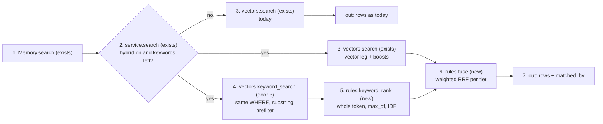
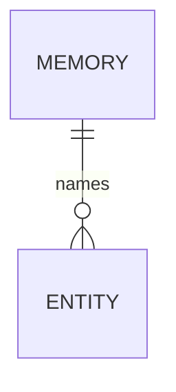

# Hybrid search: a keyword leg fused with the vector leg

**Approved**: 2026-11-14 - user: "ok for all. Implement"

## Problem

`MemoryService.search` (`src/memhub/service.py:355`) embeds the query and asks each backend for the nearest rows by cosine (`max(k * 4, 20)` candidates), then re-orders them with `apply_boosts` (`src/memhub/storage/rules.py:104`). Text only re-orders rows the vector search already found: a row outside the vector candidates never comes back, however exactly its content names what the user typed.

Embeddings are weak on the tokens that matter most in operations work: fault codes (`E47`), asset ids (`PRD_1`, `P-101`), part numbers (`6205`), ticket numbers, version strings, proper nouns. "E47 on the rooftop unit" can rank a memory about a *different* low-pressure fault above the one that says `E47`, and a query that is only a code (`6205`) has almost no semantic signal. The codes are not known in advance, so they cannot be listed in config. Memories and queries are written in Italian, French, English and Portuguese, so a keyword match on everyday words ("de", "le", "the", "problema") would match nearly every memory and push the right one down. Evidence: issue #26; Zep / Graphiti combine semantic and keyword retrieval for this reason.

When this ships, a search finds the memories whose content contains the query's informative words, codes and ids included, even when their embedding is not among the nearest. Stopwords of the four languages never count, a project adds its own generic domain words in `memhub.yaml`, and with `search.hybrid: false` results are what they are today.

## Shape

This reuses the WHERE clause every backend already builds for `vectors.search` (status, owner, stale, type, `EntityFilter`, `Filter`), `apply_boosts`, the subject tiers (AD-030, AD-033, AD-052) and the storage contract suite. Nothing stored changes: no column, no index, no migration; writes are untouched. The rules that change an outcome (tokenising, stopwords, document-frequency cut, keyword ranking, fusion) run in pure Python in `storage/rules.py` and `service.py`, which the contract suite and the unit tests reach on all three backends with no model.

1. `query` enters `Memory.search` (exists), new argument `hybrid=None`, -> `service.search` (exists). `hybrid=None` means `search.hybrid` from config; `True` / `False` override it for that call.
2. `service.search` (exists) - with hybrid off, does exactly what it does today and nothing else. With hybrid on, it turns the raw query (not the glossary-expanded text) into keywords: split into tokens, casefolded and accent-folded, minus tokens shorter than 2 characters, minus the built-in stopwords of it/fr/en/pt, minus `search.stopwords`. No keyword left: the search is the vector search of today, with `matched_by: "vector"` on each row.
3. `vectors.search` (exists) - the vector leg, unchanged, boosts included.
4. `vectors.keyword_search` (new port method on Postgres, SQLite, in-memory) - with the same arguments and WHERE clause as `vectors.search`, returns the rows whose content contains any keyword as a substring (`ILIKE` / `LIKE` / Python), each with its cosine `similarity` to the query embedding, plus the count of rows that pass the WHERE clause.
5. `rules.keyword_rank` (new) - keeps only whole-token matches in the same tokenisation (`E47` does not match `E470`, `PRD_1` does not match `PRD_10`), drops any keyword found in more than `search.keyword_max_df` of the rows that pass the WHERE clause, scores each row by the sum of IDF of the distinct keywords it contains, and keeps the top `max(k * 4, 20)`.
6. `rules.fuse` (new) - weighted reciprocal rank fusion of the two lists inside each tier: `vector_weight / (60 + rank_v) + keyword_weight / (60 + rank_k)`, ties broken by `similarity`, then the first `k`. Each row gains `matched_by`: `vector`, `keyword` or `both`.
7. out: rows as today (`similarity` is still the cosine), ordered by tier then fused score, with `matched_by`; `areas`, `matched_on`, `expanded_by` as today.

**Changes underneath**

| Front | What changes |
| --- | --- |
| domain | The order of `search` results means "fused rank" instead of "cosine plus boosts" while hybrid is on. Nothing in memhub branches on it; the middleware's injected memories and the MCP / toolkit `search_memory` results reorder, which is the point |
| stored data | nothing to migrate - no schema change, no backfill, `memhub migrate` untouched |
| readers | `Memory.search`, `memhub search`, `MemoryToolkit` / `MemoryMiddleware` / MCP `search_memory`, middleware injection: all get hybrid by default (default on), and every row carries `matched_by`. `memhub config show` lists the `search:` keys |
| tests | AD-014's same-SQL test proves the vector path: it runs with `search.hybrid: false`. No other search test's order changed. Two tests change with their claim: `test_mcp_server.py::test_search_memory` (the tool's view gains `matched_by`, settled mid-build) and `test_storage_ports.py` (38 port methods with `keyword_search`, door 3) |

New: nothing - read only. One-way constraints: none stored.

## Surface

Python API and config; there is no HTTP route. The codes in Status only name each outcome class so that checks.md can join them, as in the search-filters plan: 200 ok, 422 `ValidationError` / `ConfigError`, 404 another owner's rows, which neither leg returns.

| Route | In | Out | Status | Who |
| --- | --- | --- | --- | --- |
| `Memory.search(query, ..., hybrid=None)` | `hybrid`: `True`, `False` or `None` | each row gains `matched_by`: `vector`, `keyword` or `both` | 200; 422 `ValidationError` for a non-bool `hybrid`, before any database or model call; 404 another owner's rows absent from both legs | any caller, scoped by `workspace_id` / `user_id` as today |
| `memhub.yaml` `search:` | `hybrid` (bool, `true`), `vector_weight` (float >= 0, `1.0`), `keyword_weight` (float >= 0, `1.0`), `keyword_max_df` (0 < x <= 1, `0.5`), `stopwords` (list of str, `[]`) | `memhub config show` lists them | 200 config loads; 422 `ConfigError` naming the key for a value out of range, or both weights 0 | anyone: whoever can write the project's config file |

## Landing

| One-way door | Literal shape | Alternative rejected |
| --- | --- | --- |
| 1. Config keys | `search: {hybrid: true, vector_weight: 1.0, keyword_weight: 1.0, keyword_max_df: 0.5, stopwords: []}` | `search.keyword_weight` alone: the user wants both legs tunable, and one weight cannot turn the vector leg down |
| 2. Row field consumed by apps and agents | `matched_by` with values `"vector"`, `"keyword"`, `"both"`, present on every row while hybrid is on, absent when off | a numeric `keyword_score`: meaningless across queries and backends, and leaks the formula into the contract |
| 3. Port method every backend implements | `VectorIndex.keyword_search(*, keywords: list[str], query_embedding, <vectors.search filter args>) -> (rows, searchable_count)` | a stored full-text index (`tsvector` + GIN, FTS5): needs a migration and a backfill, which the user ruled out, and `simple`/FTS5 tokenisers would not apply our stopword and whole-token rules the same way on every backend |

- Nothing else in this change is hard to reverse

## Criteria

### S1: an exact code or rare word is found, on every backend (P1)

A search for a code or a rare word returns the memory that names it, first, on Postgres, SQLite (with and without sqlite-vec) and in-memory.

**Acceptance Criteria**

1. WHILE `search.hybrid` is true, WHEN two active memories differ only by a code (`"fault E47 on the rooftop unit"`, `"fault E74 on the rooftop unit"`) and the query is `"E47"` THEN `search` SHALL return the `E47` memory first, with `matched_by: "both"` or `"keyword"`
   - query `"E47"` → E47 first; query `"e47"` → E47 first (case-folded); query `"E74"` → E74 first
2. WHILE `search.hybrid` is true, WHEN the query is `"PRD_1"` and the memory naming `PRD_1` is outside the vector leg's `max(k * 4, 20)` candidates (25 distractors nearer by embedding) THEN `search` SHALL return it within `k`, with `matched_by: "keyword"`
3. The keyword leg SHALL match a keyword only against a whole token of the content
   - `E47` vs content `"E470"` → no match; `PRD_1` vs `"PRD_10"` → no match; `P-101` vs `"P-101."` → match; `6205` vs `"bearing 6205-2RS"` → no match (the token is `6205-2RS`); `pompe` vs `"Pompe"` → match; `prefere` vs `"préfère"` → match (accents folded)
4. The tokeniser SHALL split text on whitespace and on punctuation other than `-`, `_`, `/`, `.` inside a token, and on an apostrophe (French and Italian elision)
   - `"l'usine"` → `usine`; `"dell'impianto"` → `impianto` (`dell` is a stopword); `"v2.3.1,"` → `v2.3.1`; `"(E47)"` → `E47`
5. The keyword leg SHALL apply the same status, owner, stale, type, `EntityFilter` and `Filter` rules as the vector leg: a keyword hit is never a `candidate`, `rejected`, stale, `area`, another workspace's or another user's row, nor a row the filter or the `require_filter` guard leaves out
   - an `E47` memory of another user → never returned; an expired `E47` memory → returned only with `include_stale=True`

### S2: everyday words do not pollute the result (P1)

Words that carry no meaning in any of the four languages, and generic words of the project's domain, never move a row.

6. The system SHALL drop, before the keyword leg, every token shorter than 2 characters and every token in the built-in stopword lists for Italian, French, English and Portuguese
   - `"the"`, `"le"`, `"de"`, `"il"`, `"que"`, `"do"` → dropped; `"und"` → kept (German is not in scope); `"E"` → dropped (1 character); `"E47"` → kept
7. WHEN `search.stopwords` lists a word THEN the system SHALL drop it from the keyword leg, compared after casefolding and accent folding
   - `stopwords: ["Máquina"]`, query `"maquina E47"` → keywords `[e47]`
8. IF a keyword occurs in more than `search.keyword_max_df` of the rows that pass the search's WHERE clause THEN the system SHALL drop it from the keyword leg for that search
   - 10 searchable rows, `pump` in 6, `max_df 0.5` → dropped; in 5 → kept (boundary: at most, not more); `max_df 1.0` → never dropped
9. WHEN no keyword is left after S2's rules, or no searchable row holds one, THEN `search` SHALL return the same rows in the same order as with `hybrid=False`, each with `matched_by: "vector"`, also when the search spans several memory types
   - query `"le client préfère le café"` with no row naming `client`, `prefere` or `cafe` → vector result
10. Among keyword hits, a row SHALL rank above another WHEN the sum of IDF of the distinct keywords it contains is higher, IDF being `ln(1 + (N - df + 0.5) / (df + 0.5))` over the `N` searchable rows; a keyword repeated in one row counts once

### S3: fusion, its weights and its switch (P1)

11. WHILE `search.hybrid` is false, `search` SHALL return byte-for-byte today's result: no `matched_by`, no keyword query issued (Postgres issues the same SQL statements as before, AD-014)
12. WHERE `hybrid=True` or `hybrid=False` is passed to `Memory.search` the system SHALL use it for that call instead of `search.hybrid`
13. The default of `search.hybrid` SHALL be `true`, and a config with no `search:` block SHALL search hybrid
14. WHILE hybrid is on, the system SHALL order rows within a tier by `vector_weight / (60 + rank_v) + keyword_weight / (60 + rank_k)` (a leg the row is absent from adds 0), ties by `similarity` descending
   - weights 1.0 / 1.0: keyword rank 1 + vector rank 5 beats vector rank 1 only; `keyword_weight: 0` → order equals the vector order; `vector_weight: 0` → keyword hits first in keyword order, then nothing else
   - merging several memory types, a type with no keyword hit ranks its rows by `vector_weight / (60 + rank_v)` beside the fused rows of the others
15. WHILE hybrid is on, tiers SHALL keep their order (AD-030): a fused row of tier 2 never ranks above a row of tier 1, and each tier fuses its own two legs with the tier's filter
16. Each returned row SHALL carry `matched_by` = `"both"` when it is in both legs' lists, `"keyword"` when only in the keyword leg's, `"vector"` otherwise, and its `similarity` SHALL be what the vector leg returns for it (the cosine plus today's area, glossary and subject boosts, the same value as with hybrid off), and the cosine for a keyword-only row (AD-058)
17. IF `vector_weight` or `keyword_weight` is negative, `keyword_max_df` is not in `(0, 1]`, both weights are 0, or `stopwords` is not a list of strings THEN loading the config SHALL raise `ConfigError` naming the key
18. WHEN `memhub config show` runs THEN it SHALL list `search.hybrid`, `search.vector_weight`, `search.keyword_weight`, `search.keyword_max_df` and `search.stopwords` with their values

### S4: measured and documented (P2)

19. `scripts/bench_search.py` SHALL take a set of code-style queries and print, for hybrid on and off, the rank of the expected memory per query
20. The search reference doc SHALL have a section "Hybrid search" naming the five keys, their defaults, the four stopword languages and how to add domain stopwords; `docs/sqlite.md` SHALL say the keyword leg needs no FTS5

## Out of scope

| Excluded | Why |
| --- | --- |
| A stored full-text index (`tsvector`, FTS5) and its migration | user: "No need for migration ... It's just the input and the way of processing. write should not be impacted" |
| Indexing evidence quotes or entity ids | user: "content is indexed" |
| Stemming (`pompes` → `pompe`) and fuzzy / typo-tolerant matching | issue #26 out of scope; stemming across four languages breaks codes and ids |
| A reranker | issue #26: separate issue |
| `content: {contains: ...}` | narrows results, #25; this changes ranking and recall |
| A `--no-hybrid` CLI flag and a `hybrid` argument on the toolkit / MCP / middleware tools | config covers them; the per-call override is for Python callers (issue #26) |
| `memhub doctor` reporting a keyword index | there is no index to report |
| Languages other than it/fr/en/pt in the built-in stopwords | user named four; others go in `search.stopwords` |

## Assumptions

| Assumption | Chosen default | Rationale | Confirmed? |
| --- | --- | --- | --- |
| Default on or off | on | user: "Default is on" | y |
| Migration | none, query-time only | user: "No need for migration to me ... write should not be impacted" | y |
| What is matched | `content` only | user: "content is indexed" | y |
| Fusion when hybrid is off | none; today's path untouched | user: "Fusion is only enabled when the hybrid search is active" | y |
| Which query words reach the keyword leg | any token minus it/fr/en/pt stopwords minus `search.stopwords` from config | user: "IT can be anywords minutes stopwords and something from the domain, tunned in the cfg" | y |
| Weights tunable | `vector_weight` and `keyword_weight`, both 1.0 | user: "user can finetune the weights in case it needs" | y |
| Automatic cut of generic words | a keyword in more than 50% of searchable rows is dropped (`keyword_max_df: 0.5`) | a domain word the config does not list ("pump" in a pump plant) still matches nearly every row; RRF is rank-based, so such a word would hand a keyword rank to most rows || y |
| RRF constant | 60, not configurable | the standard value; the two weights already tune the balance || y |
| Keyword leg reads the raw query | glossary expansion feeds only the vector leg | expansion adds aliases and definitions, i.e. generic words; the keyword leg should match what the user typed || y |
| Accent folding | `préfère` matches `prefere` | queries in four languages are often typed without accents || y |
| Stopword source | Snowball stopword lists (BSD) for it/fr/en/pt, shipped as package data with attribution | maintained, licence-compatible lists || y |
| Keyword candidate fetch | substring prefilter in SQL, whole-token check in Python, no row cap on the prefilter | same scale assumption as the SQLite cosine fallback (about 50k rows per owner); no index means a scan || y |
| Tokens shorter than 2 characters | dropped | single letters and digits match too much || y |
| Branch | built on `feat/search-filters` (PR #35), since the keyword leg takes the `Filter` it adds | #35 is in review; rebase on `main` once it merges || y |

**Open questions:** none - all resolved or logged above.

## Differences from the source

Issue #26 binds; the user changed four of its proposals before the plan.

| Source shows | Product shows | Confirmed |
| --- | --- | --- |
| `search.hybrid` off in the release that adds it, on one release later | on from the release that adds it | y - AD-056 |
| a `tsvector` column + GIN / an FTS5 table, through `memhub migrate` with a backfill; `memhub doctor` reports the index | no stored index, no migration, nothing in `doctor`: the keyword leg runs at query time | y - AD-056 |
| `content` plus entity ids indexed | `content` only | y - AD-056 |
| code-aware tokens, `simple` tokenisation | every token minus it/fr/en/pt stopwords and `search.stopwords`, with whole-token matching for every token | y - AD-057 |
| `search.keyword_weight` alone | `search.vector_weight` and `search.keyword_weight` | y - AD-056 |

## Sources

- GitHub issue #26 "Hybrid search: keyword match next to vectors, for codes and ids" - binding - problem, acceptance cases, out of scope; superseded by the user on default (on), migration (none) and what is indexed (content only)
- Notion "memhub - Pluggable memory package / Integration" (PRD + TDD, `41517e87bbcc802eab1ac766dd797a07`) - binding - backends and their scale, search-filters status
- User, 2026-11-14 - binding - default on, no migration, content only, fusion only when hybrid, tunable weights, four languages, stopwords + domain words in config
