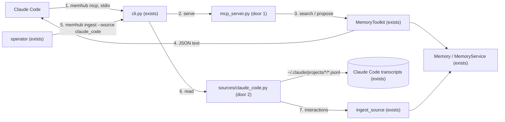

# MCP server and Claude Code source (PR 7 of #1)

**Approved**: 2026-11-11 - user: "Once plan is writen, you auto-approve and manage all tickets until they are closed."

## Problem

A Claude Code user cannot use memhub as memory for coding sessions. The PRD's user row says so: "Claude Code
user - Use memhub as memory for coding sessions - Today: Not possible". Two pieces are missing: Claude Code
talks to tools over MCP and memhub has no MCP server (`MemoryToolkit` has the tool specs but no transport);
and what was learned in past sessions sits in `~/.claude/projects/<project>/<session>.jsonl`, a format no
memhub source reads, so nothing from those sessions can become a memory.

When this ships, `memhub ingest --source claude_code` turns past sessions into memories (reviewed as usual),
and `claude mcp add memhub -- memhub mcp` gives every new session `search_memory` and `propose_memory` over
that project's memories.

## Shape

This reuses `MemoryToolkit` (the tools and their JSON results), `Memory` (configuration, backend, ids) and the
scheduled ingest pipeline with its watermarks; what is new is a transport and a reader. The rules that change
an outcome - which transcript lines become messages, which workspace and user a call runs as, what a tool
returns - live in `sources/claude_code.py` and `mcp_server.py`, reachable from pytest with fixture transcripts,
fake models and an in-process MCP client, no Docker.

1. Claude Code starts `memhub mcp` in the project folder -> `cli.py` (exists) - resolves the config as every command does, then hands on to `mcp_server.serve`
2. `mcp_server.py` (door 1) - builds one `Memory` and one `MemoryToolkit` bound to the workspace and user (door 3) and a `run_id` for the process, registers `search_memory` and `propose_memory` on an `MCPServer`, serves stdio
3. `MemoryToolkit` (exists) - `search_memory` / `propose_memory` as today; `propose_memory` now also stores the `run_id` and `agent_id = "mcp"` on the candidate
4. out: a tool result, JSON text: a list of memories, or `{"id", "event", "status"}` (AD-003)
5. operator runs `memhub ingest --source claude_code` -> `cli.py` (exists) - a `claude_code` source with no yaml entry uses the built-in defaults (door 2)
6. `sources/claude_code.py` (door 2) - reads every `*.jsonl` under `~/.claude/projects/*/`, yields one `Interaction` per user or assistant text message; `skipped` counts unreadable lines
7. `ingest_source` (exists) - groups by session, segments, extracts, reconciles, routes, writes run rows under source `claude_code`, as for any source

**Changes underneath**

| Front | What changes |
| --- | --- |
| domain | `MemoryToolkit.propose_memory` wrote candidates with no `run_id`; it now passes the toolkit's `run_id` / `agent_id` when given (default `None`: unchanged for current callers) |
| domain | `memhub ingest --source NAME` needed a `sources:` entry; `claude_code` now works without one (built-in defaults), and an entry with `kind: claude_code` overrides them |
| stored data | nothing to migrate: new rows only, in existing columns |
| readers | `memhub queue` / `search` / `runs` show what the source and the MCP tools wrote, as for any source |

Data: none new - the source and the server write through the existing ledger (memory rows, run rows).

## Surface

None - no route. Two commands are consumed at a terminal or by Claude Code: `memhub mcp [--ws ID] [--user ID] [-c FILE]`
(env `MEMHUB_WORKSPACE`, `MEMHUB_USER`), a stdio MCP server exposing `search_memory(query, type?)` and
`propose_memory(type, fields, evidence?, scope?)`; and `memhub ingest --source claude_code` with today's flags. Exit
codes: 0 served / ingested; 1 before serving when the config has no database or embedder, the ledger needs `init` or
`migrate`, or the `mcp` package is missing, and when the transcripts folder does not exist (criteria 6 and 11). A
tool error comes back as a tool result, never a crash (criterion 4). Who: whoever can start the process with the
config's credentials; a call acts as the configured user (D6).

## Landing

| One-way door | Literal shape | Alternative rejected |
| --- | --- | --- |
| 1. The MCP server and its dependency | `memhub/mcp_server.py`: `build_server(memory: Memory, *, workspace_id, user_id, run_id) -> MCPServer` and `serve(...)`; tools `search_memory` and `propose_memory` with the parameters of `MemoryToolkit`'s methods; each result is one text content holding the JSON `MemoryToolkit.call` returns; `pyproject.toml` extra `mcp = ["mcp>=2.0,<3"]`, also in `dev`; `memhub mcp` without it exits 1 with `pip install memhub[mcp]` | `mcp<2` (`FastMCP`) - 2.x renamed it to `MCPServer` and is the maintained line; a hand-written JSON-RPC loop - re-implements the protocol |
| 2. The source and its ids | `sources/claude_code.py` `ClaudeCodeSource`, `kind: claude_code`, options `path` (default `~/.claude/projects`), `projects` (folder-name globs, default all), `user` (default `$MEMHUB_USER`, else the OS user); per line of `type` `user` / `assistant`: `thread_id = sessionId`, `workspace_id = <project folder name>`, `message_id = uuid`, `timestamp`, `role`, `content` = its text blocks joined by a blank line (a string content as is), `trace_id = sessionId`; left out: `isMeta`, `isSidechain`, assistant lines whose `message.model` is `<synthetic>`, lines with no text (tool calls, tool results, thinking only), and user texts starting with `<command-`, `<local-command-`, `<task-notification>`, `<system-reminder>`, `<browser_instruction>`, `[Request interrupted` | `workspace_id` = the `cwd` field - not on every line and differs inside one session after a `cd`; one thread per project - a session is the unit of a conversation |
| 3. Who an MCP call is | workspace: `--ws`, else `MEMHUB_WORKSPACE`, else `memhub use`, else the server's working folder named the way Claude Code names project folders (every character other than `A-Za-z0-9` becomes `-`), so it matches the ingested `workspace_id`; user: `--user`, else `MEMHUB_USER`, else `memhub use`, else the OS user; `run_id = "mcp-" + uuid4().hex` once per process; `agent_id = "mcp"` | the MCP session id - stdio has none (only the HTTP transport does), and one Claude Code session is one server process |

- Nothing else in this change is hard to reverse

## Criteria

### S1: The MCP server (P1)

**Acceptance Criteria**

1. WHEN an MCP client lists the tools of `memhub mcp` THEN it SHALL get exactly `search_memory` (required `query`, optional `type` from the configured types) and `propose_memory` (required `type`, `fields`; optional `evidence`, `scope`)
2. WHEN `search_memory` is called THEN the result SHALL be JSON text of the toolkit's view of each hit (`id`, `type`, `content`, `verified`, `scope`, `as_of`, `inferred`): the caller's user memories and the workspace's active memories, never another user's, never a candidate
3. WHEN `propose_memory` is called THEN the system SHALL store a candidate (never active) with `run_id` = the process's `mcp-...` id and `agent_id = "mcp"`, and return exactly `{"id": <memory_id>, "event": "PENDING", "status": "candidate"}` (AD-003)
4. IF a tool call is invalid (an unknown type, missing `query`, fields that fail validation, an injection) THEN the client SHALL get a tool result marked as an error or `{"rejected": <reason>}`, and the server SHALL keep serving the next call
5. WHEN `memhub mcp` starts THEN the workspace and user SHALL follow door 3's order
   - `--ws acme` beats `MEMHUB_WORKSPACE=other`; nothing set and cwd `/a/b c.d` -> workspace `-a-b-c-d`
6. IF the config has no database or embedder, the ledger has no tables, or the `mcp` package is missing THEN `memhub mcp` SHALL exit 1 with the reason on stderr, before serving
7. The docs SHALL show `claude mcp add memhub -- memhub mcp`, the workspace rule, and that proposals wait in `memhub queue`

### S2: The Claude Code source (P1)

**Acceptance Criteria**

8. WHEN the source reads a session file THEN it SHALL yield one `Interaction` per user or assistant line that has text, with door 2's ids, in file order
   - a user string message -> kept; an assistant line with a `thinking` and a `text` block -> its text only; a user line holding only a `tool_result` -> left out; an assistant line holding only `tool_use` -> left out
9. The source SHALL leave out `isMeta` lines, sidechain lines, `<synthetic>` assistant lines and the harness wrappers door 2 lists, and keep a user text that merely contains `<` later in the text
10. IF a line is not JSON, not an object, or lacks `sessionId`, `uuid` or `timestamp` THEN the source SHALL count it in `skipped` and go on with the next line of the same file (per line, not per file)
11. WHEN `projects` globs are set THEN only matching project folders SHALL be read; IF `path` does not exist THEN `memhub ingest` SHALL exit 1 naming the path
12. WHEN `memhub ingest --source claude_code` runs with no `sources:` entry THEN it SHALL use the built-in defaults; a second run over the same files SHALL extract nothing new (watermark per session)

### S3: The demo (P1)

**Acceptance Criteria**

13. WHEN `memhub init` has run on a SQLite file, `memhub ingest --source claude_code` reads fixture sessions in a temporary `~/.claude/projects`, a reviewer approves the workspace candidate, and `memhub mcp` is started as a stdio subprocess from that project's folder THEN an MCP client's `search_memory` SHALL return the approved memory first (`tests/e2e/test_pr7_claude_code.py`, fake models via `connect:`, no Docker)
14. The full existing suite SHALL stay green (N1); `pip install memhub` SHALL not pull `mcp`, and `memhub[mcp]` SHALL

## Out of scope

| Excluded | Why |
| --- | --- |
| The HTTP / SSE MCP transports | Claude Code starts local servers over stdio; the issue names stdio |
| A `load_skill` MCP tool, MCP resources or prompts | the issue names two tools |
| Reading `~/.claude` subagent transcripts as their own threads | sidechains are tool work, not the user's conversation |
| Watching transcripts live (ingest while a session runs) | scheduled ingest's idle rule already waits for a session to go quiet |
| Running `claude mcp add` for the user | it changes the user's Claude Code config; the docs show the command |

## Assumptions

| Assumption | Chosen default | Rationale | Confirmed? |
| --- | --- | --- | --- |
| `run_id` on stdio | `mcp-<uuid4 hex>` per server process | user delegated ("I'll let you decide the best decision"); stdio has no MCP session id, one process per Claude Code session | y |
| Default workspace for `memhub mcp` | the cwd named as Claude Code names project folders | user delegated; it is the `workspace_id` the source writes, so search finds that project's memories with no setup | y |
| `user_id` of ingested sessions | `user` option, else `$MEMHUB_USER`, else the OS user | transcripts carry no user id; the same default as the MCP server so both meet | n |
| Wrapper texts to drop | the six prefixes in door 2 | seen in real transcripts (2026-11-11); they are harness text, not what the person said | n |
| `mcp` major version | `>=2.0,<3` | 2.x is current (2.3.0); 1.x API differs (`FastMCP`) | n |

**Open questions:** none - all resolved or logged above.

## Differences from the source

| Source shows | Product shows | Confirmed |
| --- | --- | --- |
| TDD *Connectors*: "`run_id` is the MCP session id" | `run_id` is a per-process `mcp-...` id: stdio has no session id | y - AD-022 |

## Sources

- Issue #8 "PR 7 - MCP server and Claude Code source" - binding - Delivers, Files, Acceptance
- PRD + TDD, *Connectors* (https://app.notion.com/p/jooaobrum/memhub-Pluggable-memory-package-Integration-41517e87bbcc802eab1ac766dd797a07, read 2026-11-11) - binding - tools, ids, transcript fields, tolerant parser
- Real transcripts under `~/.claude/projects/` (read 2026-11-11) - binding - the line format door 2 reads
- `mcp` 2.3.0 (`MCPServer`, in-process `Client`; probed 2026-11-11) - non-binding - implementation facts
