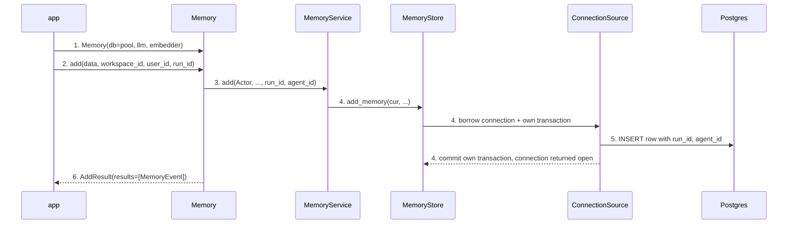
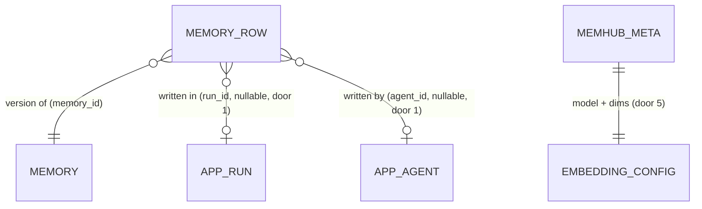

# Memory facade with your own connection and models (PR 1 of #1)

**Approved**: 2026-11-11 - user: "ok implement"

## Problem

An app that wants memhub must describe its database and models in a `memhub.yaml` (28 to 175
lines in the examples) even though it already holds a connection pool and LangChain models, and
must hand-build `Settings`, `MemoryStore`, `TypeRegistry`, embeddings and `MemoryService`.
`MemoryStore` opens its own psycopg connection per transaction from a URL, so an app on Azure
Postgres with Entra ID tokens cannot use memhub at all, and a pool it already tuned is ignored.
Every write returns something different: `MemoryService.add` returns the raw row with its
embedding, the toolkit returns `{"proposed": <version id>, "status": "candidate"}`, the middleware
tool returns a sentence. No caller is forced to say whose memory it is reading: `user_id` is
optional on `search` and `list`. Evidence: PRD "Problem and goal" (the yaml line counts, the Azure
wrapper script); none beyond that.

When this ships, an app writes `Memory(db=pool, llm=model, embedder=emb)`, calls `m.init()` once,
then uses `add` / `search` / `get_all` / review methods with required ids and gets one typed result
from every write, while its pool stays its own.

## Shape

Reuses `MemoryService` for every rule (validation, injection scan, ownership, review, search
ranking) and `MemoryStore` for every SQL statement; `Memory` only checks ids, maps arguments and
converts rows into results. The rules that change an outcome run in `MemoryService`,
`MemoryStore` and the new `Memory` / `ConnectionSource`, all reachable from pytest with fake
models (`tests/fakes.py`) and the Docker pgvector fixture (`tests/conftest.py`).

1. app calls `Memory(db=, llm=, embedder=, judge=, config=)` -> `Memory` (new) - picks a `ConnectionSource` from `db` (door 4), builds `Settings` from `config` or the built-in defaults (door 5), registry and `MemoryService`; no SQL runs
2. app calls a method -> `Memory` (new) - builds `CallContext`; a missing `workspace_id` / `user_id` / `run_id` raises `ValidationError` here, before any connection or model call (door 2)
3. `Memory` -> `MemoryService` (exists) - `Actor(id=user_id, roles)`, plus `run_id` / `agent_id` on writes
4. `MemoryService` -> `MemoryStore` (exists) -> `ConnectionSource` (door 4) - borrows a connection, opens memhub's own transaction or savepoint, `register_vector` / `search_path` once per connection, returns it un-closed
5. `MemoryStore` (exists) - persists `{prefix}_memory` rows carrying `run_id` and `agent_id` (door 1)
6. out: `Memory` turns rows into `AddResult` / `MemoryEvent` or embedding-free dicts (door 2); `MemoryToolkit` and `MemoryMiddleware` (exist) return `{"id","event","status"}` to the model (door 3)

**Changes underneath**

| Front | What changes |
| --- | --- |
| domain | new term: `CallContext` - the `workspace_id`, `user_id`, `run_id`, optional `agent_id` and `roles` of one call; `user_id` is also the actor id |
| domain | new term: `event` - `ADD`, `UPDATE`, `MERGE`, `PENDING`, `CONFLICT`; only `ADD`, `PENDING`, `UPDATE` are produced in this PR |
| domain | `MemoryStore(database_url, ...)` meant "open a connection per transaction from this URL", now takes a URL or a `ConnectionSource`; the URL path keeps today's behaviour - CLI, `examples/habitantes/chatbot.py`, `tests/conftest.py` construct it today |
| domain | `Settings.database_url`, `llm`, `embeddings` were required, now optional - `cli.py` `_service` reads all three and keeps requiring them with a clear message |
| stored data | nothing to migrate: `run_id` and `agent_id` are new nullable columns, existing rows stay null |
| domain | inside `MemoryStore.connect()`, code may still call `conn.commit()` / `conn.rollback()` on a connection memhub opened (URL, callable), as `tests/test_store.py` does; on a pooled or borrowed connection memhub's work is a `conn.transaction()` block and an explicit commit/rollback inside it raises - nothing in `src` does one |
| stored data | `add_memory` writes `run_id` / `agent_id` only when given, so a ledger whose `init` predates them keeps working for the CLI and ingest until `init` runs again |
| readers | the agent reading `propose_memory`'s output (toolkit and middleware) sees `{"id","event","status"}`; `id` is now the `memory_id`, not the version row id - `tests/test_middleware.py`, `examples/habitantes/chatbot.py`, `docs/integration.md` |
| readers | `memhub show/list/history` CLI print every column, so `run_id` / `agent_id` appear there with no code change |

**Public API** (door 2). Every method below takes `workspace_id`, `user_id`, `run_id` (required)
and `agent_id=None`; a bound client from `scope(...)` takes none of them.

| Method | In | Out | Raises | Who |
| --- | --- | --- | --- | --- |
| `Memory(db, llm, embedder, judge=None, config=None, roles=["user"])` | `db`: `ConnectionPool` / `psycopg.Connection` / callable / `postgresql://` URL | `Memory` | `TypeError` other `db`; `NotImplementedError` sqlite | any app |
| `init()` | - | `None` | `EmbeddingMismatch` on a ledger built with another model | any app |
| `add(data, *, type=None, scope="user", infer=False)` | fields dict or text | `AddResult` | `ValidationError`, `InjectionDetected`, `NotImplementedError` for `infer=True` | caller; a workspace write by a non-admin lands `PENDING` |
| `search(query, *, top_k=5, types=None)` | text | `list[dict]` | `ValidationError` | caller |
| `get(id)` / `history(id)` | `memory_id` | `dict` / `list[dict]` | `NotFound` (also for another user's row) | owner or `workspace_admin` |
| `get_all(*, status="active", type=None)` | - | `list[dict]` | `ValidationError` | caller |
| `update(id, fields)` | `memory_id`, fields | `MemoryEvent` `UPDATE` | `NotFound`, `PermissionDenied`, `ValidationError` | owner or `workspace_admin` |
| `delete(id, hard=False)` | `memory_id` (or a version id with `hard`) | `None` | `NotFound`, `PermissionDenied` | owner or `workspace_admin` |
| `delete_all()` | - | `{"deleted": n, "runs": n}` | - | the caller's own `user_id` |
| `queue()` | - | `list[dict]` | - | caller |
| `approve(id)` / `reject(id)` | `memory_id` or `version_id` | `MemoryEvent` | `PermissionDenied`, `NotFound` | a role in `roles.approve_workspace`; the rest get `PermissionDenied` |
| `promote(id)` | `memory_id` | `MemoryEvent` `PENDING` | `NotFound`, `PermissionDenied`, `ValidationError` | owner or `workspace_admin` |
| `scope(workspace_id, user_id, run_id, agent_id=None, roles=None)` | ids | bound client | `ValidationError` | any app |
| `middleware(**kw)` / `tools()` / `ingest(source=None)` | - | `MemoryMiddleware` / `MemoryToolkit` / `RunSummary` | `ValidationError` when no source is configured | any app |
| tool `propose_memory` (toolkit and middleware) | `type`, `fields`, `evidence`, `scope` | JSON `{"id","event","status"}` | `{"rejected": msg}` | the agent |

New: `run_id` and `agent_id` on `{prefix}_memory` rows. One-way constraints: both nullable text,
no backfill (door 1). `APP_RUN` / `APP_AGENT` are the app's ids, not memhub tables.

## Surface

None - nothing consumed outside over a route: memhub adds no HTTP endpoint. The consumed contract is the Python API under Shape (door 2) and the tool output (door 3).

## Landing

| One-way door | Literal shape | Alternative rejected |
| --- | --- | --- |
| 1. `run_id`, `agent_id` on memory rows | `("run_id", "text", None, False)`, `("agent_id", "text", None, False)` appended to `store.ADDED_COLUMNS`; `init` adds them with `ADD COLUMN IF NOT EXISTS`, no backfill | inside `evidence` jsonb - not filterable for erasure or audit by run, and not set on `update` |
| 2. Public `Memory` API and result models | `MemoryEvent(id, version_id, version, event, status, scope, type, content, conflicts_with=None)`, `Dropped(content: str or None, reason: str)`, `AddResult(run_id, results, dropped=[])` as Pydantic models in `memhub/memory.py`, exported from `memhub` | returning `Row` dicts - leaks `embedding` and the version-vs-memory id ambiguity apps already trip on |
| 3. Tool output to the model (AD-003) | `{"id": "<memory_id>", "event": "PENDING", "status": "candidate"}` from `MemoryToolkit.propose_memory` and the middleware `propose_memory` tool (as JSON text); errors stay `{"rejected": msg}` / `rejected: msg` | today's `{"proposed": <version id>}` and the sentence - two shapes for one write, and a version id the app cannot pass back |
| 4. `ConnectionSource` contract (AD-004) | `ConnectionSource.transaction()` and `.lock_connection()` context managers; pool -> `pool.connection()`; `psycopg.Connection` -> `conn.transaction()` on it; callable -> call, close after; URL -> `psycopg.connect`, close after; a prepared-connection `WeakSet` guards `register_vector` / `search_path` | memhub wrapping the pool itself - it would own lifetimes the app must control for Entra token refresh |
| 5. Settings without db/models and the stored embedding id (AD-005) | `database_url: str or None = None`, `llm: LLMConfig or None = None`, `embeddings: EmbeddingConfig or None = None`; with no config: prefix `memhub`, scopes `[user, workspace]`, `workspace_default` `default`, the built-in types; `init` stores model = `config.embeddings.model`, else the embedder's `model` / `model_name` attribute, else its class name, and dims from one probe embed | requiring `config=` - the app writes a yaml with a fake `database_url` just to validate |
| 6. Dependencies | `langchain>=1.0`, `psycopg-pool>=3.2` in `[project].dependencies` | `psycopg-pool` as an extra - a pool is the recommended `db` and the Azure recipe needs it |

- Nothing else in this change is hard to reverse

## Criteria

### S1: Build `Memory` from the app's own objects (P1)

An app gets a working client from objects it already has, with no yaml and no SQL at construction.

**Acceptance Criteria**

1. WHEN an app calls `Memory(db=pool, llm=fake_llm, embedder=fake_emb)` with no `config` THEN the system SHALL return a client whose settings have prefix `memhub`, scopes `["user", "workspace"]` and the 8 built-in types, and SHALL borrow no connection and call no model
2. WHEN `m.init()` runs on an empty database THEN the system SHALL create the tables with nullable `run_id` and `agent_id` columns and store the embedding model id and the dims of one probe embed
   - fresh database → columns exist, `dims` = 16 with `FakeEmbeddings(16)`; second `init()` → no error, no change; a ledger created by today's `MemoryStore.init` with rows → both columns added, existing rows have `run_id` null
3. IF a method other than `init` is called on a database where `init` never ran THEN the system SHALL raise `EmbeddingMismatch` whose message contains `init()`
4. WHEN `db` is a `ConnectionPool`, a `psycopg.Connection`, a callable returning a `psycopg.Connection`, or a Postgres URL THEN `add` followed by `search` SHALL return the added memory first
5. IF `db` is a `sqlite3.Connection` or a SQLite URL THEN `Memory(...)` SHALL raise `NotImplementedError` whose message names `sqlite`
6. IF `db` is any other object THEN `Memory(...)` SHALL raise `TypeError` naming the accepted kinds
   - `db=42` → `TypeError`; a MySQL URL string → `TypeError`
7. WHERE `config` is given as a path, a dict or a `Settings` THEN the system SHALL use its behaviour keys (types, scopes, roles, prefix) and SHALL ignore its `database_url`, `llm` and `embeddings` in favour of the objects passed
8. WHEN `judge` is omitted THEN the system SHALL use `llm` as the judge
9. IF the embedder passed reports a different model id or dims than `init` stored THEN any later call SHALL raise `EmbeddingMismatch`, as today

### S2: Borrowed connections stay the app's (P1)

memhub uses the app's pool or connection and hands it back exactly as it found it.

**Acceptance Criteria**

10. WHEN any `Memory` method returns or raises with a `ConnectionPool` THEN the pool SHALL be open (`pool.closed is False`) and `SELECT 1` through it SHALL succeed
    - after `add`; after `add` that raises `InjectionDetected`; after `get` that raises `NotFound`
11. WHEN any `Memory` method returns or raises with a borrowed `psycopg.Connection` THEN the connection SHALL be open (`conn.closed is False`) and `SELECT 1` on it SHALL succeed
12. WHILE the app holds an open transaction on a borrowed connection, WHEN a memhub call fails THEN the system SHALL roll back only its own savepoint: the app's uncommitted row SHALL still be visible in the app's transaction, and the transaction SHALL still be open (memhub never commits it)
13. WHEN `db` is a callable THEN the system SHALL close every connection the callable returned once the call ends
    - 3 calls → 3+ connections returned by the callable, all `closed is True` afterwards
14. The system SHALL run `register_vector` and `SET search_path` at most once per connection object: 5 calls through a pool of size 1 → 1 `register_vector` on it
15. WHEN `thread_lock` exits on a pool THEN the advisory lock SHALL be released: another session's `pg_try_advisory_lock` on the same key SHALL return true, and the pooled connection SHALL be back in the pool and open
16. WHEN `thread_lock` is used on a borrowed `psycopg.Connection` THEN it SHALL take the lock on that connection, release it on exit, and leave the connection open

### S3: Required ids and bound clients (P1)

No call can read or write without saying whose memory it is.

**Acceptance Criteria**

17. IF `workspace_id`, `user_id` or `run_id` is missing, `None` or `""` on any `Memory` method THEN the system SHALL raise `ValidationError` naming the missing field, with zero connections borrowed and zero model calls
    - `user_id=None` → raises; `user_id=""` → raises; `agent_id` omitted → succeeds; `search` with no `run_id` → raises; `approve` with no `user_id` → raises
18. WHEN an app calls `m.scope(workspace_id=, user_id=, run_id=, agent_id=)` THEN the system SHALL return a client whose methods take no id arguments and write the same rows as the unbound call with those ids
19. IF `scope(...)` is called without `workspace_id`, `user_id` or `run_id` THEN it SHALL raise `ValidationError` at `scope(...)`
20. WHEN `add`, `update` or `promote` writes a row THEN the row SHALL carry the call's `run_id` and `agent_id` (null when `agent_id` is omitted)
21. IF `get` or `history` targets a user-scope memory of another user, or a memory of another workspace, THEN the system SHALL raise `NotFound`, unless the caller has `workspace_admin` in the same workspace
22. WHILE roles are the default `["user"]` the system SHALL raise `PermissionDenied` on `approve` and `reject`; with `roles=["workspace_admin"]` they SHALL succeed

### S4: mem0-style methods over `MemoryService` (P1)

Each method does what `MemoryService` does today, under its mem0 name.

**Acceptance Criteria**

23. WHEN `add(fields, type="fact")` writes a user-scope memory THEN the system SHALL return `AddResult(run_id=<call run_id>, results=[MemoryEvent(event="ADD", status="active", version=1)], dropped=[])`
24. WHEN a caller without `workspace_admin` adds a workspace-scope memory THEN the event SHALL be `PENDING` with status `candidate`; with `workspace_admin` it SHALL be `ADD` with status `active`
25. WHEN `add` receives a string THEN the system SHALL store a `fact` whose `content` is that string
26. IF `add` is called with `infer=True` THEN the system SHALL raise `NotImplementedError` naming push ingestion, before any model call
27. WHEN `search(query, top_k=k)` runs THEN the system SHALL return at most `k` dicts from the caller's own active user rows and the workspace's active rows, excluding stale rows and other users' rows
28. WHEN `get_all()` runs THEN the system SHALL return the caller's active user rows and the workspace's active rows; `status="candidate"` SHALL return candidates instead
29. WHEN `update(id, fields)` runs THEN the system SHALL return `MemoryEvent(event="UPDATE", status="active", version=<previous + 1>)` with the same `id`
30. WHEN `delete(id)` runs THEN the memory SHALL be archived and `get(id)` SHALL raise `NotFound`; `delete(id, hard=True)` SHALL remove the row with today's `MemoryService.delete` rules
31. WHEN `delete_all()` runs THEN the system SHALL erase every memory and run row of the caller's `user_id` and return `{"deleted": <memory rows>, "runs": <run rows>}`; other users' rows SHALL remain
32. WHEN `queue()` runs THEN the system SHALL return the candidates of the caller's workspace, conflicts first
33. WHEN `approve(id)` or `reject(id)` receives a `memory_id` THEN the system SHALL act on that memory's newest candidate version; WHEN it receives a `version_id` THEN on that row; the result SHALL be a `MemoryEvent` with status `active` or `rejected`
    - `memory_id` with no candidate → `NotFound`; the version id printed by `memhub queue` → accepted
34. WHEN `promote(id)` runs on the caller's user-scope memory THEN the system SHALL return `MemoryEvent(event="PENDING", status="candidate", scope="workspace")` with a new `id`
35. WHEN `middleware()` / `tools()` are called THEN the system SHALL return a `MemoryMiddleware` / `MemoryToolkit` built on the same `MemoryService`, the toolkit bound to the call's workspace and user
36. WHEN an agent calls `propose_memory` through `MemoryToolkit` or `MemoryMiddleware` THEN the tool SHALL return JSON `{"id": <memory_id>, "event": "PENDING", "status": "candidate"}`
37. WHEN `ingest()` runs with exactly one configured source THEN the system SHALL run it and return a `RunSummary` with its `run_id`; IF no source is configured THEN `ValidationError`

### S5: One result format, no embeddings out (P1)

Every write tells the app what happened in the same shape.

**Acceptance Criteria**

38. The system SHALL return `MemoryEvent` with exactly the fields `id` (the `memory_id`), `version_id`, `version`, `event`, `status`, `scope`, `type`, `content`, `conflicts_with`
39. The system SHALL never return a key named `embedding`, at any depth, from any `Memory` method or from the `propose_memory` / `search_memory` tools
40. IF a call is invalid (unknown type, injection, missing id, permission) THEN the system SHALL raise and SHALL not return an `AddResult`
41. WHEN `AddResult.model_dump()` is called THEN the system SHALL return a plain dict that `json.dumps` accepts

### S6: Nothing existing breaks (P1)

**Acceptance Criteria**

42. The system SHALL pass today's test suite, with only the `propose_memory` output assertions changed by criterion 36
43. WHEN `MemoryStore` is built from a URL string, as `cli.py` does THEN the system SHALL open and close one connection per transaction, as today
44. IF the CLI runs with a `memhub.yaml` lacking `database_url`, `llm` or `embeddings` THEN it SHALL exit non-zero with a message naming the missing key
45. The package SHALL export `Memory`, `AddResult`, `MemoryEvent`, `Dropped`, `CallContext` and `ValidationError` from `memhub`
46. The system SHALL declare in `pyproject.toml` `langchain>=1.0` and `psycopg-pool` as dependencies
47. The system SHALL ship `docs/azure.md` showing a `ConnectionPool` whose connection class fetches an Entra token with `max_lifetime` under 3600, and `AzureChatOpenAI` / `AzureOpenAIEmbeddings` with `azure_ad_token_provider`; no module under `src/memhub` SHALL import `azure`
48. WHEN `tests/e2e/test_pr1_memory.py` opens a psycopg pool, builds `Memory` with fake models and runs `init` → `add` → `search` → `promote` → `approve` → `delete_all` THEN each step SHALL succeed and the user's rows SHALL be gone; a call with no `user_id` SHALL raise `ValidationError`

## Out of scope

| Excluded | Why |
| --- | --- |
| `add(messages, infer=True)` | push ingestion is PR 5; raises `NotImplementedError` here |
| SQLite and `memory://` backends | PR 4 and PR 3 |
| `MERGE` / `CONFLICT` produced by a `Memory` call | only the pipeline decides them; collected into results with push ingestion in PR 5 |
| An audit table of which memories a run read | PRD open question; rows carry `run_id`, nothing more |
| Config discovery, env overrides, `connect:` factory | PR 2 |
| Stamping `run_id` on rows written by scheduled ingest | the ingest's own run id lives in the runs table; PR 5 decides push |
| An async `AsyncMemory` | PRD out of scope |

## Assumptions

| Assumption | Chosen default | Rationale | Confirmed? |
| --- | --- | --- | --- |
| What `Memory` needs in PR 1 | `config` optional; built-in defaults; db/models optional in `Settings` (AD-005) | user chose "Defaults, yaml optional" | y |
| Ids on reads and review | required on every method (AD-001) | user chose "Required on every method" | y |
| Table creation | explicit `m.init()` only (AD-002) | user chose "Explicit m.init()" | y |
| Tool output | `{"id","event","status"}` in toolkit and middleware (AD-003) | user chose "Switch to {id,event,status}" | y |
| `add` text input type | `fact` with `content` = the text | the one built-in type with only `content` required | n |
| Slot already filled / `max_active` reached on `add` | raises `ValidationError`, as today | an invalid manual call, not a pipeline decision; keeps R5 | n |
| `delete` return value | `None` | the write-result table lists no event for archive | n |
| `delete_all` target | the call's own `user_id`; erasing another user stays on `MemoryService.delete_user` / CLI | ids come from the context (AD-001) | n |
| `approve(memory_id)` with several candidates | the newest candidate version | the one a reviewer just saw in `queue` | n |
| `get` on another user's row | `NotFound`, not `PermissionDenied` | does not reveal that the id exists | n |
| Embedding model id with no config | embedder `model` / `model_name` attribute, else class name | stable across restarts for LangChain models | n |
| `search` / `get_all` item shape | today's row dict minus `embedding` | a typed read model is not asked for; reversible | n |

**Open questions:** none - all resolved or logged above.

## Differences from the source

| Source shows | Product shows | Confirmed |
| --- | --- | --- |
| TDD *Public API*: `get(id)`, `history(id)`, `delete(id)`, `queue()`, `approve(id)`, `reject(id)`, `promote(id)` with no ids | each takes `workspace_id`, `user_id`, `run_id` (or uses a `scope(...)` client) | y - AD-001 |
| TDD *Config and CLI*: `database_url`, `llm`, `embeddings` become optional in PR 2 | optional from PR 1, with built-in defaults | y - AD-005 |

## Sources

- PRD + TDD "memhub - Pluggable memory package - Integration" (Notion, read 2026-11-11), sections *Public API*, *Write results*, *Connections passed in*, *Azure recipe* - binding - methods, ids, result models, connection table
- Issue #1 PR 1 description (the request) - binding - deliverables, files, acceptance demo
