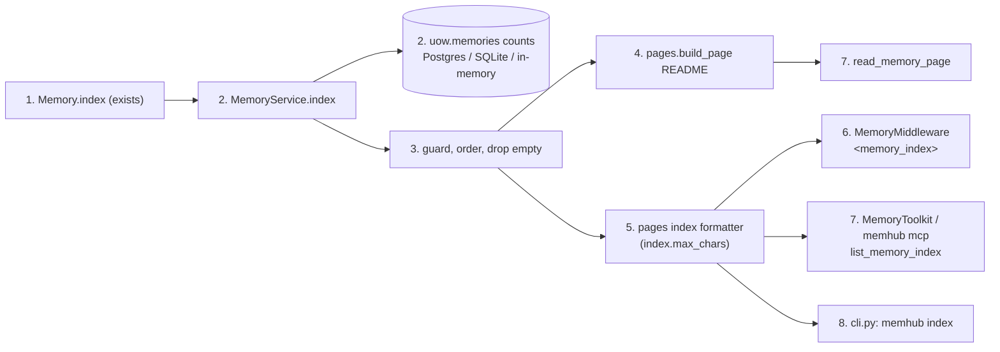
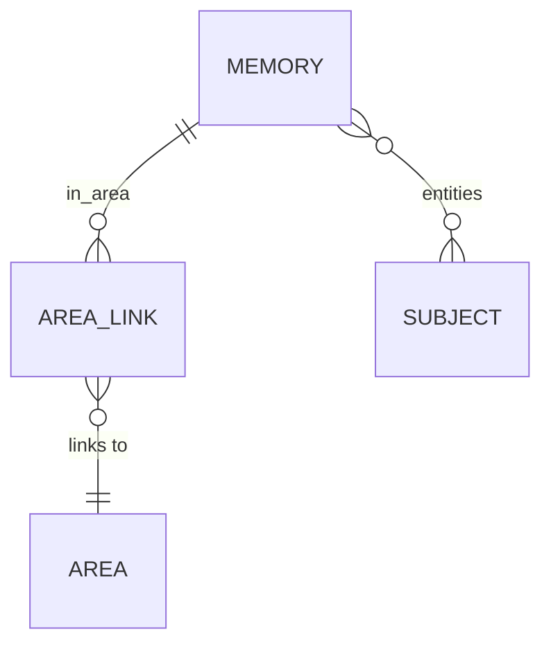

# Memory index: show the agent what exists, open it on demand

**Approved**: 2026-11-22 - user: "Ok implement"

## Problem

An agent using memhub does not know what its memory holds. Through `MemoryMiddleware` it sees the user's `always`
types (`<about_the_user>`), the top `k` results for the last message, the area page nearest that message, and, for
`index_then_load` types only, a `<skill_index>`. Through `MemoryToolkit` and `memhub mcp` (Claude Code) it sees
nothing until it calls `search_memory` with words it has to guess. It cannot tell that 12 memories are about machine
`PRD_1` or that a whole area is about "Lubrication" unless the current message happens to match them.

The data to tell it exists and is not shown: areas have titles and counts (`MemoryService.areas`, `memhub areas`,
the README page of #41's file view), and every row stores its subjects. Who pays: every agent on the toolkit or MCP
path (no view at all), and every middleware agent on a project with many subjects. Evidence: issue #28; Claude's
memory tool (list a directory, then read a file) and Letta (a short always-visible block, an archive searched on
demand) both disclose memory this way.

When this ships, an agent sees a short index of the caller's own and the team's areas, subjects and types with
counts, at the start of a conversation (middleware) or with one tool call (toolkit, MCP), and opens what it names in
one more call: `read_memory_page` for an area, `search_memory` with `filters` for a subject.

## Shape

This reuses #41's file view (`pages.build_page`, the README page `render(area=None)` and the `users/<id>` /
`team/<ws>` folders, AD-063, AD-065), #25's filter grammar for opening a subject, the snapshot the middleware already
builds once per thread, and the storage contract suite; there is no interim formatter (AD-066). The rules that change
an outcome - what is counted, what is hidden, the order, and the budget cut - run in `MemoryService.index`, a storage
port method per backend, and one formatter in `pages.py`; the contract suite and `tests/test_pages.py` reach them with
no model.

1. caller -> `Memory.index()` (exists module, new method) -> `MemoryService.index(actor, workspace_id=, user_id=)` (exists module, new method)
2. `MemoryService` (exists) `.index`, new method, -> `uow.memories` index counts (new port method on Postgres, SQLite, in-memory) - counts active, non-stale rows per owner: the user's own user-scope rows (`me`) and the workspace-scope rows (`team`), by area, by subject (a row once per distinct subject it names) and by type (internal `area` and `term` excluded); hands on an `Index` (two groups)
3. `MemoryService.index` drops subjects of a `require_filter` type not in `index.show_guarded` (AD-069), orders each list by count descending then name, drops areas with no counted row
4. `pages.build_page` (exists) for `key=None` - the README of one folder - lists `## Areas`, `## Subjects`, `## Types` from that folder's group of the `Index`, unbudgeted
5. `pages` index formatter (new) - both groups as `Yours (users/<id>)` then `Team (team/<ws>)`, with the same lines as the README, cut to `index.max_chars`: largest first, then `and N more` per section
6. `MemoryMiddleware._snapshot` (exists) - appends `<memory_index>` (step 5's text) after `<about_the_user>` once per thread, when `index.enabled` and at least one area or subject is listed (AD-068); adds no id to `memhub_injected`
7. `MemoryToolkit` (exists) - `list_memory_index` returns `{"text", "index"}`, `read_memory_page(area, subject=None, owner="me")` returns `render(...)` text; `memhub mcp` (exists) registers both; the middleware gets `read_memory_page`
8. `cli.py` (exists) - `memhub index` prints step 5's text unbudgeted, or the `Index` with `--json`
9. out: the system prompt, a tool result, or stdout

**Changes underneath**

| Front | What changes |
| --- | --- |
| domain | none: "area", "subject", "type" keep their meaning; `Index` is new |
| stored data | nothing to migrate: read only, no column or table |
| readers | the README page (`render(area=None)`) gains `## Subjects` and `## Types`, so its stamp changes - `examples/deepagents_backend` and `tests/e2e/test_deepagents_backend.py` read it; `write_page` on the README still refuses |
| readers | `MemoryMiddleware.tools` grows to four, `memhub mcp` to four tools - `tests/test_mcp_server.py` asserts the tool set |
| readers | MCP `INSTRUCTIONS` names `list_memory_index` |

New: nothing - read only.

## Surface

| Route | In | Out | Status | Who |
| --- | --- | --- | --- | --- |
| `Memory.index()` / `Scoped.index()` | `workspace_id`, `user_id` (CallContext, AD-001) | `Index`: `me` (None without a user) and `team`, each `{areas: [{key, title, count}], subjects: [{type, id, count}], types: [{name, count}]}` | 200 `Index`; 422 `ValidationError` for a missing workspace | anyone holding the ids - memhub trusts the ids it is given (AD-001); another user's user-scope rows are never counted (criterion 3) |
| `memhub index [--ws] [--user] [--json]` | flags, else `MEMHUB_*`, else `memhub use` | the index text, or the `Index` as JSON | 200 exit 0; 500 exit 1 on a config or database error | anyone holding the ids - memhub trusts the ids it is given (AD-001); another user's user-scope rows are never counted (criterion 3) |
| tool `list_memory_index` (toolkit, MCP) | none | `{"text": <budgeted text>, "index": <Index>}` | 200 `{"text", "index"}`; 500 `{"error"}` on a failure | anyone holding the ids - memhub trusts the ids it is given (AD-001); another user's user-scope rows are never counted (criterion 3) |
| tool `read_memory_page` (toolkit, MCP, middleware) | `area` (key), `subject` (slug, optional), `owner` (`me` or `team`, default `me`) | the page text of `render(area, subject=, personal=owner == "me")` | 200 page text; 404 `{"error": "no area 'x'"}` or `{"error": "no subject ..."}`; 422 `{"error": "owner must be me or team"}` | the toolkit's workspace and user; `team` is the workspace folder every workspace member reads |
| `<memory_index>` block (middleware) | `index.*` config | text in the system prompt | 200 block injected; 204 no block when off or empty | anyone holding the ids - memhub trusts the ids it is given (AD-001); another user's user-scope rows are never counted (criterion 3) |

## Landing

| One-way door | Literal shape | Alternative rejected |
| --- | --- | --- |
| config section consumed in `memhub.yaml` | `index: {enabled: true, max_chars: 1200, show: [areas, subjects, types], show_guarded: []}`; `max_chars >= 200`; an unknown `show` value or a `show_guarded` type not declared in `entities` is a `ConfigError` | keys under `render:` - the index is read by the prompt as well as the file view, and `render.summarize_over` is a page rule |
| tool names and arguments a model and MCP clients bind to | `list_memory_index()`; `read_memory_page(area: str, subject: str \| None = None, owner: "me" \| "team" = "me")` | `read_memory_page(path)` taking `users/<id>/lubrication.md` - makes the model build folder paths that are app templates (AD-065) |
| prompt and README text a model learns | block `<memory_index>` ... `</memory_index>`; each group `Yours (users/<id>):` / `Team (team/<ws>):`, then `Areas: Lubrication [lubrication] (8) · ...`, `Subjects: machine PRD_1 (12) · ...`, `Types: fact (21) · ...`, a section cut ends `· and N more`; last line `Open an area with read_memory_page(area, owner); a subject with search_memory filters={"entities": {"type": .., "id": ..}}.` README: `## Subjects` lines `- machine PRD_1 (12)`, `## Types` lines `- fact (21)` | subjects nested under each area - asked, user chose subjects on their own line (AD-070) |
| CLI command | `memhub index [--ws W] [--user U] [--json] [-c FILE]` | a flag on `memhub areas` - areas lists one owner and carries `proposed` and merge, the index is both owners and three sections |

- A new storage port method is added to the three backends; ports are internal (`storage/base.py`), so it is reversible
- Nothing else in this change is hard to reverse

## Criteria

### S1: the index as data (P1)

`Memory.index()` returns what the caller may read, counted the same way on every backend.

**Acceptance Criteria**

1. WHEN `Memory.index(workspace_id="w", user_id="u1")` is called THEN the system SHALL return an `Index` with group `me` (u1's user-scope rows in w) and group `team` (w's workspace-scope rows), each holding `areas` (`key`, `title`, `count`), `subjects` (`type`, `id`, `count`) and `types` (`name`, `count`)
   - u1 with 3 Lubrication and 2 Bearings memories in user scope, 1 workspace Lubrication memory → `me.areas` = Lubrication 3, Bearings 2; `team.areas` = Lubrication 1
2. The system SHALL count only rows with `status = 'active'` that are not stale at the call's time; candidate, flag, archived, rejected, superseded and stale rows SHALL NOT be counted
   - u1's Lubrication: 3 active, 1 archived, 1 candidate, 1 flag, 1 stale (`valid_until` yesterday) → 3; the strong case: a row whose old version is active-then-superseded and new version active → counted once
3. The system SHALL NOT count another user's user-scope rows in either group
   - u2 has 5 Lubrication memories in w → u1's `me` Lubrication stays 3, `team` stays 1
4. WHEN a counted row names several subjects THEN the system SHALL count it once for each distinct subject, and once in `types`
   - a fact naming machine PRD_1 and machine PRD_2 → PRD_1 +1, PRD_2 +1, fact +1; a fact naming PRD_1 twice → PRD_1 +1
5. The system SHALL leave the internal types `area` and `term` out of `types`, and their rows out of every count
6. IF a subject type has `require_filter: true` and is not in `index.show_guarded` THEN the system SHALL list none of its subjects; its rows still count in `areas` and `types`
   - `patient` guarded, `show_guarded: []` → no `patient` subject; `show_guarded: [patient]` → `patient p1 (2)` listed
7. The system SHALL order `areas`, `subjects` and `types` by count descending, then by title / `type id` / name ascending, and SHALL omit an area with no counted row
8. WHEN `user_id` is None THEN the system SHALL return `me` as None and `team` as above
9. The system SHALL return the same `Index` for the same rows on Postgres, SQLite (with and without sqlite-vec) and in-memory, proven by contract cases

### S2: the index as text (P1)

The README page and the budgeted index text say the same thing.

**Acceptance Criteria**

10. WHEN `render(area=None)` is called THEN the system SHALL list the folder's group under `## Areas` (existing line form `- lubrication.md: Lubrication (8 memories)`), then `## Subjects` (`- machine PRD_1 (12)`), then `## Types` (`- fact (21)`), unbudgeted, each with the `<!-- no ... yet -->` placeholder when empty
11. The index text SHALL be `<memory_index>`, a `Yours (users/<id>):` group, a `Team (team/<ws>):` group (a group with nothing listed is left out), the line form in Landing, and the closing instruction line, then `</memory_index>`
12. The index text SHALL NOT exceed `index.max_chars`, closing tag included; WHEN a section does not fit THEN it SHALL keep its largest entries whole and end with `· and N more`, N being the entries left out
    - 2,000 machines with `max_chars: 1200` → length ≤ 1200, the Subjects line ends `and <2000 - shown> more`; the strong case: one area title longer than the budget → that area is left out and counted in `and N more`, never cut mid-title
13. WHERE `index.show` omits a section THEN the index text and the README SHALL leave that section out
    - `show: [areas]` → no `Subjects:` or `Types:` line
14. The index text SHALL contain no memory content, only area titles and keys, subject types and ids, type names and counts

### S3: the middleware block (P1)

**Acceptance Criteria**

15. WHEN a thread starts (no `memory_snapshot`) and the caller has at least one listed area or subject THEN the system SHALL put `<memory_index>` in the system prompt right after `</about_the_user>` (or first when there is none)
16. IF neither group lists an area or a subject THEN the system SHALL inject no `<memory_index>`
    - only `fact (3)` in `types` → no block
17. WHERE `index.enabled: false` THEN the system SHALL inject no `<memory_index>`
18. WHILE a thread has a `memory_snapshot`, WHEN a memory is added between turns THEN the system SHALL keep the turn-1 `<memory_index>` unchanged for that thread
19. The `<memory_index>` block SHALL add no entry to `memhub_injected` nor to the trace metadata
20. WHEN an agent with the middleware and a fake chat model is given an index naming area `lubrication` and the model calls `read_memory_page(area="lubrication")` THEN the tool result SHALL contain every active Lubrication line of the user's page, in that one call

### S4: tools on every surface (P1)

**Acceptance Criteria**

21. The system SHALL make `MemoryToolkit.tool_specs()` list `search_memory`, `propose_memory`, `list_memory_index` and `read_memory_page`, and make `memhub mcp` serve the same four with the same descriptions
22. WHEN `list_memory_index` is called THEN the system SHALL return `{"text": <the S2 index text>, "index": <the Index as JSON>}`, built at the call (not cached)
23. WHEN `read_memory_page(area="lubrication")` is called THEN the system SHALL return `render("lubrication", personal=True)`; with `owner="team"` the workspace's page; with `subject="prd-1"` that subject's page
24. IF `read_memory_page` names an area or subject the folder does not have, or an `owner` other than `me` / `team` THEN the tool SHALL return `{"error": "<message>"}` and raise nothing
    - `area="nope"` → `{"error": "no area 'nope'"}`; `owner="admin"` → `{"error": "owner must be me or team"}`
25. The MCP server's `INSTRUCTIONS` SHALL tell the model to call `list_memory_index` to see what the memory holds

### S5: CLI, config and docs (P2)

**Acceptance Criteria**

26. WHEN `memhub index --ws w --user u1` runs THEN it SHALL print the index text of both groups with no `max_chars` cut and exit 0; with `--json` it SHALL print the `Index`; without a user (flag, env or `memhub use`) it SHALL print the `Team` group only
27. IF the config or the database cannot be used THEN `memhub index` SHALL print the error on stderr and exit 1, as the other read commands do
28. IF `index.show` holds a value outside `areas`, `subjects`, `types`, `index.max_chars` is below 200, or `index.show_guarded` names a type not declared in `entities` THEN loading the config SHALL raise `ConfigError` naming the key
29. WHEN `memhub config show` runs THEN it SHALL list the `index` section with its four keys and their values
30. The docs SHALL describe the index in `docs/integration.md` (middleware section), `docs/claude-code.md` (the two new tools) and `docs/subjects.md` (index and `show_guarded`), and `tests/test_docs.py` SHALL pass

## Out of scope

| Excluded | Why |
| --- | --- |
| moving `MemoryMiddleware` to `examples/` | issue #30; the block and tool land where the middleware lives today |
| subjects nested under areas in the index | AD-070: subjects have their own line |
| refreshing the block every turn | AD-071: once per thread; `list_memory_index` is fresh |
| a per-call opt-in for guarded subjects | AD-069: project-wide `index.show_guarded` only |
| changing `memhub areas` / `MemoryService.areas` counts (they count stale and other users' linked rows) | a separate reader with its own contract; noted, not touched |
| opening a subject across areas as one page | `render` pages are per area; a subject is opened by `search_memory` filters (AD-070) |

## Assumptions

| Assumption | Chosen default | Rationale | Confirmed? |
| --- | --- | --- | --- |
| scope of #28 | both steps: `index()` data, README-based text, `read_memory_page`; no local formatter | asked; user chose "Both steps now (Recommended)" (AD-066) | y |
| owners in the index | two groups, own and team, never merged | asked; user chose "Two groups (Recommended)" (AD-067) | y |
| default on | on when an area or subject is listed; `index.enabled: false` turns it off | asked; user chose "Areas or subjects exist (Recommended)" (AD-068) | y |
| guarded subjects | hidden unless in `index.show_guarded` | asked; user chose "Config list (Recommended)" (AD-069) | y |
| subjects placement | own line per group, opened with `search_memory` filters | asked; user chose "Own line, open by search (Recommended)" (AD-070) | y |
| refresh | once per thread with the snapshot | asked; user chose "Once per conversation (Recommended)" (AD-071) | y |
| `index.max_chars` default | 1200, minimum 200 | close to `areas.page_max_chars` (1500), below it since it is always in the prompt | n |
| guarded rows in area and type counts | counted; only the subject ids are hidden | the rows are the caller's own and `get_all` returns them; AD-033 guards subjects, not counts | n |
| types listed | every configured type except internal `area`, `term`, `always` types included | the index is what exists; `<about_the_user>` shows content, the index only counts | n |
| `read_memory_page` in the middleware | added beside `search_memory`, `load_skill`, `propose_memory`; `list_memory_index` not added there (the block carries it) | one way to open a page on every surface; AD-048 precedent | n |
| `list_memory_index` budget | the same `index.max_chars` text as the block, plus the full `Index` data | stacks without the block get what the block would show; the data is there for more | n |
| `memhub index` budget | unbudgeted | a person reads it; the budget is for prompts | n |

**Open questions:** none - all resolved or logged above.

## Differences from the source

| Source shows | Product shows | Confirmed |
| --- | --- | --- |
| issue #28 point 4: ship a local formatter now, switch to `render()` and add `read_memory_page` later | both at once; no local formatter | y - AD-066 |
| issue example: one `Areas:` line and one `Subjects:` line for the caller | two groups, `Yours (users/<id>)` and `Team (team/<ws>)`, each with its own lines | y - AD-067 |
| issue example `Use search_memory with \`filters\` to read any of these.` | `Open an area with read_memory_page(area, owner); a subject with search_memory filters=...` | y - AD-066, AD-070 |
| issue: "unless the project opts in" (shape not given) | `index.show_guarded: [<type>]` | y - AD-069 |

## Sources

- https://github.com/jooaobrum/memhub/issues/28 - binding - problem, proposal, scope, acceptance (read 2026-11-22)
- #41 file view (`src/memhub/pages.py`, AD-063, AD-065) - binding - the README page and folders this builds on
- #25 filter grammar (`src/memhub/filters.py`) - binding - how a subject is opened
