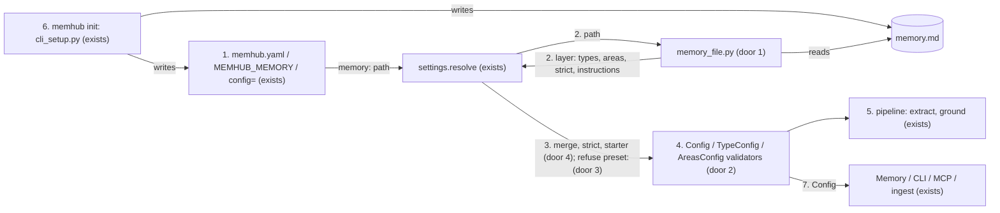

# Project-defined memory: one memory.md, no built-in presets (PR 9 of #1, issue #18)

**Approved**: 2026-11-12 - user: "Ok agree"

## Problem

What a project remembers is set by a preset that ships inside the package (`src/memhub/presets/{assistant,support,maintenance}.yaml`, read by `settings.load_preset`). A project cannot add its own preset: `memhub init --preset mine` fails with `unknown preset 'mine'; available: assistant, maintenance, support`. A project with a narrow domain has to start from a preset and undo it. In the e2e birds scenario (S4, `.specs/e2e/scenarios.md`) that took about 50 lines of yaml:

- six `<type>: null` removals;
- `fields` written as `{type, description}` for every field, plus a `content_template` that repeats them;
- `area: required` and `scopes` on each type;
- seeds written as `{key, title, description}`, plus `areas.open: false`;
- the extraction prompt as a yaml string;
- an `admission.threshold` tuned by hand after a run dropped a valid note.

Every new user pays this cost before the first useful memory. The cost falls hardest on the user with a narrow domain, the one memhub most needs to serve well.

When this ships, a project writes one file it owns, `memory.md`. Its frontmatter lists the types and areas in short forms, and its body says in plain words what to save. `memhub init` writes a starter file; the birds memory fits in 20 lines of frontmatter or fewer, with no tuning. No type set ships in the package, and no database changes.

## Shape

This reuses today's `TypeConfig`, `AreasConfig`, `model_from_fields`, the layered `settings.resolve` and the whole pipeline. The memory file and the short forms turn into the objects those already take, so extraction, grounding, admission and reconcile do not change. The rules that change an outcome run in the config layer:
- reading the memory file;
- expanding the short forms;
- expanding `strict`;
- applying the starter types;
- refusing `preset:`.

The one exception is optional template sections, which run in `pipeline/ground.py`. pytest reaches all of them with no database and no model.

1. A layer names the file: `memory: ./memory.md` in `memhub.yaml`, `MEMHUB_MEMORY`, or `config={"memory": ...}` -> `settings.resolve` (exists). It refuses `preset:` in any layer (door 3) and hands the path, resolved against the folder of the file that names it, to `memory_file`.
2. `memory_file.py` (door 1) splits the YAML frontmatter from the Markdown body. It refuses any frontmatter key other than `types`, `areas` and `strict`, and returns a layer: `types`, `areas`, `strict`, and `extraction.instructions` = the body.
3. `settings.resolve` (exists) merges that layer into the layer that named the file, refusing a key set in both places. It then expands `strict`. When no layer lists a type, it applies the starter types (door 4). The default layer keeps only the internal `area` and `term` types.
4. The `Config` validators, `TypeConfig` and `AreasConfig` (exists), turn short forms into long forms (door 2): a template string becomes `fields` + `content_template`, `builtin` becomes the built-in class, and `key: description` becomes a `SeedArea`.
5. The pipeline (exists) is unchanged: the extractor sees the types and `extraction.instructions` as today. `pipeline/ground.py` (exists) renders `content_template` and leaves out an optional `[...]` section whose placeholders are empty.
6. `memhub init` -> `cli_setup.py` (exists) writes `memhub.yaml` with `memory: ./memory.md`, plus a `memory.md` holding the starter types and a body. Interactive init asks one question for the body; with `--memory PATH` it names that file instead.
7. Output: the `Config` used by `Memory`, the CLI, MCP and ingest. In `memhub config show`, the keys the file sets show their source as the file's name.

**Changes underneath**

| Front | What changes |
| --- | --- |
| domain | `preset` meant "a packaged type set under this file's keys" (`Config.preset`, the `preset` layer in `settings._resolve`, the `preset` source label in `config show`, `init --preset`, `cli.py` option). It is removed, and any `preset:` raises (AD-025) |
| domain | the default types were all six built-ins. They are now `fact`, `preference`, `profile`, plus the internal `area` and `term` (AD-029). Code that relies on the old default: the 12 test files using `episode`, `case` or `skill` without a config, `Memory.add` defaulting `type` to `fact` (`memory.py:278`), and `pipeline/ingest.py:196,202` / `pipeline/ground.py:112-131` naming `fact`, `profile` and `preference`. The last two are a no-op when the type is absent |
| domain | `content_template` gains optional `[...]` sections. Templates written today hold no `[`, so they render as before |
| stored data | nothing to migrate (N5): rows keep `type` text and JSON `payload`; a row whose type the project stops listing keeps today's behaviour for a type removed from the config |
| readers | `memhub config show` names the memory file as a source; `examples/*/` scripts (`habitantes/chatbot.py`, `functional_check.py`) load the converted configs; README, `docs/` and the guides teach `memory.md` |

Data: none - configuration only. No table, column or migration is added (N5).

## Surface

None - no route. Two commands change, consumed at a terminal:

- `memhub init [--project --db --chat --embeddings --connect --memory PATH --force]`, with `--preset` removed. It writes `memhub.yaml` with `memory: ./memory.md` (or the given PATH, relative to the yaml), and a `memory.md` when `--memory` is not given. Exit 0 written; exit 1 with `memory file not found: <path>` (criterion 26); exit 2 for the unknown option `--preset` (criterion 20).
- `memhub config show` takes the same arguments as today. Its SOURCE column reads `memory.md` (the file's name as given) for keys the file sets, and no longer shows `preset` (criterion 7). Exit 0; exit 1 on an invalid config.

Who: whoever can run the CLI in the folder with the config's credentials, as today.

## Landing

| One-way door | Literal shape | Alternative rejected |
| --- | --- | --- |
| 1. The memory file | Key `memory: <path>` in `Config` (any layer; env `MEMHUB_MEMORY`); a relative path resolves against the folder of the yaml that names it, else the working directory. File: optional `---\n<yaml>\n---\n` frontmatter, then a Markdown body. Frontmatter keys allowed: `types`, `areas`, `strict`. The body, stripped, becomes `extraction.instructions`; an empty body leaves the default instructions. A file with no frontmatter is all body. `src/memhub/memory_file.py`: `read_memory_file(path: Path) -> dict` | `types: ./memory-types.yaml` (issue #18 as first written): it splits the prompt from the types into two files, and the prompt stays a yaml string, which is what made S4 heavy. A yaml-only memory file: same reason |
| 2. Short forms | A type given as a string is either `builtin` (a built-in name only) or a template. In a template, placeholders are `{name}`, `{name?}`, `{name:type}`, `{name:type?}`, where type is one of `str int float bool list[str] list[int]` and the default is `str`. `[ ... ]` is an optional section, rendered only when every placeholder inside has a value; `[[` and `]]` are literal brackets. The stored `content_template` holds bare `{name}`. An area given as `key: description` becomes `SeedArea(key, title=key with "_" -> " ", first letter upper, description)`. Long forms stay valid in every layer | Jinja templates: a new dependency, with conditionals and loops beyond what a memory line needs. Fields inferred by the model: not deterministic, not reviewable |
| 3. Presets removed | `src/memhub/presets/` deleted. `preset_names`, `load_preset` and the `preset` layer are gone. `preset:` in any layer raises `ConfigError("preset: is removed: list your memory types in memory.md (see docs/memory.md)")` | One release of expansion with a deprecation warning: nobody uses presets, and the user asked to start from scratch (AD-025) |
| 4. Starter types | When no layer lists `types`: `fact`, `preference`, `profile` as built-ins with today's options (`type_prior` 0.6 / 0.8 / 0.8), plus internal `area` and `term`. `types: {}` given explicitly raises `ConfigError("memhub.yaml defines no memory types: add types to memory.md (see docs/memory.md)")` | Raise when nothing lists types: breaks `Memory(db=...)` with no file. Keep all six built-ins: a bare `Memory()` would keep `episode`, `case` and `skill`, which nobody chose (AD-029) |

- Nothing else in this change is hard to reverse

## Criteria

### S1: The memory file is read (P1)

A project's types, areas and prompt come from one Markdown file.

**Acceptance Criteria**

1. WHEN `memhub.yaml` holds `memory: ./memory.md` THEN `resolve` SHALL take `types`, `areas` and `strict` from the file's frontmatter, and set `extraction.instructions` to the file's body with leading and trailing blank lines stripped
   - a body of two bullet lines → `extraction.instructions` equals those two lines; resolving from a subfolder, with -c pointing at the parent folder's yaml → the same types (the path is relative to the yaml, not the working directory)
2. WHEN `MEMHUB_MEMORY=./m.md` or `config={"memory": "./m.md"}` names the file THEN `resolve` SHALL read it relative to the working directory
3. IF the named file does not exist THEN `resolve` SHALL raise `ConfigError` with `memory file not found: <absolute path>`
4. IF the frontmatter holds a key other than `types`, `areas`, `strict` THEN `resolve` SHALL raise `ConfigError` with `memory.md: unknown key 'db'; allowed: types, areas, strict` (the key and the file name as found)
5. IF the layer that names the file also sets `types`, `areas`, or `extraction.instructions` while the body is not empty THEN `resolve` SHALL raise `ConfigError` with `types is set in both memhub.yaml and memory.md: keep one` (the key and both names as found)
6. WHEN the file has no frontmatter THEN `resolve` SHALL use the whole file as the body and apply the starter types; WHEN the body is empty THEN `extraction.instructions` SHALL be the default instructions
7. WHEN `memhub config show` runs on a config with a memory file THEN every key the file sets SHALL show the source `memory.md`, and no row SHALL show `preset`

### S2: Short forms (P1)

Types are written as templates and areas as `key: description`; both turn into today's objects.

**Acceptance Criteria**

8. WHEN a type is a string holding placeholders THEN its `fields` SHALL be the placeholders in order, each typed by its `:type` (default `str`), optional when it ends in `?`, and its `content_template` SHALL hold bare `{name}`
   - `"{species} at {location}"` → `{species: str, location: str}`; `"{count:int?}"` → `{count: "int?"}`; `"{tags:list[str]}"` → `{tags: "list[str]"}`
9. IF a placeholder names an unknown type (`{n:number}`) THEN `resolve` SHALL raise `ConfigError` naming the type, the field, and the allowed types
10. IF one placeholder appears twice with different types THEN `resolve` SHALL raise `ConfigError` naming the field
11. WHEN a memory is written for a template with optional sections THEN its `content` SHALL leave out each `[...]` section that has an empty placeholder and drop the brackets of the rest
    - `"Saw {species} at {location}[ on {seen_on?}][ (count {count:int?})]"` with `seen_on=None, count=2` → `Saw Heron at canal (count 2)`; with both empty → `Saw Heron at canal`; with both set → `Saw Heron at canal on 2026-11-12 (count 2)`; `"[[x]] {a}"` → `[x] A`
12. WHEN a type is `builtin` and its name is one of `fact preference profile episode case skill` THEN it SHALL equal today's built-in entry for that name (class and options); IF the name is not built-in (`sighting: builtin`) THEN `resolve` SHALL raise `ConfigError` listing the built-ins
13. IF a type is a string with no placeholder that is not `builtin` THEN `resolve` SHALL raise `ConfigError` with `sighting: a type is a template with {fields}, builtin, or a mapping`
14. WHEN `areas` is a mapping of key to text THEN each entry SHALL become a seed with that key, that description, and a title made from the key
    - `raptors` → `Raptors`; `other_birds` → `Other birds`; `shorebirds_seabirds` → `Shorebirds seabirds`
15. The system SHALL load every long-form config the existing test suite uses into the same `Config` it loads today (N1)

### S3: strict (P1)

`strict: true` makes the memory a domain filter.

**Acceptance Criteria**

16. WHEN `strict: true` THEN `areas.open` SHALL be `false` and every listed type without an `area` key SHALL get `area: required`; a type with `area: optional` SHALL keep it
17. WHILE `strict: true`, WHEN a candidate fits no area THEN `add(messages, infer=True)` SHALL return it in `dropped` with reason `no_area`
18. The system SHALL leave `admission.threshold` at its value from the other layers when `strict` is set (0.5 with none)

### S4: No presets, starter types (P1)

19. IF any layer holds `preset:` THEN `resolve` SHALL raise `ConfigError` with `preset: is removed: list your memory types in memory.md (see docs/memory.md)`
20. The built wheel SHALL contain no path under `memhub/presets`, and `memhub init --preset support` SHALL exit 2
21. WHEN no layer lists `types` THEN the config SHALL hold exactly `fact`, `preference`, `profile`, `area`, `term`, and an in-memory `Memory` with no config SHALL `add` and `search` a `fact`
22. IF `types: {}` is given THEN `resolve` SHALL raise `ConfigError` with `memhub.yaml defines no memory types: add types to memory.md (see docs/memory.md)`
23. IF `Memory.add` gets no `type` and the project lists no `fact` THEN it SHALL raise `ValidationError` with `type is required: this project has no 'fact' type (types: sighting, species_note)` (the listed types as configured), before any database or model call

### S5: memhub init writes the memory file (P1)

24. WHEN `memhub init` runs with flags and no `--memory` THEN it SHALL ask nothing, write `memhub.yaml` with `memory: ./memory.md`, and write `memory.md` with `fact: builtin`, `preference: builtin`, `profile: builtin` and the default body
25. WHEN `memhub init` runs interactively THEN it SHALL ask `In a sentence, what should this memory keep?` and write the answer under `# What to remember` in the body; an empty answer SHALL give the default body
26. WHEN `memhub init --memory ./mine.md` runs and the file exists THEN `memhub.yaml` SHALL hold `memory: ./mine.md` and no `memory.md` SHALL be written; IF the file does not exist THEN init SHALL exit 1 with `memory file not found: <path>`
27. IF `memory.md` already exists and `--force` is not given THEN init SHALL keep it and print `kept memory.md` to stderr

### S6: Examples and onboarding docs (P1)

28. WHEN `examples/habitantes`, `examples/maintenance` and `examples/support` are loaded THEN each SHALL have a `memory.md` beside a `memhub.yaml` that names it, and SHALL resolve to the same type names, fields, areas and instructions as its config at the base commit (AD-026)
29. The system SHALL ship `docs/memory.md` (the file, short forms, long forms, `strict`, starter types, one worked example) and `docs/memory-setup.md` (a prompt any agent or person can follow to interview the project owner, write `memory.md` and test it with one pushed conversation)
30. WHEN any `memory.md` block (a fenced block that opens with `---`) in `README.md`, `docs/` or `examples/` is written to a file THEN `resolve` SHALL load it with no error
31. The files `README.md`, `memhub.example.yaml`, `src/`, `docs/` and `examples/` SHALL contain no `preset` (case-insensitive) and no `--preset`
32. `docs/memory.md` and `docs/memory-setup.md` SHALL not contain the word `Claude`
33. The README quickstart and guides 01-06 SHALL take a new user from install through `memhub init`, editing `memory.md`, `add` and `search`, with every command and flag they show accepted by the CLI. `docs/guides/06-your-own-domain.md` SHALL use the short-form birds `memory.md`, with 20 frontmatter lines or fewer and no `admission.threshold`

### S7: The e2e scenarios rerun (P1)

34. WHEN the birds demo runs in `tests/e2e/test_pr9_memory_file.py` with fake models (`memhub init` in an empty folder, the birds `memory.md`, one mixed conversation pushed) THEN only the bird memories SHALL be written, every other candidate SHALL be in `dropped` with its reason, and the database SHALL hold no table or column it held before
35. WHEN S1-S6 of `.specs/e2e/scenarios.md` are rerun from scratch on this branch with real models (new folder, venv and database each, as the file's preamble says) THEN each SHALL reach its recorded "After" outcome. A new dated section SHALL record per scenario:
    - the `memory.md` it used: S1, S3, S5 the init starter; S2 a support `memory.md`; S4 the birds file; S6 a maintenance `memory.md`;
    - the outcome;
    - any bug found, with its fix.
36. WHEN S4 is rerun THEN its `memory.md` SHALL hold 20 frontmatter lines or fewer, no `null`, no `admission.threshold`, and the run SHALL write the Hoopoe and Heron sightings and the Hoopoe species note and nothing about the job, the move, the phone, the coffee, the binocular question or the assistant-only falcon fact

## Out of scope

| Excluded | Why |
| --- | --- |
| Shipping any domain or tool type set in the package (support, maintenance, coding assistants) | Type sets belong to the projects that use memhub (AD-025, AD-026) |
| `memhub init --domain "<sentence>"` drafting a `memory.md` with the chat model | A later step once the short form has settled; the setup prompt covers it by hand |
| Field descriptions inside the short form | The long form gives them; one syntax fewer to learn |
| A vendor- or tool-specific setup skill | `docs/memory-setup.md` is a plain prompt any agent or person can follow |
| A database migration or new column | N5: types stay configuration |
| Converting `pilot/` configs | Not in the repo's tracked configs; the pilot reads `examples/habitantes`, which is converted |

## Assumptions

| Assumption | Chosen default | Rationale | Confirmed? |
| --- | --- | --- | --- |
| `preset:` in an old config | raise, no deprecation path | user: "There is no re-usage, we need to always start from scratch ... just raise an error" (AD-025) | y |
| The three `examples/` folders | converted to `memory.md` + `memhub.yaml`, outside `src/` | user: "convert to memory.md but OUTSIDE src" (AD-026) | y |
| Types in the init `memory.md` | `fact`, `preference`, `profile` as `builtin` | user chose "fact + preference + profile (Recommended)" (AD-027) | y |
| Interactive init | asks one question for the body | user chose "Yes, one question (Recommended)" (AD-028) | y |
| No types listed anywhere | the init starter | user chose "Use the init starter (Recommended)" (AD-029) | y |
| The memory file design (frontmatter + body, short forms, `strict`, setup prompt, no Claude in the design) | as in Landing doors 1-2 | proposed in the conversation; user: "ok. Update the PRD and TDD related to it" and "we don't need to mention something from claude" | y |
| The same key set in the naming layer and the file | raise (criterion 5) | one place per key; silent precedence would hide a stale copy | n |
| Relative `memory:` path | relative to the yaml that names it; else the working directory | the file sits beside its yaml wherever the CLI is run from | n |
| Existing `memory.md` at init | kept unless `--force` | init never overwrites what the user wrote | n |
| Literal brackets in a template | `[[` and `]]` | a template rarely needs them; doubling matches `{{` in Python format | n |
| SOURCE label in `config show` | the file's name as given (`memory.md`) | what the user sees in their folder | n |
| e2e rerun cost | real OpenAI calls (`gpt-4.1-mini`, `text-embedding-3-small`), `claude -p` for S1/S5 MCP steps, as the scenarios already do | the user asked for the rerun; same set-up as the first run | n |

**Open questions:** none - all resolved or logged above.

## Differences from the source

None - the product matches the source

## Sources

- Issue #18 "Project-defined memory: one memory.md, no built-in presets" - binding - deliverables and acceptance
- Notion "memhub - Pluggable memory package - Integration", PR 9, R18-R22, N5, D11-D12, section "Project-defined memory (PR 9)" (read 2026-11-12) - binding - the design
- `.specs/e2e/scenarios.md` S1-S6 (2026-11-12) - binding - the scenarios to rerun and their "After" outcomes
- `docs/guides/06-your-own-domain.md` - non-binding - the long-form birds config this replaces
