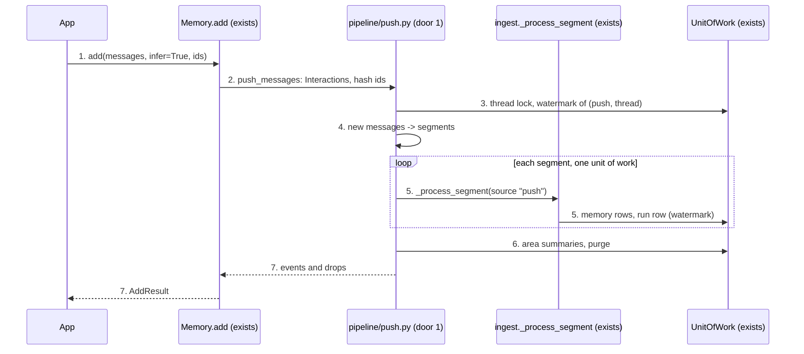
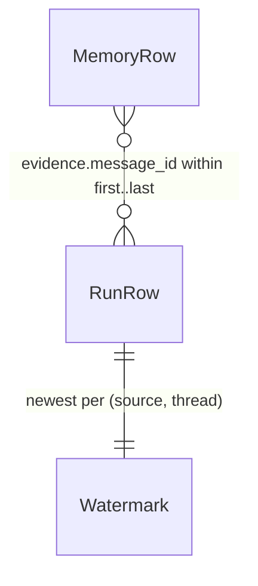

# Push ingestion (PR 5 of #1)

**Approved**: 2026-11-11 - user: "Once plan is writen, you auto-approve and manage all tickets until they are closed."

## Problem

An app that wants memhub to learn from a conversation has to write its turns somewhere memhub can read them
later: a JSONL file, MLflow traces or a SQL table, plus a `sources:` block in the yaml and a scheduled
`memhub ingest`. The epic says so: "log turns as JSONL or MLflow traces, because there is no way to push
messages directly". `Memory.add(..., infer=True)` exists in the signature and answers
`NotImplementedError("add(messages, infer=True) - push ingestion - is not available yet; pass fields")`.
The app pays with a log format, a job and a delay of at least `segment_idle` (1 h) before a memory exists.

When this ships, an app calls `m.add(messages, infer=True, workspace_id=, user_id=, run_id=)` at the end of a
conversation and gets back, in the same call, every memory the pipeline wrote and everything it dropped with
the reason. Nothing else about memory behaviour changes.

## Shape

This reuses the whole scheduled pipeline (`_process_segment`: prefilter, extract, ground, verify, admission,
areas, reconcile, route) and its run rows and watermark instead of a second extraction path; only how messages
arrive is new. The rules that change an outcome - which messages are new, how they are cut into segments, which
event a routed proposal becomes - live in `pipeline/push.py` and `pipeline/ingest.py`, reachable from pytest on
the in-memory backend and SQLite with fake models, no Docker.

1. app calls `Memory.add(messages, infer=True, workspace_id=, user_id=, run_id=, agent_id=, thread_id=)` -> `Memory.add` (exists) - builds the `CallContext` (ids required, AD-001), refuses a call without an llm, hands on to `push_messages`
2. `pipeline/push.py` `push_messages` (door 1) - validates the messages, turns them into `Interaction`s with content-hash ids (door 2), `thread_id` defaulting to `run_id`
3. `push_messages` - under the backend's thread lock when it has `parallel_ingest` (AD-016), reads the watermark of (`push`, thread) through the `UnitOfWork` (exists) and keeps the messages after the one the watermark names
4. `segment._slices` (exists) - one segment per `segment_max_user_turns` user turns, no idle wait, no final pass
5. `ingest._process_segment` (exists) - one unit of work per segment under source name `push` (door 3); now also records what each proposal became (`Routed`) and stamps the app's `run_id` / `agent_id` on the rows it writes; writes the run row, which is the watermark
6. `ingest._finish_run` (new, split out of `ingest_source`) - area summaries and the dropped-candidate purge, as after a scheduled run
7. out: `AddResult(run_id, results=[MemoryEvent...], dropped=[Dropped...])` built by `Memory.add` from the rows written

**Changes underneath**

| Front | What changes |
| --- | --- |
| domain | `add(..., infer=True)` meant "not available yet", now runs the pipeline; `infer=False` (the default) is unchanged |
| domain | `_process_segment` returned counts only; it now also lists what each admitted proposal became (`_SegmentResult.routed`) - `ingest_source` ignores it |
| domain | `route` wrote rows with no `run_id` / `agent_id`; it now takes them and passes them on - scheduled ingest passes none, so its rows are unchanged |
| stored data | nothing to migrate: push writes the existing memory and run rows; run rows gain the source name `push` |
| readers | `memhub runs` / `run_detail` list push runs like any other source; `memhub queue`, `search`, review are unchanged |

New: nothing - no table or column; `push` run rows and hash message ids in existing columns. One-way
constraints: the message id formula (door 2), the source name `push` and the run uuid (door 3).

## Surface

None - no route. The consumed contract is the Python signature in Landing door 1.

## Landing

| One-way door | Literal shape | Alternative rejected |
| --- | --- | --- |
| 1. The call and its result | `Memory.add(data, *, workspace_id, user_id, run_id, agent_id=None, roles=None, type=None, scope="user", infer=False, thread_id=None) -> AddResult`; with `infer=True`, `data` is `list[{"role": "user"\|"assistant", "content": str, "timestamp"?: datetime \| ISO str}]`, or a `str` (one user message); `results` holds one `MemoryEvent` per proposal written: created active -> `ADD`, created candidate -> `PENDING`, new version -> `UPDATE` (`PENDING` when the new version waits for review), same fact -> `MERGE`, contradiction -> `CONFLICT` with `conflicts_with`; `dropped` holds one `Dropped(content, reason)` per drop, `Dropped(content=None, reason="extract_error")` when the model's answer could not be read; `infer` stays `False` by default (AD-019) | `infer=True` by default like mem0 - a plain `add("text")` would call the LLM and could store nothing; returning the TDD's `{created, merged, candidates, dropped: {reason: count}}` - the issue asks for `AddResult` with every event and drop (R17) |
| 2. Message ids | `message_id(workspace_id, user_id, thread_id, role, content, timestamp, n) = sha256("\x1f".join([workspace_id, user_id, thread_id, role, content, timestamp ISO or "", str(n)])).hexdigest()[:32]`, `n` = how many earlier messages of the same call have the same role, content and timestamp; stored in evidence and in run rows `first_message_id` / `last_message_id` | a random id per call - the same messages sent twice would be extracted twice; an id chained over every earlier message - a sliding window of the last N messages would never match the watermark |
| 3. Source name and run id | run rows are written with `source = "push"` and `run_id = uuid.UUID(run_id)` when the app's `run_id` is a uuid, else `uuid.uuid5(uuid.NAMESPACE_URL, "memhub:push:" + run_id)`; evidence entries carry `source: "push"` | a configurable source name - a second place to keep in sync and a watermark that moves when it is renamed; a random uuid - `memhub runs` could not group the pushes of one app run |

| 2b. Message ids, revised after verification (supersedes door 2's formula, AD-023) | `message_id(workspace_id, user_id, thread_id, role, content, timestamp, prev_role, prev_content, n) = sha256("\x1f".join([..., timestamp ISO or "", prev_role, prev_content, str(n)])).hexdigest()[:32]`; `prev_*` is the message before it in the call ("" for the first); `n` counts earlier messages of the call with all of these equal | door 2's call-wide counter - a window that cuts off an earlier copy of a repeated answer shifts `n`, so a new answer can take the watermark's id and the new turn is dropped (Verifier finding) |

- Nothing else in this change is hard to reverse

## Criteria

### S1: Messages in, memories out (P1)

A pushed conversation goes through the scheduled pipeline and the caller sees what happened.

**Acceptance Criteria**

1. WHEN `add(messages, infer=True, ...)` is called THEN the system SHALL run extraction, grounding, admission, reconcile and routing on the messages and return an `AddResult` whose `run_id` is the caller's `run_id`, with one `MemoryEvent` per proposal written and one `Dropped` per candidate dropped
   - a user fact -> `ADD`, `active`, `scope="user"`; a workspace memory of a reviewed type -> `PENDING`, `candidate`, `scope="workspace"`; a candidate whose quote is not in the messages -> `Dropped(content=<its content>, reason="ungrounded")`; a conversation with nothing to keep -> `results == []`
2. WHEN a pushed proposal meets a stored memory THEN the event SHALL say what the pipeline decided: the same fact again -> `MERGE` with the stored memory's `id` and no new version; a newer value for a keyed slot -> `UPDATE` with `version` 2; a contradiction of a verified memory -> `CONFLICT`, `candidate`, `conflicts_with` = the verified memory's id
3. The system SHALL write every row of a push with the caller's `run_id` and `agent_id` (`None` when not given), `created_by = "extractor"`, and evidence entries with `source = "push"`, the thread id and the message's id; no embedding SHALL appear in the result
4. WHEN the messages hold more user turns than `ingestion.segment_max_user_turns` THEN the system SHALL process one segment per that many user turns, each in its own unit of work, with no idle wait and no final pass
   - `segment_max_user_turns=2`, 5 user turns -> 3 run rows (2, 2, 1 user turns); a conversation pushed one second after its last message is extracted at once
5. WHEN a user message starts with the configured `remember_command` THEN the system SHALL store what follows as in scheduled ingest: written even when the admission score is below the threshold, `created_by = "remember"`
6. The default SHALL stay `infer=False`: `add("text")` and `add({...})` store one memory with no model call, as before this change (AD-019)

### S2: The same messages twice (P1)

Sending a conversation again costs nothing and changes nothing.

**Acceptance Criteria**

7. WHEN the same messages are pushed twice to the same thread THEN the second call SHALL make no model call, write no memory row and no run row, and return `results == []` and `dropped == []`
8. WHEN a call repeats earlier messages and adds new ones THEN the system SHALL extract only the messages after the one the thread's watermark names
   - push [m1..m4] then [m1..m6] -> the second call's run row covers m5..m6; push [m1..m4] then the window [m3..m6] -> m5..m6; push [m1, m2] then [m3, m4] (new turns only) -> m3..m4
9. The system SHALL give two messages the same id only when workspace, user, thread, role, content and timestamp are equal and they stand at the same repeat position in their call; `thread_id` SHALL default to `run_id`
   - "yes" twice in one call -> two ids; the same text from another user or in another thread -> another id; a message with a `timestamp` and the same without -> two ids

### S3: Calls that cannot run (P1)

An invalid call raises before any model or database work; a pipeline decision never raises.

**Acceptance Criteria**

10. IF `infer=True` and `Memory` has no `llm` THEN `add` SHALL raise `ValidationError` naming `llm`; IF `workspace_id`, `user_id` or `run_id` is missing THEN it SHALL raise `ValidationError` before any model call (AD-001)
11. IF `infer=True` and `data` is not a string or a list of `{"role", "content"}` dicts with a string `content`, or the list holds no user message, or `type` is given THEN `add` SHALL raise `ValidationError`; IF `infer=False` and `data` is a list THEN it SHALL raise `ValidationError` naming `infer=True`; a message whose role is neither `user` nor `assistant` SHALL be left out, not refused
   - `[]` -> raises; `[{"role": "user"}]` -> raises; `[{"role": "system", "content": "x"}, {"role": "user", "content": "hi"}]` -> runs on the user message; `add([...])` with no `infer` -> raises
12. IF a segment's unit of work raises (model or embedder down) THEN the system SHALL let the exception reach the caller, leave no memory row and no run row for that segment, keep the segments already committed, and process the failed segment on the next call with the same messages
13. IF another call holds the same thread on a backend with `parallel_ingest` THEN `add` SHALL raise `Conflict` naming the thread, having made no model call; on a backend without it (SQLite) no lock is taken (AD-016)
14. IF the model's answer cannot be parsed THEN `add` SHALL not raise: it SHALL return `dropped == [Dropped(content=None, reason="extract_error")]` and write the run row with status `extract_error`

### S4: The demo (P1)

**Acceptance Criteria**

15. WHEN a script pushes a 6-turn conversation THEN the user memories SHALL come back `ADD` / `active` and be found by `search`, the workspace one SHALL come back `PENDING`, appear in `queue()` and not in another user's `search`; WHEN a `workspace_admin` approves it THEN another user's `search` SHALL return it (`tests/e2e/test_pr5_push.py`, on the in-memory backend, SQLite and Postgres)
16. The full existing suite SHALL stay green (N1), and the docs (`README`, `docs/integration.md`) SHALL show `add(messages, infer=True)` with its result and say that `infer` defaults to `False`

## Out of scope

| Excluded | Why |
| --- | --- |
| An async or queued push (return at once, extract later) | PRD out of scope: `AsyncMemory`; the issue asks for a synchronous `AddResult` |
| A `memhub push` CLI command or an HTTP endpoint | not in the issue; the PRD leaves an HTTP API to the app |
| The final pass over a closed thread for pushed threads | the caller decides the conversation is ready; there is no idle clock to close it |
| Feedback signals (thumbs) passed with the messages | sources' `signals()` has no push counterpart in the issue; correction signals found in the text still apply |
| `tool` and `system` messages as evidence | left out of the segment; the extractor reads user and assistant turns, as with the JSONL source |
| `infer=True` in `MemoryToolkit` / `MemoryMiddleware` tools | those propose one memory; unchanged |

## Assumptions

| Assumption | Chosen default | Rationale | Confirmed? |
| --- | --- | --- | --- |
| Default of `infer` | `False` | user delegated ("Any question you need from me, I'll let you decide the best decision"); epic open question - avoids surprise LLM calls and keeps PR 1 behaviour (AD-019) | y |
| `MERGE` in results | shown as an event | user delegated; epic open question - the TDD's event table lists it, and an app learns the id of the memory its messages confirmed (AD-020) | y |
| Result shape | `AddResult` (issue, R17), not the TDD's count dict | the issue is the later, more specific source | n |
| A message with no `timestamp` | the time of the call, for every such message; order is the list's order | evidence `observed_at` needs a time; the id leaves the timestamp out when none was given, so a resend still matches | n |
| A string as `data` with `infer=True` | one user message | mem0 accepts it; a one-line `add("I moved to Lyon", infer=True)` | n |
| `scope=` with `infer=True` | ignored: the pipeline chooses the scope per candidate | it has a default, so it cannot be told from "not given" | n |
| Thread lock held by another call | `Conflict`, not a silent empty result | a caller that got `results == []` would believe nothing was worth keeping | n |
| A failed segment | the exception propagates; committed segments stay | "invalid calls raise, pipeline decisions never do" - a model outage is neither, and hiding it loses the conversation | n |

**Open questions:** none - all resolved or logged above.

## Differences from the source

| Source shows | Product shows | Confirmed |
| --- | --- | --- |
| TDD *Ingestion* step 4: "Returns `{created, merged, candidates, dropped: {reason: count}}`" | an `AddResult` with every event and every drop, as issue #6 and R17 say | y - AD-020 |
| TDD step 3: "inside one unit of work" | one unit of work per segment (the TDD's own "one transaction per segment, as today"); a push of up to `segment_max_user_turns` user turns is one unit of work | y - AD-020 |

## Sources

- Issue #6 "PR 5 - Push ingestion" - binding - Delivers, Files, Acceptance
- PRD + TDD, *Ingestion*, *Write results* (https://app.notion.com/p/jooaobrum/memhub-Pluggable-memory-package-Integration-41517e87bbcc802eab1ac766dd797a07, read 2026-11-11) - binding - the push steps, event table, errors vs drops
- `.specs/features/memory-facade/plan.md` (PR 1) - binding - `AddResult`, `MemoryEvent`, `CallContext`
