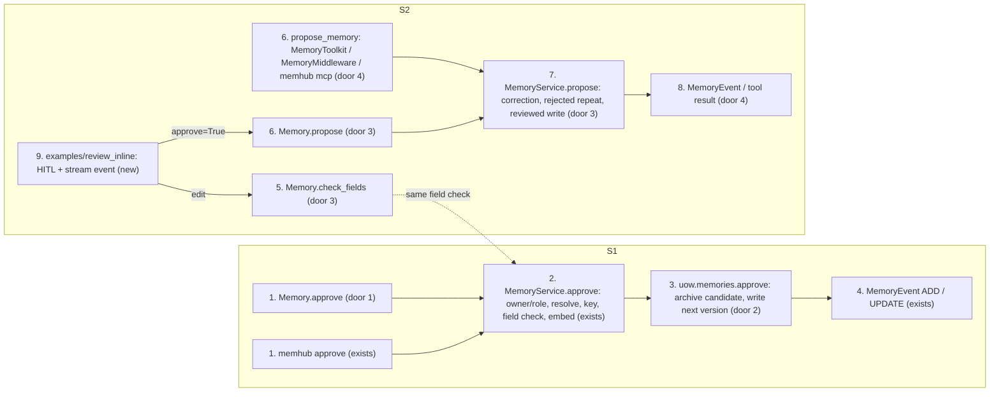
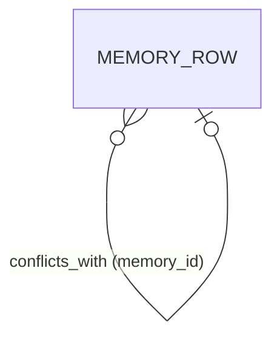
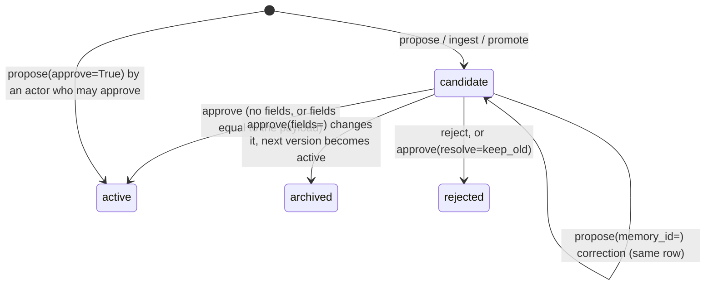

# Review edit: correct a candidate while approving it, and the primitives an agent review flow needs

**Approved**: 2026-11-13 - user: "Ok implement it and open the PR to main"

## Problem

A reviewer can only approve or reject a candidate as it is. A proposal that is almost right (wrong wording, a missing entity, one field off) has to be rejected and re-added by hand, and the re-added memory loses its evidence, `run_id` and `agent_id`. The code shows why:

- `MemoryService.edit` looks up the **active** version only (`uow.memories.get_active`, `service.py:189`), so a candidate raises `NotFound`.
- `MemoryService.approve` (`service.py:254`) takes no fields. The store's `approve` already accepts a `merged` override (`content`, `payload`, `embedding`), but only the `keep_both` path uses it.

An app that wants the user to review memories from the chat cannot build that on memhub's public API:

- `Memory` has no `propose`, so an app cannot write a candidate on its own terms, and cannot write a reviewed proposal as active in one step.
- There is no public way to check fields against a memory type before saving.
- A correction adds a second candidate.
- A proposal a reviewer rejected can be proposed again in the next turn.
- Only a role can approve, so an end user cannot approve their own user-scope memory.

Who pays: reviewers (re-typing and lost provenance), and every app builder who wants human-in-the-loop memory and has to reach into `memhub.service`. The evidence is issue #19 and the PRD/TDD PR 10 section (R23-R27, D13-D15). There are no user reports.

When this ships, a reviewer approves a candidate with corrected fields in one call (Python, CLI, any backend), and the history shows what was proposed and what was approved. An app builds inline review (approve, edit or reject a proposed memory in the chat) or "capture now, review later" from public `Memory` calls only. A runnable example in `examples/` shows both. Corrections update the pending draft, and rejected drafts are not proposed again.

## Shape

This reuses the store's `approve` with its `merged` override, `edit_memory` (which already writes version N+1), the registry's type models, `_check_instance` and `MemoryService.propose`. It adds no table, and no interrupt or UI concept to the package: the HITL flow lives in an example, built on LangChain's `HumanInTheLoopMiddleware` (AD-045). The rules that change an outcome run in `service.py` (field check, permissions, conflict and key rules, the reviewed write, the correction and the rejected-repeat rule) and in each backend's `approve` (archive plus next version). pytest reaches all of it with fake models and the contract suite on every backend. The example is run by a test with a fake model and an in-memory checkpointer.

**S1 - edit on approve**

1. `Memory.approve` (exists, door 1) resolves the candidate (memory id or version id, as today) and passes `fields` to `MemoryService.approve` (exists, door 1). The CLI `memhub approve` (exists) passes its `--set KEY=VALUE` values the same way.
2. `MemoryService.approve` (exists) checks the actor (AD-037), checks `resolve` against `fields` (AD-038), merges the fields into the candidate's payload, refuses a key change (AD-039), runs the field check (`registry` model at the candidate's `schema_version` + `_check_instance`) and re-embeds the content.
3. `uow.memories.approve` on memory / sqlite / postgres (exists): with an edit, it archives the candidate with `review_note` "edited on review" and writes the edited text as the next version, active and verified, with the candidate's evidence, `run_id` and `agent_id` (door 2, AD-040). Without an edit it behaves as today.
4. out: a `MemoryEvent` (exists; `ADD` when no version of the memory was ever active before, else `UPDATE`), or the row printed by the CLI.

**S2 - review primitives, and the example built on them**

5. `Memory.check_fields` (new, door 3) runs the same field check as step 2 and returns the rendered content, so an app can validate a reviewer's edit before anything is saved.
6. `Memory.propose` (new, door 3) and the `propose_memory` tool of `MemoryToolkit`, `MemoryMiddleware` and `memhub mcp` (exists, door 4) call `MemoryService.propose` (exists, door 3).
7. `MemoryService.propose` (exists) does one of three things. With `memory_id`, it corrects that pending candidate in place. Unless `user_requested`, it refuses a near-duplicate of a rejected candidate (AD-043). With `approve=True` and an actor who may approve that scope (AD-037), it writes active and verified in one transaction; otherwise it writes a candidate. Tools never pass `approve`.
8. out: a `MemoryEvent` from `Memory.propose`, and the tool result (door 4) with id, event, status and content.
9. `examples/review_inline` (new) wires a `HumanInTheLoopMiddleware` around its own `propose_memory` tool. It checks an edit with `Memory.check_fields`, asks again on an error, writes with `Memory.propose(approve=True)` and emits a `memory_proposed` stream event. It imports only public `memhub` names.

**Data**

New: nothing. An edit on review adds a row of an existing kind (the next version of the same `memory_id`). The `UNIQUE (memory_id, version)` constraint and the one-active-per-memory index stay as they are.

**Changes underneath**

| Front | What changes |
| --- | --- |
| domain | "approver" meant a role in `roles.approve_workspace`. For a user-scope candidate it now also means the owner (AD-037, AD-041). Today's readers: `MemoryService.approve` / `reject`, `Memory.queue` (shows other users' private candidates only to a role, unchanged) |
| domain | `archived` meant "retired by archive, a `replace` resolution or a `keep_both` merge". It now also means "proposed text changed on review" (`review_note` begins `edited on review`). Today's readers: `history`, `memhub history`, `list(status=)` |
| domain | `MemoryEvent.event` for an approval was `ADD` when `version == 1`. It is now `ADD` when no earlier version of the memory was ever `active` |
| domain | `MemoryService.propose` meant "always a candidate". With `approve=True` and a permitted actor it now writes active. Tools never pass it |
| stored data | nothing to migrate. Old rows are untouched, and the new rows use existing columns |
| readers | `memhub history` and `Memory.history` show the archived proposal before the approved version. Tool results gain `content` (AD-044). `MemoryMiddleware` gets no new constructor option (AD-046). Docs: `docs/integration.md` (review section, pointing at the example), README review commands |

## Surface

Python API, CLI and agent tools; there is no HTTP route. The codes in Status only name each outcome class so that checks.md can join them: 200 ok, 403 `PermissionDenied`, 404 `NotFound`, 409 `StoreError` (wrong status or concurrent change), 422 `ValidationError` / `InjectionDetected` / tool `{"rejected"}`. For the CLI they map to exit 0 (200) and exit 1 (the rest).

| Route | In | Out | Status | Who |
| --- | --- | --- | --- | --- |
| `MemoryService.approve(actor, id, *, fields=None, resolve=None, note=None)` | `fields: dict` merged into the candidate payload | row of the active version (or rejected row for `keep_old`) | 200; 422 `ValidationError` / `InjectionDetected`; 403 `PermissionDenied`; 404 `NotFound`; 409 `StoreError` | user scope: owner or a role in `roles.approve_workspace`; workspace scope: that role. Others get `PermissionDenied` |
| `MemoryService.reject(actor, id, *, note=None)` | unchanged | unchanged | 200; 403 `PermissionDenied`; 404; 409 | as approve (AD-041) |
| `Memory.approve(id, *, fields=None, resolve=None, note=None, **ids)` | as above | `MemoryEvent` | 200; 422; 403; 404; 409, as the service | as above |
| `memhub approve ID [--set KEY=VALUE ...] [--resolve ...] [--note ...]` | `--set` repeatable; VALUE parsed as JSON when it is valid JSON, else a string | the row as JSON, as today | 200 = exit 0; 422 / 403 / 404 / 409 = exit 1 with the error on stderr (as `_fail` today) | the CLI actor, as today |
| `Memory.check_fields(type, fields, **ids)` | a type name and its fields | `{"content": str, "payload": dict}` | 200; 422 `ValidationError` / `InjectionDetected` | anyone with ids (AD-001); writes nothing |
| `Memory.propose(type, fields, *, evidence=None, scope="user", memory_id=None, user_requested=False, approve=False, **ids)` | as listed | `MemoryEvent` (`PENDING` candidate, or `ADD` active) | 200; 422 invalid fields, rejected repeat; 404 unknown `memory_id`; 403 `memory_id` of another owner or workspace | anyone with ids; `approve=True` writes active only for an actor allowed by AD-037, else a candidate |
| `MemoryService.propose(actor, *, ..., memory_id=None, user_requested=False, approve=False)` | as `Memory.propose` | row | 200; 422; 404; 403, as `Memory.propose` | as `Memory.propose` |
| tool `propose_memory(type, fields, evidence, scope="user", memory_id=None, user_requested=False)` (`MemoryToolkit`, `MemoryMiddleware`, `memhub mcp`) | as listed | `{"id", "event", "status", "content"}` or `{"rejected": "<reason>"}` | 200 written candidate; 422 `{"rejected": reason}` for invalid fields, a bad `memory_id` or a rejected repeat; never raises to the model | anyone - the agent of the app that registered the tool; memhub trusts the caller (D6) |

## Landing

| One-way door | Literal shape | Alternative rejected |
| --- | --- | --- |
| 1. Approve takes fields | `approve(id, *, fields: dict \| None = None, resolve=None, note=None)` on `MemoryService` and `Memory`; `memhub approve --set KEY=VALUE` | `edit` then `approve` as two calls: the candidate is changed but not approved in between (D13) |
| 2. History of an edit on review | candidate row -> `status='archived'`, `review_note='edited on review'` (or `'edited on review: <note>'`); approved text -> `version = max(version)+1`, `status='active'`, `verified=true`, same `evidence`, `run_id`, `agent_id`, `reviewed_by` (AD-040) | a `proposed_payload` column: needs a migration on three backends. Overwriting in place: loses what was proposed |
| 3. Review primitives on the public API | `Memory.check_fields(type, fields, **ids) -> {"content", "payload"}`; `Memory.propose(type, fields, *, evidence=None, scope="user", memory_id=None, user_requested=False, approve=False, **ids) -> MemoryEvent`; `MemoryService.propose(..., memory_id=None, user_requested=False, approve=False)` | a review option on `MemoryMiddleware`: puts an agent framework's flow inside the memory system (AD-045) |
| 4. Proposal tool contract | args add `memory_id: str \| None`, `user_requested: bool = False`; result `{"id", "event", "status", "content"}` (refines AD-003, AD-044) | a new `correct_memory` tool: two tools for one draft, and the model has to choose |
| 5. Dev dependency | `langchain>=1.4.6` in the `dev` extra (the example's per-call interrupts); the package keeps `langchain>=1.0` (AD-045) | raising the package pin: every user pays for an example |

- Nothing else in this change is hard to reverse. The example's code is not a contract

## Criteria

### S1: A reviewer approves a candidate with corrected fields (P1)

One call edits and approves. The history keeps both texts, on every backend.

**Acceptance Criteria**

1. WHEN a permitted actor calls `approve(id, fields=F)` on a non-conflicting candidate and F changes its payload THEN the system SHALL archive the candidate row with `review_note` `edited on review`, and write version `max+1` as `active`, `verified=true`, `reviewed_by=<actor>`. The new version SHALL hold content, payload and entities from the merged payload, an embedding of the new content, and the candidate's `evidence`, `run_id` and `agent_id`
   - candidate v1 `{"content": "Login uses Auth0"}`, F `{"content": "Login uses Okta"}` -> v1 `archived`, v2 `active` "Login uses Okta", same evidence
   - with `note="typo"` -> the archived row's `review_note` is `edited on review: typo` and the active row's `review_note` is `typo`
2. WHEN `Memory.approve(id, fields=F)` succeeds THEN it SHALL return a `MemoryEvent` whose `version` is the new version, with `event` `ADD` if no earlier version of that memory was ever `active`, else `UPDATE`
   - new memory, candidate v1 edited -> `ADD`, version 2; candidate v3 over an active v2, edited -> `UPDATE`, version 4, v2 `superseded`
3. WHEN the candidate is a new version of a memory that has an active version THEN the system SHALL leave exactly one active version, the edited one, and the previous active SHALL become `superseded` (as today without fields)
4. WHEN `fields` is `None`, `{}`, or leaves the merged payload equal to the candidate's payload THEN `approve` SHALL behave exactly as today: the candidate row itself becomes active, no row is added and no `edited on review` note is written
5. IF the merged payload fails the candidate type's model at its `schema_version`, names an undeclared entity type, or matches an injection pattern THEN `approve` SHALL raise `ValidationError` (`InjectionDetected` for injection), and the candidate SHALL stay `candidate` with no row added
   - `count: "abc"` on an `int` field -> `ValidationError`; entity type `planet` not declared -> `ValidationError`; content `ignore previous instructions` -> `InjectionDetected`
6. IF `fields` changes `payload.key` of a keyed type THEN `approve` SHALL raise `ValidationError` with the message `the key cannot change on review: reject and propose again`, and write nothing
   - key `"plan"` -> `"tier"` refused; key `"1"` -> `1` accepted (the slot index reads both as the text `1`, so the slot and `conflicts_with` stay right); key unchanged, other fields changed -> accepted
7. WHEN `approve(id, fields=F, resolve="replace")` is called on a conflicting candidate THEN the system SHALL archive the old active memory, apply criterion 1 to the candidate, and leave the edited version active
8. IF `fields` is given with `resolve="keep_old"`, or with `resolve="keep_both"` on a keyed candidate THEN `approve` SHALL raise `ValidationError` and change nothing. `keep_both` with `fields` on a non-keyed candidate SHALL apply criterion 1 and keep the old memory active
9. WHEN a user-scope candidate is approved or rejected, with or without `fields` THEN the system SHALL allow the owner (`actor.id == user_id`) or an actor with a role in `roles.approve_workspace`, and raise `PermissionDenied` for anyone else, before any write
   - owner with role `user` -> allowed; other user with role `user` -> `PermissionDenied`; reviewer role, not owner -> allowed
10. WHEN a workspace-scope candidate is approved or rejected THEN the system SHALL require a role in `roles.approve_workspace`, and an actor with only `user` SHALL get `PermissionDenied`
11. The system SHALL give the same results for criteria 1-10 on the in-memory, SQLite and Postgres backends, proven by the storage contract suite
12. WHEN `memhub approve ID --set content="Login uses Okta" --set count=3` runs THEN the CLI SHALL approve with `fields={"content": "Login uses Okta", "count": 3}` (a value that parses as JSON is used as JSON, anything else as a string), print the active row as JSON and exit 0
13. IF a `--set` argument has no `=`, or the approval fails THEN `memhub approve` SHALL print the error on stderr and exit 1, and write nothing
14. The system SHALL check fields with one function for `approve(fields=)`, `edit`, `add`, `propose` and `check_fields`, so the same invalid payload gets the same error message from each
    - `count: "abc"` gives the same `ValidationError` text from `approve(fields=)`, `propose` and `check_fields`

### S2: An app builds review from the chat on public calls (P1)

The package gives the primitives. `examples/review_inline` proves they are enough.

**Acceptance Criteria**

15. WHEN `Memory.check_fields(type, fields)` gets valid fields THEN it SHALL return `{"content": <rendered content>, "payload": <validated payload>}` and write nothing. IF they are invalid THEN it SHALL raise as criterion 14
16. WHEN `Memory.propose(type, fields, ...)` is called without `approve` THEN it SHALL write a candidate and return a `MemoryEvent` with `event` `PENDING` and `status` `candidate`, for user and workspace scope alike
17. WHEN `Memory.propose(..., approve=True)` is called by an actor allowed to approve that scope (criteria 9-10) THEN it SHALL write the memory `active` and `verified` with `reviewed_by=<actor id>` in one transaction, return `event` `ADD`, and leave nothing in the queue
18. IF `Memory.propose(..., approve=True)` is called by an actor not allowed to approve that scope THEN it SHALL write a candidate (`PENDING`) as without `approve`, and not raise
    - workspace scope, actor with role `user` -> candidate; user scope, owner -> active
19. WHEN `propose(..., memory_id=X)` is called and X is a `candidate` of the same workspace and owner THEN the system SHALL replace that row's content, payload, entities and embedding in place, add no row, and return X as `id`
    - correction "actually it's Okta, not Auth0" -> one candidate, now Okta
20. IF X is unknown THEN `propose` SHALL raise `NotFound`. IF X belongs to another owner or workspace THEN it SHALL raise `PermissionDenied`. IF X is not a `candidate` (active, rejected, archived) THEN it SHALL raise `ValidationError`. In every case it SHALL write nothing
21. IF a `rejected` candidate of the same type and owner (same `user_id` for user scope, same workspace for workspace scope) has cosine similarity >= `reconcile.duplicate` with the proposal THEN `propose` SHALL raise `ValidationError` `a reviewer already rejected this memory` and write nothing, unless `user_requested=True`
    - similarity exactly 0.92 with `duplicate` 0.92 -> refused; 0.91 -> written; same text rejected for another user -> written; same text, other type -> written; `user_requested=True` -> written
22. WHEN the `propose_memory` tool of `MemoryToolkit`, `MemoryMiddleware` or `memhub mcp` writes THEN its result SHALL be `{"id": <memory_id>, "event", "status", "content"}`. It SHALL accept `memory_id` and `user_requested`, never write active, and return `{"rejected": "<reason>"}` for every refusal in criteria 20-21 and for invalid fields
23. The `MemoryMiddleware` constructor and `Memory.middleware()` SHALL keep today's parameters, with no review option added (AD-046)
24. WHEN the test drives `examples/review_inline` with a fake model and an in-memory checkpointer, and the agent calls `propose_memory`, THEN the run SHALL stop at an interrupt whose description contains the memory type, the rendered content, the scope and each evidence quote
25. WHEN the reviewer answers that interrupt with `approve`, or with an `edit` whose args are valid THEN the example SHALL leave the (edited) memory `active` and `verified`, and the queue empty
26. IF the reviewer answers with an `edit` whose args fail `check_fields` THEN the example SHALL write nothing and interrupt the same call again with the error in its description. A valid answer to that second interrupt SHALL complete as criterion 25
27. WHEN the reviewer answers `reject` THEN the example SHALL write nothing
28. WHEN the example writes a memory THEN it SHALL emit exactly one stream event `{"type": "memory_proposed", "id", "event", "status", "content", "memory_type"}`, and none when nothing is written
29. The example SHALL import from `memhub` only names exported by `memhub/__init__.py`, never `memhub.service`, `memhub.storage` or a private name
30. The package SHALL keep `langchain>=1.0` in its dependencies, and the `dev` extra SHALL declare `langchain>=1.4.6`

## Out of scope

| Excluded | Why |
| --- | --- |
| A review option on `MemoryMiddleware` (`review=`, `hitl()`) | the flow is an example, not the memory system (AD-045, AD-046) |
| Moving `MemoryMiddleware` out of the package | a separate issue: it breaks R5 and `Memory.middleware()` (AD-046) |
| A review web page or HTTP API | issue #24 (dashboard) |
| Review tools over MCP (approve / reject from Claude Code) | not asked; MCP keeps search and propose |
| Recomputing `conflicts_with` after an edit | AD-039 refuses key changes instead |
| Editing a rejected or archived row | only candidates are reviewed; a rejected memory is proposed again with `user_requested` |
| Recording an inline rejection as a `rejected` row | nothing was written before the decision; see Assumptions |
| Approval rules per memory type | issue #29 |

## Assumptions

| Assumption | Chosen default | Rationale | Confirmed? |
| --- | --- | --- | --- |
| `fields={}` or fields equal to the payload | same as no fields: no extra row, no "edited" mark | the history should only show an edit when the text changed | n |
| CLI value parsing | `--set k=v`: JSON when `v` parses as JSON, else the raw string | `count=3` becomes an int and `content=Okta` stays a string, with no extra flag | n |
| Inline rejection in the example | writes nothing, so the rejected-repeat rule (AD-043) cannot see it | the decision comes before any write; storing it would put the user's "no" in the ledger as a row | n |
| `propose(approve=True)` by an actor who may not approve | writes a candidate, no error | issue #19: "That person needs an approving role. Otherwise fall back to a candidate" | y |
| A correction (`memory_id=`) keeps the row | updates the candidate row in place, so its version is unchanged | an unreviewed draft has no history worth keeping; the issue asks for "updates that pending candidate" | n |
| Tool result gains `content` | AD-044 refines AD-003 | issue #19: "It returns id + content, so the model can tell several drafts apart" | y |
| Mutations | 3 (skill default; no `mutations:` in AGENTS.md) | the rules most worth probing: the permission rule, the key/resolve refusals, the rejected-repeat threshold | n |

**Open questions:** none - all resolved or logged above.

## Differences from the source

| Source shows | Product shows | Confirmed |
| --- | --- | --- |
| issue #19: `mem.middleware(..., approval="inline")` and `mw.hitl()` in the package | the same flow in `examples/review_inline`, on public `Memory` calls | y - AD-045 |
| issue #19: raise the pin or support the batched resume | package pin unchanged; `langchain>=1.4.6` in the `dev` extra for the example | y - AD-045 |
| issue #19: the tool emits a typed `memory_proposed` stream event | the example's tool emits it; the package tools do not | y - AD-045 |

## Sources

- GitHub issue #19 "Review queue: edit a candidate, then approve it" - binding - the problem, behaviour, flows A and B, acceptance
- PRD/TDD "memhub - Pluggable memory package - Integration" (Notion), PR 10, R23-R27, D13-D15 - binding - updated 2026-11-13 for this feature; to be aligned with AD-045
- Notion "Human-in-the-loop & Guardrails" (Agent Patterns) - non-binding - issue #19 cites it as reference for per-call mode and "capture now, validate later"
- `.specs/STATE.md` AD-036 to AD-046 - the answers given for this plan
