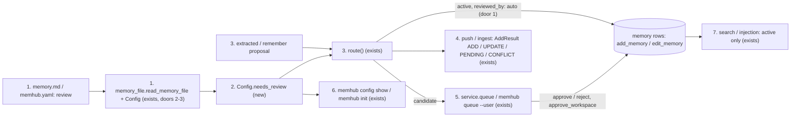
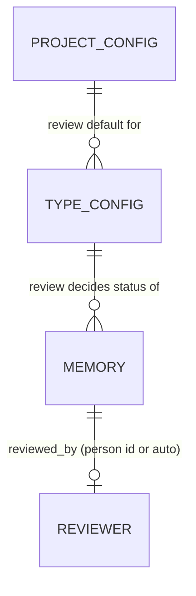
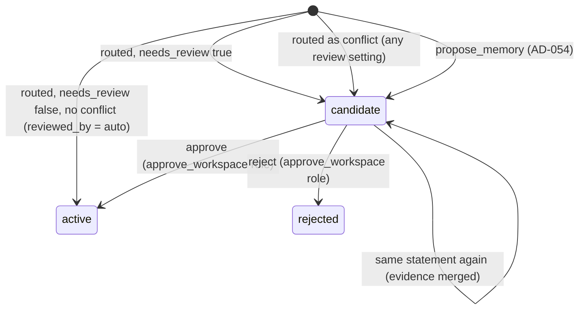

# Review per type: memory.md says which types wait for a person and which are auto-approved

**Approved**: 2026-11-14 - user: "ok agree"

## Problem

Whether an extracted memory waits for a person is decided by its scope, not by its kind (`route()`, `src/memhub/pipeline/route.py:73` and `:85`):

- a user-scope memory is `active` at once, always: `review: true` on a user-scope type has no effect;
- a workspace-scope memory is a `candidate` unless its type sets `review: false`, which only the long form of a type can write (`fact: builtin` and template strings take no options);
- there is no project-wide default, so the rule cannot be read in one place, and `memhub config show` does not print it;
- a row that went active with no human step looks like any other active row: `reviewed_by` is `NULL` whether nobody looked or the row predates review.

Who pays: a project that keeps one user's sensitive facts (a `diagnosis`, an `account` detail) cannot make them wait for a reviewer, so the agent serves a model's extraction about a person as fact; and a project that trusts a shared kind (`profile`) must spell out the long form to say so. Evidence: issue #29, which states this from the code; it gives no incident.

When this ships, `memory.md` (or `memhub.yaml`) states one rule - a project default `review: none | workspace | all`, and `review: true | false` on any type in any form - that applies to both scopes. A type under review keeps its extracted memories out of search and injection until someone with the approving role runs `memhub approve`, and every row that went active without a person carries `reviewed_by: "auto"`. With no `review` anywhere, everything behaves as today, apart from that mark.

## Shape

This reuses `TypeConfig.review`, the existing `candidate` status, the review queue, `approve` / `reject` with `roles.approve_workspace` (AD-053), reconcile's handling of pending candidates, and the `reviewed_by` column every backend already stores; nothing is added to the schema. The rule that changes an outcome runs in one function, `Config.needs_review(type, scope)` in `config.py`, called by `route()`. Both are reached by `tests/test_pipeline_units.py`-style unit tests and by the storage contract suite with no model.

1. `review:` in the `memory.md` frontmatter or `memhub.yaml`, and `review:` on a type (long form, `{builtin: true, ...}`, `{template: "...", ...}` - AD-052) -> `memory_file.read_memory_file` (exists) and `Config` validators in `config.py` (exists, door 2, door 3) - validates and hands on `Config.review` and `TypeConfig.review: bool | None`.
2. `Config.needs_review(type, scope)` (new, in `config.py`) - decides: the type's `review` if set; else the project default (`all` -> both scopes, `workspace` -> workspace only, `none` -> neither).
3. an extracted or `/remember` proposal -> `route()` (exists) - a new row or a superseding version is `candidate` when `needs_review` says so or it is a conflict; otherwise `active`, stamped reviewed_by = auto (door 1). Persists through `uow.memories.add_memory` / `edit_memory` (exists, gain a `reviewed_by` argument) on Postgres, SQLite and in-memory.
4. `push` / `ingest` (exists) - turn the routed row into `ADD` / `UPDATE` (active) or `PENDING` / `CONFLICT` (candidate) via `_push_event` (exists, unchanged).
5. `service.queue(workspace_id, user_id)` (exists, gains `user_id`) and `memhub queue --user` (exists, gains the flag) - list candidates of both scopes; `service.approve` / `reject` (exists) with `roles.approve_workspace`.
6. `memhub config show` (exists) - prints `review` and one `review.<type>` line per type with its effective value and where it came from; `memhub init` (exists) writes `review: workspace` in the starter `memory.md`.
7. out: `search`, `get_all(status="active")` and the middleware's injection (exist) read `active` rows only, so a candidate is never served.

**Changes underneath**

| Front | What changes |
| --- | --- |
| domain | `TypeConfig.review` meant "a workspace memory of this type waits" (default `true`, no effect on user scope). It now means "this type waits in every scope (`true`) / never (`false`)", default unset = the project's `review`. Today's readers: `route()` lines 73 and 85, `tests/test_adapt.py:162` (`review=False`, still active), `docs/memory.md` |
| domain | `reviewed_by` meant "the person who approved or rejected". It now also holds `auto`: let in with no person (AD-055). Readers: `service.approve` / `reject` (writers), every row returned to the app (`MEMORY_COLUMNS`), `examples/habitantes/functional_check.py:148` (asserts truthy after a person's approve - unaffected) |
| domain | the review queue already holds candidates of both scopes (agent proposals write user-scope candidates today); a user-scope extracted candidate is new to it |
| stored data | nothing to migrate: rows written before keep `reviewed_by` `NULL` (AD-055) |
| readers | `memhub queue`, `Memory.queue`, `service.queue`; `search` / injection (active only, already); `memhub config show`; the `memhub init` starter; `docs/memory.md`, `docs/guides/01-quickstart.md` section 6, `docs/memory-setup.md` question 4 |

New: nothing stored - `reviewed_by` exists; its new value `auto` is door 1.

## Surface

Config keys, Python API and CLI; there is no HTTP route. The codes in Status only name each outcome class so that checks.md can join them, as in the earlier plans: 200 ok, 422 `ConfigError` (a bad `review` value or type mapping, raised when the config resolves, before any database or model call), 403 `PermissionDenied` (approve / reject by an actor with no role in `roles.approve_workspace`). For the CLI they map to exit 0 (200) and exit 1 (422, 403).

| Route | In | Out | Status | Who |
| --- | --- | --- | --- | --- |
| `review:` in the `memory.md` frontmatter or `memhub.yaml` | `none`, `workspace` or `all` | `Config.review`, default `workspace` | 200; 422 `ConfigError` for another value, or when both files set it | anyone who can edit the config file |
| `review:` on a type | `true` or `false`, in the long form, `{builtin: true, ...}` or `{template: "...", ...}` | `TypeConfig.review`, unset = project default | 200; 422 `ConfigError` for a non-boolean or two schema keys in one mapping | anyone who can edit the config file |
| `memhub queue [--ws W] [--user U]` | workspace; `--user` keeps that user's user-scope candidates | JSON rows, conflicts first | 200 = exit 0; 422 = exit 1 on a config error | anyone with the config (no role check today) |
| `MemoryService.queue(actor, workspace_id=, user_id=)` | filters | candidates of both scopes | 200; 404 another user's candidates absent from `Memory.queue` for a non-approver, as today | anyone; `Memory.queue` shows another user's candidates only to an approver |
| `Memory.approve` / `reject`, `memhub approve` / `reject` on a user-scope candidate | id | the row, `active` or `rejected`, `reviewed_by` = actor | 200; 403 `PermissionDenied` (exit 1) without a role in `roles.approve_workspace`, owner included | approvers (AD-053) |
| `memhub config show` | - | adds `review` and `review.<type>` lines | 200 = exit 0; 422 = exit 1 on a config error | anyone with the config (no role check today) |
| rows returned to the app | - | `reviewed_by: "auto"` on rows let in with no person | 200 | anyone the row is returned to today |

## Landing

| One-way door | Literal shape | Alternative rejected |
| --- | --- | --- |
| 1. the auto-approval mark (AD-055) | `reviewed_by = "auto"` on rows `route()` writes `active` (new row or new version), both scopes; old rows stay `NULL` | a new `approved_by` column: a migration on three backends for a value the existing column holds; no mark: the user chose a queryable mark (#24's dashboard will bind to it) |
| 2. the project rule in config | `review: none \| workspace \| all`, default `workspace`, allowed in the `memory.md` frontmatter and in `memhub.yaml`, set in at most one of them | a boolean project default: cannot say "every scope" |
| 3. the type override and its short form (AD-052) | `review: true \| false` (unset = project default); `profile: {builtin: true, review: false}`; `fix: {template: "{fault}: {action}", review: true}` | a suffix inside the string (`builtin, review: false`): a second syntax inside a string |

- Nothing else in this change is hard to reverse: `needs_review`, the `reviewed_by` argument on the storage port and the queue filter are internal.

## Criteria

### S1: one rule decides who waits, in both scopes (P1)

An extracted memory is `active` or a `candidate` by its type's `review`, else the project's, in either scope.

**Acceptance Criteria**

1. WHEN no `review` is set anywhere THEN the system SHALL route an extracted memory as today: user scope `active`, workspace scope `candidate`
   - user-scope `fact` → `active`; workspace-scope `fact` → `candidate`; the existing test suite and e2e scenarios pass with no assertion changed
2. WHEN a type sets `review: true` THEN the system SHALL write an extracted memory of that type as a `candidate` in user scope and in workspace scope
   - `diagnosis` with `scopes: [user]`, project default unset → `candidate`; same type under project `review: none` → `candidate`
3. WHEN a type sets `review: false` THEN the system SHALL write an extracted memory of that type `active` in both scopes
   - workspace-scope `profile` → `active`; same type under project `review: all` → `active`
4. WHEN the project sets `review: all` and a type sets nothing THEN the system SHALL write its extracted memories as `candidate` in both scopes
   - user-scope `preference` → `candidate`
5. WHEN the project sets `review: none` and a type sets nothing THEN the system SHALL write its extracted memories `active` in both scopes
   - workspace-scope `fact` → `active`
6. WHEN `route()` supersedes an existing row THEN the system SHALL write the new version as `candidate` or `active` by the same rule as a new row
   - superseding a user-scope `preference` with `review: true` → new version `candidate`, old version still `active` and served
7. WHEN a `/remember` order is routed THEN the system SHALL apply the same rule as extraction
8. The system SHALL return from `Config.needs_review(type, scope)`, for each of the 3 project values × 3 type values (unset, true, false) × 2 scopes, the value rules 1-5 give (18 cases)

### S2: what must not change (P1)

The rule never weakens the guarantees that hold today.

**Acceptance Criteria**

9. IF a routed memory contradicts an active one THEN the system SHALL write it as a `candidate` with `conflicts_with` set, and return `CONFLICT`, whatever `review` says
   - type `review: false`, project `review: none`, contradicting a user-scope `preference` → `candidate` in the queue
10. IF an extracted memory would replace a `verified` row THEN the system SHALL open a conflict and leave the verified row `active` and unchanged, whatever `review` says
11. WHEN an agent calls `propose_memory` (service, `MemoryToolkit`, `MemoryMiddleware`, MCP) THEN the system SHALL write a `candidate`, whatever the type's `review` says (AD-054)
    - type `review: false`, project `review: none` → `candidate`, event `PENDING`
12. WHEN a person adds a memory by hand (`memhub add`, `Memory.add(..., infer=False)`) THEN the system SHALL keep today's status and `verified` value, whatever `review` says
13. WHILE a type is under review, the system SHALL still run grounding, the admission score and the injection scan on its extracted memories, and drop what they drop today

### S3: user-scope candidates are reviewable and never served (P1)

A user-scope memory that waits can be found, approved or rejected, and is not used before.

**Acceptance Criteria**

14. WHILE a user-scope memory is a `candidate`, the system SHALL NOT return it from `search` or `get_all()` (default `status="active"`), nor inject it through `MemoryMiddleware`, including for `retrieval: always` types
15. WHEN an extracted user-scope candidate exists THEN `memhub queue` and `MemoryService.queue` SHALL list it, conflicts first as today
16. WHEN `memhub queue --user U` runs THEN the system SHALL list only the user-scope candidates whose `user_id` is `U`
    - candidates for `U`, for `V` and a workspace one → only `U`'s
17. WHEN an actor with a role in `roles.approve_workspace` approves or rejects a user-scope candidate THEN the system SHALL make it `active` (served by the next `search`) or `rejected`, with `reviewed_by` = that actor (AD-053)
18. IF an actor with no role in `roles.approve_workspace` approves or rejects a user-scope candidate, its owner included, THEN the system SHALL raise `PermissionDenied` and leave it a `candidate`
19. WHEN the same statement is extracted again while its user-scope candidate is pending THEN the system SHALL merge the new evidence into that candidate (`MERGE`) and SHALL NOT write a second candidate

### S4: what the app and the reviewer see (P1)

Events and rows say what happened.

**Acceptance Criteria**

20. WHEN `Memory.add(..., infer=True)` or a push routes a memory THEN its `AddResult` event SHALL be `ADD` (or `UPDATE` for a new version) when written `active`, and `PENDING` when written `candidate` by the rule, in both scopes
21. WHEN `route()` writes a row `active` (new row or new version) THEN the system SHALL store `reviewed_by = "auto"` on it, in both scopes, on Postgres, SQLite and in-memory (AD-055)
    - default config, user-scope `fact` → `active`, `reviewed_by: "auto"`, `verified: false`; a candidate → `reviewed_by` `NULL`; a merge into an existing row → its `reviewed_by` unchanged
22. WHEN a row is added by hand, approved or rejected THEN the system SHALL NOT write `auto` in `reviewed_by` (hand-added: unchanged `NULL`; approved / rejected: the actor's id)

### S5: the rule is written once and readable (P1)

The config accepts the rule in short and long forms and shows it back.

**Acceptance Criteria**

23. WHEN the `memory.md` frontmatter or `memhub.yaml` sets `review: none | workspace | all` THEN the system SHALL use it as the project default
24. IF `review` is any other value THEN the system SHALL raise `ConfigError` naming `none, workspace, all`
    - `review: maybe` → error; `review: true` at project level → error
25. IF both `memhub.yaml` and its `memory.md` set `review` THEN the system SHALL raise `ConfigError` "review is set in both <yaml> and memory.md: keep one"
26. WHEN a type is written `{builtin: true, <options>}` THEN the system SHALL read it as `builtin` with those options over the built-in's own (AD-052)
    - `profile: {builtin: true, review: false}` → profile's class and fields, `review: false`; `{builtin: true}` on `sighting` (not built in) → `ConfigError` as `sighting: builtin` gives today
27. WHEN a type is written `{template: "<template>", <options>}` THEN the system SHALL read it as that template string with those options
    - `fix: {template: "{fault}: {action}", review: true}` → fields `fault`, `action`, `review: true`
28. IF a type mapping holds two of `builtin: true`, `template`, `fields` / `class` THEN the system SHALL raise `ConfigError` naming the type and the keys
29. WHEN `memhub config show` runs THEN it SHALL print a `review` line and, for every type, a `review.<type>` line whose value is `none`, `workspace` or `all` (type `true` → `all`, `false` → `none`, unset → the project value) and whose source is where it was set
    - default config → `review  workspace  default` and `review.fact  workspace  default`; `diagnosis` with `review: true` in memory.md → `review.diagnosis  all  memory.md`
30. WHEN `memhub init` writes the starter `memory.md` THEN its frontmatter SHALL hold `review: workspace`

### S6: docs (P2)

**Acceptance Criteria**

31. The system SHALL document, in `docs/memory.md`, the project `review` key with its three values and default, the type `review` (`true` / `false` / unset), the two mapping short forms, that conflicts and agent proposals always wait, and `reviewed_by: "auto"`
32. The system SHALL state, in `docs/guides/01-quickstart.md` section 6, the rule by type and project default instead of by scope alone
33. The system SHALL ask, in `docs/memory-setup.md` question 4, who approves each kind of memory, and say in its section 2 how to write `review`

## Out of scope

| Excluded | Why |
| --- | --- |
| `auto_approve_proposals` on a type | AD-054: a proposal has no grounding or admission check behind it |
| `roles.approve_user` | AD-053: the existing role approves both scopes |
| a filter on `reviewed_by` in `search` / `get_all` / `memhub list` | rows carry the field; a filter belongs to the grammar of #25, not here |
| backfilling `reviewed_by = "auto"` on rows written before | AD-055: no backfill; old rows are told apart by date |
| `reviewed_by = "auto"` on area and summary rows (`pipeline/areas.py`, `summarize.py`) | internal rows no `review` setting governs; they are not routed |
| showing why a row waits (type rule or conflict) in the queue | #24 (dashboard) |
| editing a candidate before approval | #19 |

## Assumptions

| Assumption | Chosen default | Rationale | Confirmed? |
| --- | --- | --- | --- |
| short form for type options | mapping keys `builtin: true` / `template:` | AD-052 | y |
| who approves user-scope candidates | `roles.approve_workspace` | AD-053 | y |
| `propose_memory` and `review: false` | always a candidate | AD-054 | y |
| the auto-approval mark | `reviewed_by = "auto"`, both scopes, no backfill | AD-055 | y |
| `/remember` orders | follow the same rule as extraction | they go through `route()` like extraction; a project that wants a type reviewed wants it whoever triggered extraction | n |
| internal type `term` | follows the rule like any type (workspace scope, so `candidate` by default as today) | it is in `settings.types`; no special case | n |
| `reviewed_at` on an auto-approved row | left `NULL` | `created_at` already holds when it went active; `reviewed_at` stays "when a person acted" | n |
| `memhub config show` | prints the `review.<type>` lines without `--all` | the issue asks the rule to be readable in one place | n |
| `{builtin: true}` with other options | the written options win over the built-in's | same as the long form overriding a built-in today | n |
| `builtin: false` in a mapping | `ConfigError` | `builtin` only has meaning as `true`; a silent ignore hides a typo | n |
| `memhub queue --user` | shows only user-scope candidates of that user, not workspace ones | the flag names an owner; workspace rows have none | n |

**Open questions:** none - all resolved or logged above.

## Differences from the source

None - no capture or design binds this feature; the issue's proposal is followed except where AD-052 to AD-055 settle its open points (AD-055 picks `reviewed_by: "auto"` from the issue's two options).

## Sources

- GitHub issue #29 "Approval per memory type: memory.md says which types need review and which are auto-approved" - binding - problem, rules to keep, scope and acceptance
- `.specs/STATE.md` AD-025, AD-027, AD-031, AD-035 (memory.md as the project's one memory file; the init starter) and AD-052 to AD-055 (this feature's answers)
