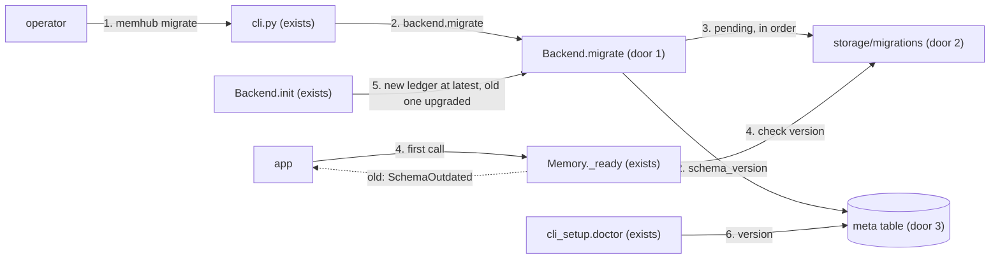
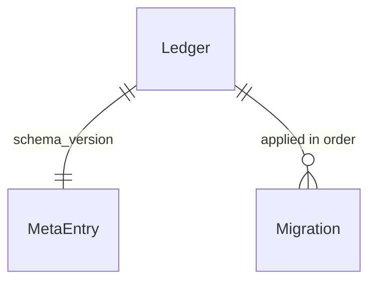
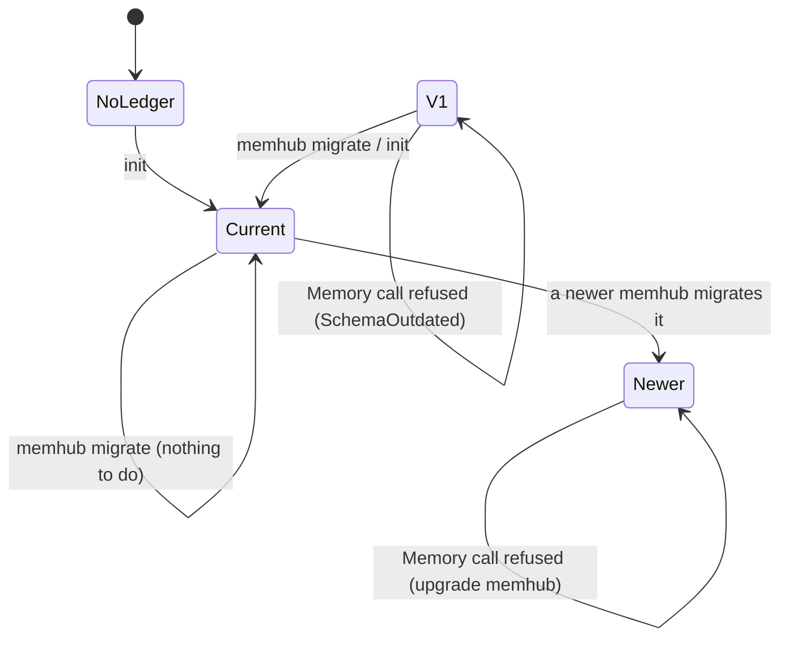

# Schema version and migrations (PR 6 of #1)

**Approved**: 2026-11-11 - user: "Once plan is writen, you auto-approve and manage all tickets until they are closed."

## Problem

A memhub database does not say which version of the schema it holds. A ledger created by v0.1.0 has no
`run_id` and `agent_id` columns; the code of today writes them whenever an app passes those ids, so the first
`Memory.add(...)` on such a ledger fails in the middle of a request with a database error about a missing
column (`store.add_memory` only leaves the columns out "when not given"). The only upgrade path is `init`,
which silently alters tables as a side effect of "create the tables", and nothing tells an operator that an
upgrade is needed, was done, or what it changed. R14: "Schema version stored in the database; `memhub migrate`
upgrades; `Memory` refuses an old schema with a clear message".

When this ships, every ledger carries its schema version; a `Memory` on an older ledger refuses the first call
with a message naming `memhub migrate`; `memhub migrate` upgrades it and says what it applied; `memhub doctor`
reports the version.

## Shape

This reuses the `meta` key/value table every backend already has (`uow.meta.get_meta` / `set_meta`) for the
version, and the backends' own transactions for applying a migration; no migration framework is added. The
rules that change an outcome - which migrations are pending, in which order, and what `Memory` refuses - live
in `storage/migrations/__init__.py` and `Memory._ready`, reachable from pytest: on SQLite and the in-memory backend with
no Docker, on Postgres with the existing Docker fixture.

1. operator runs `memhub migrate` -> `cli.py` (exists) - resolves the config, builds the backend, calls `backend.migrate()`, prints what was applied
2. `Backend.migrate()` (door 1; Postgres, SQLite, in-memory) - one transaction: reads the ledger's version, applies each pending migration of `storage/migrations/<backend>/` in number order (door 2), stores the new version in meta key `schema_version` (door 3)
3. `storage/migrations` (door 2) - `SCHEMA_VERSION`, the numbered files per backend, `pending(backend, current)`, and `check(version)` raising `SchemaOutdated`
4. app builds `Memory(...)` and makes a call -> `Memory._ready` (exists) - reads the version once per instance and calls `check`; an old ledger raises before any other read or write
5. `Backend.init()` (exists) - creates a new ledger at `SCHEMA_VERSION`; on an existing ledger it applies the pending migrations, as `init` has always upgraded (AD-002)
6. out: `cli_setup.doctor` (exists) prints the version and fails when it is not current; every other CLI command refuses an old ledger with the same message

**Changes underneath**

| Front | What changes |
| --- | --- |
| domain | "the ledger exists" meant "the `embedding` meta row is there"; a usable ledger is now also one whose `schema_version` equals `SCHEMA_VERSION` - `Memory._ready` and the CLI's `_service` branch on it |
| domain | Postgres `ADDED_COLUMNS` no longer lists `run_id` / `agent_id`: they are migration 2; `init` still ends with them present |
| stored data | migrate on demand: a ledger with no `schema_version` key is version 1; `memhub migrate` (or `init`) brings it to 2 and writes the key; a SQLite or in-memory ledger made before this change already has the columns and only gains the key |
| readers | `memhub doctor` shows the version (AD-009); every command built on `_service` refuses an old ledger; `memhub init` and `memhub migrate` are the two that accept one |

New: the meta entry `schema_version`. One-way constraints: the key name and its integer value (door 3), the
numbering of the migration files (door 2).

## Surface

None - no route. The new command `memhub migrate [-c FILE] [--dry-run]` is consumed by people at a terminal; its
output lines and exit codes (0: applied, nothing pending, or a dry run; 1: no ledger, a newer ledger, or a failed
migration, with nothing applied and the reason on stderr) are criteria 12 to 14. Who may run it: whoever holds the
config's database credentials.

## Landing

| One-way door | Literal shape | Alternative rejected |
| --- | --- | --- |
| 1. The backend port | `Backend.schema_version() -> int \| None` (`None`: no ledger; a ledger with no `schema_version` key is `1`) and `Backend.migrate(*, dry_run: bool = False) -> list[str]` (the names applied, or pending with `dry_run`), on `MemoryStore`, `SqliteBackend` and `InMemoryBackend`; `Memory.migrate()` forwards to it | a `meta` repository method - `METHODS` is pinned by PR 3's contract (37 methods mirroring `MemoryStore`), and a migration must run outside a caller's unit of work |
| 2. Migration files and numbering | `memhub/storage/migrations/<backend>/NNNN_<name>.sql`, `<backend>` in `postgres`, `sqlite`; `NNNN` is the schema version the file produces, starting at `0002`; `{prefix}` stands for the table prefix; statements split on `;`; every backend has a file for every version (a comment-only file when it has nothing to change); `SCHEMA_VERSION = 2`; version 1 is the v0.1.0 schema | Alembic - a new dependency and an `alembic_version` table for three tables; Python migration functions - not "numbered SQL per backend" (TDD) |
| 3. Where the version lives | meta row `key = 'schema_version'`, value the JSON integer; written by `init` and `migrate` in the transaction that changes the schema | a `PRAGMA user_version` / a Postgres comment - one place per backend instead of the meta table all three share |
| 4. The refusal | `class SchemaOutdated(StoreError)`; older: `the ledger is at schema version 1 and this memhub needs 2: run \`memhub migrate\``; newer: `the ledger is at schema version 3, newer than this memhub (2): upgrade memhub`; exported from `memhub` | a warning and carrying on - the failure it prevents happens mid-run, on the first write |

- Nothing else in this change is hard to reverse

## Criteria

### S1: A ledger knows its version (P1)

**Acceptance Criteria**

1. WHEN `init()` creates a ledger on Postgres, SQLite or the in-memory backend THEN `backend.schema_version()` SHALL be `2` and meta `schema_version` SHALL hold `2`; on a database with no ledger `schema_version()` SHALL be `None`
2. WHEN a ledger has tables and no `schema_version` key THEN `schema_version()` SHALL be `1`
   - a Postgres database built by v0.1.0's DDL -> 1; a SQLite file whose `schema_version` row was deleted -> 1
3. The system SHALL make `pending(backend, current)` return the migrations numbered above `current`, in ascending order, and every backend directory SHALL hold exactly the versions `2..SCHEMA_VERSION` with no gap and no duplicate
   - current 1 -> [2]; current 2 -> []; current None -> raises (no ledger)

### S2: An old ledger is refused, then upgraded (P1)

**Acceptance Criteria**

4. IF a `Memory` call reaches a ledger whose version is below `SCHEMA_VERSION` THEN it SHALL raise `SchemaOutdated` whose message is exactly ``the ledger is at schema version 1 and this memhub needs 2: run `memhub migrate` ``, before any other read or write, on every method (`add`, `search`, `get_all`, `queue`)
5. IF the ledger's version is above `SCHEMA_VERSION` THEN the call SHALL raise `SchemaOutdated` whose message is exactly `the ledger is at schema version 3, newer than this memhub (2): upgrade memhub`, and `migrate()` SHALL raise the same without changing anything
6. WHEN `migrate()` runs on a version-1 Postgres ledger THEN the memory table SHALL gain nullable `run_id` and `agent_id` columns, every existing row SHALL keep its values with both new columns `NULL`, `schema_version` SHALL be `2`, and `migrate()` SHALL return `["0002_run_and_agent_ids"]`
7. WHEN `migrate()` runs on a current ledger THEN it SHALL return `[]` and change nothing; WHEN it runs twice in a row THEN the second SHALL return `[]`
8. IF a migration statement fails THEN no statement of that run SHALL stay applied and `schema_version` SHALL keep its old value (one transaction)
9. WHEN two `migrate()` calls start together on Postgres THEN both SHALL return without error and the migration SHALL be applied once (a transaction-level advisory lock)
10. WHEN `init()` runs on a version-1 ledger THEN it SHALL leave it at version 2 with the migrations applied, as `init` upgraded a ledger before this change (AD-002)
11. IF `migrate()` runs where no ledger exists THEN it SHALL raise `EmbeddingMismatch` naming `init()`, and create nothing

### S3: The CLI (P1)

**Acceptance Criteria**

12. WHEN `memhub migrate` runs on a version-1 ledger THEN it SHALL print `applied 0002_run_and_agent_ids` and `schema version 1 -> 2` and exit 0; on a current ledger it SHALL print `already at schema version 2` and exit 0
13. WHEN `memhub migrate --dry-run` runs on a version-1 ledger THEN it SHALL print `pending 0002_run_and_agent_ids`, exit 0 and leave the version at 1
14. IF `memhub migrate` runs with no ledger, or on a ledger newer than this memhub THEN it SHALL exit 1 with the reason on stderr
15. IF any other ledger command (`search`, `add`, `queue`, `ingest`, ...) runs on a version-1 ledger THEN it SHALL exit 1 and print the `SchemaOutdated` message naming `memhub migrate`
16. WHEN `memhub doctor` runs THEN it SHALL print the schema version: `ok` with `2` on a current ledger; a failed check naming `memhub migrate` and exit 1 on a version-1 ledger

### S4: The demo (P1)

**Acceptance Criteria**

17. WHEN a Postgres database created by v0.1.0 (its DDL and one memory row, `tests/data/v0_1_0_ledger.sql`) is opened THEN `Memory.search` SHALL raise `SchemaOutdated`; WHEN `memhub migrate` has run THEN `Memory.add` with a `run_id` and `Memory.search` SHALL work and the v0.1.0 row SHALL still be found (`tests/e2e/test_pr6_migrate.py`)
18. The full existing suite SHALL stay green (N1), and the docs (`README` commands, `docs/integration.md`) SHALL describe `memhub migrate` and the refusal

## Out of scope

| Excluded | Why |
| --- | --- |
| Downgrades | no consumer; a ledger newer than the code is refused with "upgrade memhub" |
| Migrating data between backends (Postgres <-> SQLite) | a new capability, not in the issue |
| A lock for concurrent `migrate` on SQLite beyond `BEGIN IMMEDIATE` | SQLite has one writer; the second waits and finds nothing pending |
| Auto-migrating on `Memory(...)` or on the first call | R14 says refuse; a schema change must be an operator's decision |
| The per-type `schema_version` column of a memory row | it versions a type's payload, not the tables; unchanged |

## Assumptions

| Assumption | Chosen default | Rationale | Confirmed? |
| --- | --- | --- | --- |
| What version 1 is | the v0.1.0 schema (tag `0.1.0`): no `run_id`, `agent_id`; a ledger with no `schema_version` key is version 1 | the issue's demo: "a database created by v0.1.0" | n |
| `init()` on an old ledger | upgrades it (applies pending migrations) | AD-002 and the existing tests `test_init_upgrades_*` (N1); `migrate` is the explicit path, `init` stays idempotent | n |
| SQLite and in-memory ledgers made before this change | version 1 by the missing key; migration 2 is a comment-only file for them and only writes the key | they already have the columns; one rule ("no key = 1") for every backend | n |
| `--dry-run` | offered | cheap, and an operator wants to see what will run on a production database | n |
| Who may migrate | whoever holds the database credentials; no memhub role check | the CLI acts with the config's connection; roles are trusted from the caller (D6) | n |

**Open questions:** none - all resolved or logged above.

## Differences from the source

None - the product matches the source

## Sources

- Issue #7 "PR 6 - Schema version and migrations" - binding - Delivers, Files, Acceptance
- PRD + TDD, R14 and *PR-by-PR changes* row 6 (https://app.notion.com/p/jooaobrum/memhub-Pluggable-memory-package-Integration-41517e87bbcc802eab1ac766dd797a07, read 2026-11-11) - binding - version in meta, `memhub migrate`, numbered SQL per backend, refusal
- `.specs/STATE.md` AD-002, AD-009 - binding - `init` is explicit and idempotent; doctor gains the schema version in PR 6
