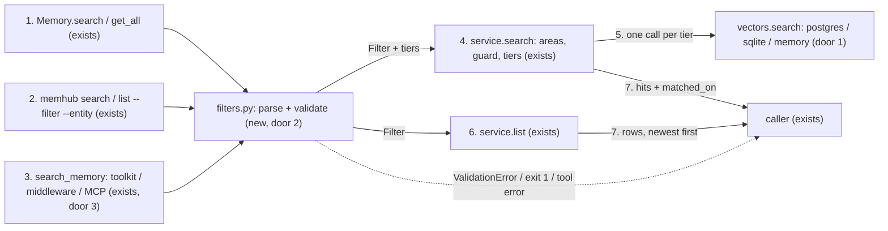
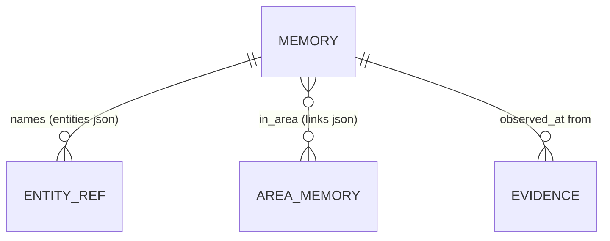

# Search filters: AND / OR / NOT, in, contains and prefix on subjects, areas, types and time

**Approved**: 2026-11-14 - user: "Ok let's implement it. Once this is finished, open a PR to main"

## Problem

`filters=` on `Memory.search` and `Memory.get_all` accepts three keys (`entities`, `entity_type`, `types`), and a subject id matches only exactly (`Memory._filters`, `src/memhub/memory.py:313`). Common questions therefore need work in the app, or get a wrong answer with no error:

- "Everything under `PRD_`" (machines `PRD_1`, `PRD_2`, ...): `{"type": "machine", "id": "PRD_"}` is taken as a literal id and returns nothing.
- "About `PRD_1` **and** `PRD_2`": `entities: [a, b]` always means *any of*, never *all of*.
- "Machine X, in area Y, observed since last month": areas, time and text cannot be filtered through `filters` at all.
- The filter is reachable from Python only. `memhub search`, `memhub list`, `MemoryToolkit`, `MemoryMiddleware` and the MCP server take none (`docs/subjects.md`, "What subjects do not do"), so an agent cannot narrow its own search by subject, area or type.
- `search` and `get_all` read the same filter differently: `search` ignores `entity_type` next to `entities`, while `get_all` requires both (AD-051).

Who pays: every project with many similar subjects (maintenance, support, software), and every agent that reaches memhub through a tool rather than Python. Evidence: issue #25, and mem0, whose search has this shape of filter (`AND` / `OR`, `in`, `contains`, time ranges) where memhub's does not.

When this ships, one filter grammar (today's keys plus operators and `AND` / `OR` / `NOT`) narrows `search` and `get_all` by subject, subject type, memory type, area, time and text. It returns the same rows on Postgres, SQLite and in-memory, and works the same from Python, the CLI, the toolkit, the middleware and MCP. Every filter written today keeps its result, apart from the AD-051 fix.

## Shape

This reuses today's `filters=` keys, the tiered `service.search` with `matched_on` (AD-030), the `require_filter` guard (AD-033), the `entities` and `links` columns every backend already stores, `_find_area`'s key-or-title matching, and the storage contract suite. Nothing is added to the schema. The rules that change an outcome run in one parser (validation, AD-047 to AD-051), in `service.search` / `service.list` (tiers, guard, area resolution) and in each backend's `vectors.search` (the filter in the query). The contract suite reaches all three backends with no model.

1. `filters` dict enters `Memory.search` / `Memory.get_all` (exists) -> `memhub/filters.py` (new, door 2) parses and validates it against the settings' declared entity types. It raises `ValidationError` before any database or model call, and hands on a `Filter` tree plus its top-level tiers.
2. `--filter '<json>'` / `--entity type:id` enter `memhub search` and `memhub list` in `cli.py` (exists) -> the same parser -> `service.search` / `service.list` (exists). An invalid filter exits 1.
3. `filters` enters the `search_memory` tool of `MemoryToolkit`, `MemoryMiddleware` (AD-048) and `memhub mcp` (exists, door 3) -> the same parser -> `service.search`. An invalid filter becomes the tool's error result, not an exception.
4. `service.search` (exists) resolves `areas` refs to the caller's area memory ids (user and workspace owners). It adds the `require_filter` guard for every guarded type no positive branch names, then builds the tiers: one per top-level `entities` item in order, else one tier for the whole filter, and `general` last when `widen=True` (AD-047). Every other top-level key is ANDed into each tier (AD-051).
5. `vectors.search` on Postgres, SQLite (sqlite-vec and fallback) and in-memory (exists, door 1) applies the `Filter` inside the nearest-neighbour query, so `top_k` is filled from matching rows only.
6. `service.list` (exists) keeps the rows `Filter.matches` accepts, with the same area resolution, so `get_all` and `memhub list` share the grammar.
7. out: hits with `matched_on` (`"machine:PRD_2"`, `"general"`) whenever the filter has an entity predicate. `get_all` and `memhub list` return rows newest first, as today.

**Changes underneath**

| Front | What changes |
| --- | --- |
| domain | `filters["entities"]` meant "a list of exact `{type, id}`, any of". It now also takes one item, and an item's `id` may be `{"in" / "prefix" / "contains": ...}`; a list stays any-of, one tier per item. Today's readers: `Memory._filters` / `_subjects`, `service._subject_tiers`, `service.list` |
| domain | `EntityFilter` (`storage/rules.py`) is the only filter a backend understands today. A `Filter` tree now carries the search and list filters. The reconcile isolation path (`top_similar(entities=EntityFilter)`, `pipeline/reconcile.py`) keeps today's filter and results; no reconcile rule changes |
| domain | `search` with top-level `entities` and `entity_type` now requires both, as `get_all` already does (AD-051) |
| stored data | nothing to migrate: `entities`, `links`, `content`, `observed_at`, `valid_until` and `type` are read as stored |
| readers | `Memory.search` / `get_all`, `memhub search` / `list`, the three `search_memory` tools, `docs/subjects.md` ("take no filter yet" goes away) and a filter reference in the docs. Tool schemas change (door 3), so a model sees the new argument |

New: nothing - read only. No column, index or migration is added (the Postgres GIN index on `entities` keeps serving the exact-id case).

## Surface

Python API, CLI and agent tools; there is no HTTP route. The codes in Status only name each outcome class so that checks.md can join them, as in the review-edit plan: 200 ok, 422 `ValidationError` (a bad filter, before any database or model call) or a tool's error result, 404 another owner's memories (another user's user-scope rows, another workspace's rows), which no filter returns: they are absent from the result, as today. For the CLI they map to exit 0 (200) and exit 1 (422).

| Route | In | Out | Status | Who |
| --- | --- | --- | --- | --- |
| `Memory.search(query, ..., filters=, widen=)` | `filters`: the grammar below; `widen` as today | hits, each with `matched_on` when the filter has an entity predicate | 200; 422 `ValidationError` for a bad filter, before any database or model call; 404 another owner's rows absent | any caller with `workspace_id`, `user_id`, `run_id` (AD-001); sees only its user rows and the workspace's |
| `Memory.get_all(..., filters=)` | `filters`: the grammar | rows newest first | 200; 422 `ValidationError` as `search`; 404 as `search` | as above |
| `memhub search QUERY [--filter JSON] [--entity TYPE:ID ...]` | `--filter` the grammar as JSON; `--entity` repeatable, in order, becomes top-level `entities` | JSON rows on stdout | 200 = exit 0; 422 = exit 1 with the reason on stderr for bad JSON or a bad filter; 404 as `Memory.search` | the CLI user, `--ws` / `--user` / `memhub use` as today |
| `memhub list [--filter JSON] [--entity TYPE:ID ...]` | as above | JSON rows | 200 = exit 0; 422 = exit 1, as `search`; 404 as `Memory.get_all` | as above |
| tool `search_memory(query, type?, filters?)` in `MemoryToolkit`, `MemoryMiddleware`, `memhub mcp` | `filters`: an object, or its JSON text | as today; `{"error": "<reason>"}` (toolkit, MCP) / `invalid filters: <reason>` (middleware) for a bad filter | 200; 422 `{"error"}` (toolkit, MCP) / `invalid filters: ...` (middleware) for a bad filter, never an exception; 404 as `Memory.search` | the agent, under the toolkit's / middleware's / server's workspace and user |

Grammar (top-level keys are ANDed; `AND` / `OR` take a non-empty list of filters, `NOT` one filter):

| Field | Forms |
| --- | --- |
| `entities` | `{"type", "id"}` or a list of them (any of, one tier each); `id` is a string (exact) or `{"in": [..]}`, `{"prefix": ".."}`, `{"contains": ".."}`, case-sensitive |
| `entity_type` | `"line"` or `{"in": [..]}` |
| `types` | a list of memory types, as today |
| `areas` | `"bearings"` or `{"in": [..]}`, an area key or title, case-insensitive |
| `observed_at`, `valid_until` | `{"gte": .., "lte": ..}`, one or both, ISO date or datetime (date = whole UTC day, AD-049; null `valid_until` = never expires, AD-050) |
| `content` | `{"contains": ".."}`, case-insensitive substring |

## Landing

| One-way door | Literal shape | Alternative rejected |
| --- | --- | --- |
| 1. Filters run inside each backend's nearest-neighbour query | `vectors.search(..., filter: Filter \| None)` on every backend; `Filter.matches(row)` is the reference the in-memory backend and `service.list` use, and the contract suite holds Postgres and SQLite to it | Filter in Python after the vector search: the backends fetch `max(k*4, 20)` nearest rows, so a narrow filter (one machine among thousands) returns fewer than `top_k`, or nothing, while matches exist |
| 2. The filter grammar is a public contract | the keys and operators in `## Surface`, parsed only in `memhub/filters.py`; today's three keys keep their meaning | mem0's exact shape (`{"user_id": ..., "metadata": {...}}`, operators `eq`/`ne`/`gt`/...): it would rename today's keys and break every existing `filters=` call |
| 3. `search_memory` tool schemas gain `filters` | toolkit spec `"filters": {"type": "object", "description": "<grammar summary with one example>"}`, MCP `filters: Optional[dict]`, middleware `filters: dict \| None = None` | A separate `filter_memory` tool: two tools for one question, and the model must learn which to call |

- Nothing else in this change is hard to reverse

## Criteria

### S1: one grammar, the same rows on every backend (P1)

The new operators and combinators narrow `Memory.search` and `Memory.get_all`, and Postgres, SQLite (with and without sqlite-vec) and in-memory return the same rows for each contract case.

**Acceptance Criteria**

1. WHEN `Memory.search` or `Memory.get_all` gets `filters={"entities": {"type": "machine", "id": {"prefix": "PRD_"}}}` THEN the system SHALL return the memories naming `machine:PRD_1`, `machine:PRD_2` and `machine:PRD_3`, and none naming only `machine:LINE_1`
   - `PRD_1` → kept; `PRD_10` → kept; `PRDX1` → not kept (`_` is a literal character, not a wildcard); `prd_1` → not kept (case-sensitive)
2. WHEN an `entities` item has `id: {"in": ["PRD_1", "PRD_2"]}` THEN the system SHALL keep memories naming either id and no other
   - `PRD_1` → kept; `PRD_3` → not kept
3. WHEN an `entities` item has `id: {"contains": "D_1"}` THEN the system SHALL keep memories naming an id of that type holding that substring, case-sensitive
   - `PRD_1` → kept; `PRD_12` → kept; `prd_1` → not kept
4. WHEN `filters={"AND": [{"entities": [PRD_1]}, {"entities": [PRD_2]}]}` THEN the system SHALL return only the memory that names both, and not the memories naming only one
5. WHEN `filters={"OR": [{"entities": [PRD_1]}, {"entity_type": "line"}]}` THEN the system SHALL return the memories naming `PRD_1` and the memories naming any `line`, each once
6. WHEN `filters={"NOT": {"entities": [PRD_1]}}` THEN the system SHALL return the visible memories that do not name `PRD_1`, untagged memories included
7. WHEN `filters={"entity_type": {"in": ["machine", "line"]}}` THEN the system SHALL keep the memories naming any subject of either type
8. WHEN `filters={"areas": "Bearings"}` or `{"areas": {"in": ["bearings", "lubrication"]}}` THEN the system SHALL keep the memories linked (`in_area`) to an area of the caller (its user areas or the workspace's) whose key or title equals one of the values, ignoring case
   - area key `bearings` with filter `"Bearings"` → kept; area title `Bearings & seals` with filter `"bearings"` → not kept (whole key or title, not a substring); a value naming no area → no memories, no error
9. WHEN `filters={"observed_at": {"gte": "2026-10-01", "lte": "2026-10-31"}}` THEN the system SHALL keep the memories observed from 2026-10-01T00:00Z up to, not including, 2026-11-01T00:00Z (AD-049)
   - observed 2026-10-31T15:00Z → kept; 2026-11-01T00:00Z → not kept; 2026-09-30T23:59Z → not kept; `{"gte": "2026-10-01T12:00:00+00:00"}` and a row at 11:59Z → not kept
10. WHEN `filters={"valid_until": {"gte": "2026-12-01"}}` THEN the system SHALL keep the memories whose `valid_until` is on or after that day or is null (AD-050), and `{"valid_until": {"lte": "2026-12-01"}}` SHALL keep no memory whose `valid_until` is null
11. WHEN `filters={"content": {"contains": "e47"}}` THEN the system SHALL keep the memories whose content holds that text, ignoring case, on every backend
    - content `Error E47 on start` → kept; content `Ölpumpe defekt` with `{"contains": "ölpumpe"}` → kept (non-ASCII); `{"contains": "50%"}` and content `500 rpm` → not kept (`%` is literal)
12. IF a filter compares a null field THEN the comparison SHALL be false and its `NOT` SHALL be true, on every backend
    - `{"NOT": {"valid_until": {"lte": "2026-12-01"}}}` and a row with null `valid_until` → kept
13. The system SHALL return the same rows, in the same order for `get_all`, on Postgres, SQLite with sqlite-vec, SQLite without it, and in-memory for criteria 1 to 12 and 15, proven by contract cases in `storage/contract.py`
14. WHEN `search` gets a filter that matches fewer rows than the nearest `max(k*4, 20)` of the owner THEN the system SHALL still return up to `top_k` matching rows (door 1)
    - 30 nearer memories about `LINE_1` and 2 about `PRD_1`, `top_k=5`, prefix `PRD_` → both `PRD_1` memories returned

15. IF a filter would match memories outside the caller's user rows and its workspace's rows (`NOT`, `OR`, an `areas` value naming another user's area, an `entities` prefix shared by another user's rows) THEN the system SHALL not return them, on every backend and through every entry point
    - user `bob`'s user memory naming `PRD_1`, caller `alice`, `{"NOT": {"entities": [LINE_1]}}` → not returned; workspace `w2`'s memory, caller in `w1` → not returned

### S2: today's filters keep their result, and the grammar fails early (P1)

Every `filters=` written today keeps its answer, apart from AD-051. A bad filter is refused before any database or model work, with a message naming what is wrong.

**Acceptance Criteria**

16. The system SHALL return for every `filters=` call made by today's tests exactly the rows and `matched_on` values it returns before this change, with the test files' assertions unchanged, except the AD-051 case
17. WHEN `search(filters={"entities": [a], "entity_type": "line"})` runs THEN the system SHALL keep only memories naming `a` and a `line`, as `get_all` does (AD-051)
18. WHEN a filter uses only today's keys with exact ids THEN the Postgres backend SHALL issue the same SQL as before, and `tests/test_search_sql.py` (AD-014) SHALL pass unchanged
19. IF `filters` holds an unknown key, an unknown operator, an operator on a field that does not take it, an undeclared entity type, an empty `AND` / `OR` / `in`, an empty `prefix` / `contains`, more than one operator on an `id`, a `NOT` whose value is not one filter, or a date that is not ISO 8601 THEN `Memory.search` and `Memory.get_all` SHALL raise `ValidationError` naming the key or value, before any database or model call
    - `{"tags": "x"}` → names `tags` and lists the allowed keys; `{"areas": {"prefix": "b"}}` → names `prefix` and `areas`; `{"types": {"in": ["fact"]}}` → error; `{"observed_at": {"gte": "last month"}}` → names the value; `{"OR": []}` → error; `{"entities": {"type": "machine", "id": {"in": ["a"], "prefix": "b"}}}` → error
20. IF `types` is given both as a parameter and in `filters` THEN the system SHALL raise `ValidationError` as today

### S3: tiers, widen and the guard with the new grammar (P1)

Subject tiers keep their order and `matched_on` says what each hit matched.

**Acceptance Criteria**

21. WHEN top-level `entities` is a list THEN `search` SHALL run one tier per item in the order given (AD-030), an operator item included, and every other top-level key SHALL apply to each tier
    - `{"entities": [{"type": "machine", "id": {"prefix": "PRD_"}}, LINE_1], "areas": "bearings"}` → `PRD_*` memories in bearings first, then `LINE_1` memories in bearings
22. WHEN a hit comes from an operator tier, or from a filter whose entity predicates sit under `AND` / `OR` THEN its `matched_on` SHALL be `"<type>:<id>"` of the first entity in the row's `entities` that a positive entity predicate of the filter matches
    - row entities `[line:L1, machine:PRD_2]`, prefix `PRD_` → `matched_on == "machine:PRD_2"`
23. WHEN the filter has no entity predicate THEN hits SHALL carry no `matched_on`, as today for `{"types": [...]}`
24. WHEN `widen=True` and the filter has a top-level `entities` THEN `search` SHALL add the `general` tier last, holding rows about no isolated subject that match every other top-level key (AD-047)
    - `{"entities": [PRD_1], "content": {"contains": "pump"}}, widen=True` → a general memory about pumps is returned, a general memory about fans is not
25. IF `widen=True` and the filter has no top-level `entities`, or has `AND` / `OR` / `NOT` at the top level THEN `search` SHALL raise `ValidationError` before any database call (AD-047)
26. WHILE a type is marked `require_filter: true`, WHEN the filter names that type only inside a `NOT` THEN `search` SHALL return none of its tagged memories; WHEN a positive branch names it (an `entities` item, `entity_type` or its `in`) THEN its memories SHALL be returned
    - guarded `patient`: `{"NOT": {"entities": [patient:p1]}}` → no patient memories; `{"OR": [{"entities": [patient:p1]}, {"types": ["fact"]}]}` → p1's memories can be returned, never p2's (AD-052: a guarded memory comes back only for the subject a positive part names; `entity_type: patient` names every patient)

### S4: the CLI, the tools and MCP take the same filter (P1)

An agent or a person at the terminal narrows a search the way Python does.

**Acceptance Criteria**

27. WHEN a user runs `memhub search "vibration" --filter '{"entities": {"type": "machine", "id": {"prefix": "PRD_"}}}'` THEN the CLI SHALL print the same hits as `Memory.search` with that filter, as JSON on stdout, exit 0
28. WHEN a user runs `memhub list --entity machine:PRD_1 --entity machine:PRD_2` THEN the CLI SHALL list the memories naming either, as with `filters={"entities": [PRD_1, PRD_2]}`; `memhub search` with the same flags SHALL rank them in that order
29. IF `--filter` is not valid JSON, the filter is invalid, `--entity` has no `:`, or `--entity` is given with a `--filter` that has a top-level `entities` THEN the CLI SHALL print the reason on stderr and exit 1, printing nothing on stdout
30. WHEN the model calls `search_memory` with `filters` (an object or its JSON text) through `MemoryToolkit.call`, `MemoryMiddleware` or `memhub mcp` THEN the tool SHALL return the hits `service.search` returns for that filter
31. IF the model's `filters` is invalid THEN the toolkit and MCP tool SHALL return `{"error": "<reason>"}`, and the middleware tool `invalid filters: <reason>`, with no database call and no exception
32. WHEN the toolkit, middleware, MCP server or CLI searches with no filter THEN it SHALL never return a memory tagged with a `require_filter` type (AD-033 unchanged)
33. The tool specs (`MemoryToolkit.tool_specs`, the MCP tool and the middleware tool) SHALL declare `filters` as optional, with a description holding the grammar's keys and one example
34. WHEN this ships THEN `docs/subjects.md` SHALL no longer say the toolkit, middleware, CLI and MCP take no filter, and the docs SHALL hold a filter reference listing every key and operator of `## Surface` with one example each

## Out of scope

| Excluded | Why |
| --- | --- |
| Filters on payload fields of a type | issue #25: can follow once the grammar exists |
| Relations between subjects | memhub stores none; the caller passes the widening order (AD-030) |
| Any change to reconcile isolation | issue #25: this is about reading only |
| `--widen` on `memhub search` | not asked in #25; Python keeps `widen=` |
| Filtering the `queue` / review calls | `queue` takes no `filters` today and #25 does not ask for it |
| Keyword / hybrid matching beyond `contains` | issue #26 |
| A size or depth limit on a filter | no evidence of abuse; a single owner's rows bound the cost |

## Assumptions

| Assumption | Chosen default | Rationale | Confirmed? |
| --- | --- | --- | --- |
| How `widen=True` combines with the grammar | top-level `entities` only; other top-level keys apply to every tier; `AND` / `OR` / `NOT` at top level + widen → `ValidationError` | user chose "Top-level entities only (Recommended)" - AD-047 | y |
| Middleware gets `filters` although #30 moves it out | yes, same argument as toolkit and MCP | user chose "Yes, add it (Recommended)" - AD-048 | y |
| Date-only `lte` | the whole UTC day is kept | user chose "Kept: whole day (Recommended)" - AD-049 | y |
| Null `valid_until` | never expires: matches every `gte`, no `lte` | user chose "Null = never expires (Recommended)" - AD-050 | y |
| `entities` + `entity_type` at top level in `search` | ANDed, as `get_all`; the one change to an existing result | user chose "AND both, fix search (Recommended)" - AD-051 | y |
| Case of id operators | `prefix`, `contains`, `in` on ids are case-sensitive | ids are canonical ("pass canonical ids", `docs/subjects.md`) | n |
| An `areas` value that names no area | matches nothing, no error | areas are data (learnt or listed), and a model may guess a name; a search should not fail on it | n |
| A naive datetime in a time bound | read as UTC | `observed_at` is stored as UTC on every backend | n |
| `filters` in a tool as a JSON string | parsed as JSON, as `MemoryToolkit.call` already does for its arguments | models often stringify nested objects | n |
| `matched_on` for a nested filter | the first row entity a positive entity predicate matches | issue #25 proposal; gives one stable label per hit | n |
| Where the filter reference lives | a section or page linked from `docs/subjects.md`; placement is the builder's | #25 asks for "a short filter reference" | n |

**Open questions:** none - all resolved or logged above.

## Differences from the source

None - the product matches the source. The one change to an existing result (AD-051) is a decision recorded in STATE.md, not a departure from issue #25.

## Sources

- GitHub issue #25 "Search filters: AND / OR, in, contains and prefix on subjects, areas, types and time" - binding - problem, grammar, scope and acceptance
- Notion "memhub - Pluggable memory package - Integration" (PRD + TDD, read 2026-11-13) - binding - R5 (existing entry points keep working), N1, N4 / AD-014, the contract-suite strategy; updated with this feature's requirements
- `.specs/STATE.md` AD-030, AD-033, AD-047 to AD-051 - binding - tiers, guard and the answers above
- mem0 search filters - non-binding - user: "mem0 offers this shape of filter" (issue #25) - informs the operator set
