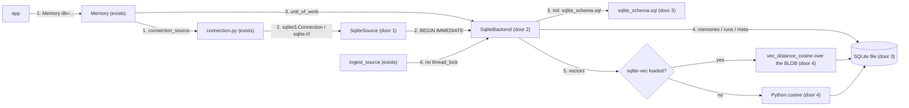
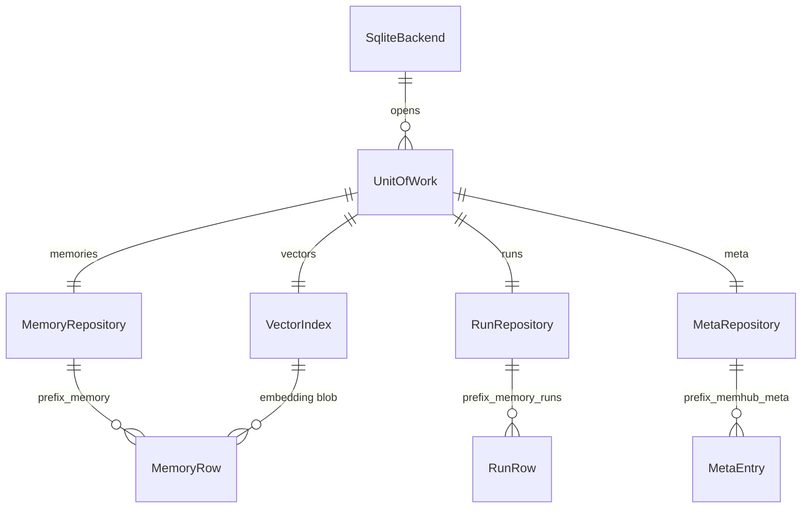

# SQLite backend (PR 4 of #1)

**Approved**: 2026-11-11 - user: "Once plan is writen, you auto-approve and manage all tickets until they are closed."

## Problem

memhub runs only on Postgres with pgvector. Someone who wants to try it, run it on a laptop, or test
an app that adopts it needs Docker and a pgvector container first; the PRD's user row "Developer
testing locally: Postgres + pgvector required" and its success criterion "A full local run (init,
ingest, review, search) works on SQLite with no Docker" say so. Today `connection.py` answers a
`sqlite3.Connection` or a `sqlite:///` URL with `NotImplementedError("the sqlite backend is not
available yet ...")`. PR 3 (`feat/storage-ports`) put every ledger call behind `UnitOfWork`, so a second
database now means one more implementation of the same four repositories, not a new copy of every caller.

When this ships, `memhub init --db sqlite:///m.db`, ingest, review and search run on one local file with
nothing to install beyond `pip install memhub`; `memhub[sqlite]` makes vector search fast. What SQLite cannot
do says which capability is missing and how to fix it.

## Shape

This reuses the PR 3 ports (`Backend`, `UnitOfWork`, `METHODS`, `require`), the backend-neutral
`storage/rules.py` (row columns, `apply_boosts`, errors) and the contract suite in `storage/contract.py`:
`SqliteBackend` implements the same repository methods as `MemoryStore`, in SQLite SQL. The rules that change
an outcome (which rows search returns, ordering, boosts, uniqueness of active rows, rollback) live in the
repository methods and are proven by that same contract suite plus fake-model ingest, all reachable from pytest
with no Docker.

1. app calls `Memory(db=<sqlite3.Connection | "sqlite:///path" | "sqlite:///:memory:">)` -> `open_backend` (exists, PR 3) -> `connection_source` (exists) - detects SQLite by type or scheme and returns a `SqliteSource` (door 1) instead of the `NotImplementedError` of today
2. `SqliteSource` (door 1) - hands out a connection for one transaction: a `sqlite3.Connection` the app gave is borrowed and never closed; a URL is opened per transaction and closed after, except `:memory:`, which keeps one connection for the life of the backend; each transaction starts `BEGIN IMMEDIATE`
3. `SqliteBackend` (door 2, `storage/sqlite.py`) - `name = "sqlite"`; `unit_of_work()` yields the four repositories on that connection; `init()` runs `sqlite_schema.sql` (door 3); the vector path (door 4) is chosen once, when the backend is built, on a scratch in-memory connection
4. `memories`, `runs`, `meta` repositories (door 2) - today's `MemoryStore` methods in SQLite SQL: JSON columns as text, queried with `json_each`; uuids as text and timestamps as ISO text, converted back to `uuid.UUID` and aware `datetime` on the way out so rows match Postgres rows key for key
5. `vectors` (door 4) - `search`, `top_similar`, `nearest_area`: with sqlite-vec, `vec_distance_cosine` over the `embedding` BLOB in SQL; otherwise the owner's candidate rows are loaded and ranked by cosine in Python; both feed `apply_boosts` so order matches Postgres
6. `ingest_source` (exists) - `thread_lock` is not called when the backend lacks `parallel_ingest` (AD-016); one worker is assumed
7. out: the same rows to `Memory` / `MemoryService`, unchanged callers

**Changes underneath**

| Front | What changes |
| --- | --- |
| domain | `Capability` set for SQLite: `transactions`, `vector_search`, `json_lookup` present; `parallel_ingest`, `schemas` absent. `thread_lock` on SQLite raises the capability error; `ingest_source` now asks the backend before locking (today it always locks) |
| domain | `connection_source(db)` meant "psycopg things only; SQLite is not available yet", now also returns a SQLite source; `FactorySource` accepts a callable returning a `sqlite3.Connection` instead of raising |
| stored data | nothing to migrate: SQLite is new; Postgres tables and SQL unchanged |
| readers | `Memory`, `MemoryService`, `MemoryMiddleware`, `MemoryToolkit` and the CLI go through `UnitOfWork` and see no change; the CLI builds the SQLite backend from `database_url: sqlite:///...` / `memhub init --db` (PR 2) |

New: the same three tables in SQLite; no extra vector table. One-way constraints: an active row
is unique per `memory_id` and per keyed slot (door 3, partial unique indexes as in Postgres).

## Surface

None - no route. The consumed contract is the Python API in Landing: accepted `db` values (door 1), the
backend name `sqlite` in capability errors (door 2), the file layout (door 3) and the `memhub[sqlite]` extra (door 5).

## Landing

| One-way door | Literal shape | Alternative rejected |
| --- | --- | --- |
| 1. Accepted `db` values and connection lifecycle | `sqlite3.Connection` -> borrowed, never closed or committed outside memhub's own `BEGIN IMMEDIATE ... COMMIT/ROLLBACK`; `"sqlite:///relative.db"`, `"sqlite:////abs/path.db"`, `"sqlite:///:memory:"`; a callable returning a `sqlite3.Connection` -> called per transaction, closed after (as for psycopg); `FactorySource`/`connection_source` detect by `isinstance` / scheme (D2) | a `provider:` key in config - two things to keep in sync (PRD D2); holding one connection for URLs - a second process or `check_same_thread` error |
| 2. The backend and its capabilities | `memhub/storage/sqlite.py`: `class SqliteBackend: name = "sqlite"; capabilities = frozenset({TRANSACTIONS, VECTOR_SEARCH, JSON_LOOKUP})`; `thread_lock` and a `database_schema` raise `not_available(...)` with the fixes `run one ingest worker or use Postgres` and `remove database_schema from the config, or use Postgres` | declaring `parallel_ingest` with an in-process lock - gives no protection across processes and contradicts R12 |
| 3. DDL file and storage types | `memhub/storage/sqlite_schema.sql`, packaged as data; tables `{prefix}_memory`, `{prefix}_memory_runs`, `{prefix}_memhub_meta` with the Postgres columns and names; `id`/`memory_id`/`conflicts_with` `TEXT` (uuid), timestamps `TEXT` ISO-8601 UTC, JSON columns `TEXT` (`payload`, `entities`, `evidence`, `links`, `signals`, `dropped`, meta `value`), `embedding BLOB` (little-endian float32), `verified` `INTEGER`; partial unique indexes on active rows per `memory_id` and per keyed slot | storing JSON in separate tables - not "the same tables and fields" (TDD); storing timestamps as unix ints - rows would not match Postgres rows and the DB is unreadable by hand |
| 4. Vector search path | embeddings live only in the `embedding BLOB` column (little-endian float32); when `sqlite_vec` imports and `enable_load_extension` works, the extension is loaded on each connection memhub uses and search runs `1 - vec_distance_cosine(embedding, ?)` in SQL with the same `WHERE` filters; otherwise Python cosine over rows loaded for the owner (documented limit ~50k rows per owner); `set_embedding_dims` clears every vector and stores the new dims in meta key `vector_dims`; `MEMHUB_SQLITE_VEC=0` forces the fallback, `=1` requires the extension; `backend.vector_path` is `sqlite-vec` or `python` | a `vec0` virtual table - a second copy of every embedding to keep in sync on each write, delete and dims change, and still a brute-force scan in sqlite-vec 0.1.x, so no faster than the scalar function; always Python - fails the sqlite-vec deliverable |
| 5. New dependency | `pyproject.toml`: `[project.optional-dependencies] sqlite = ["sqlite-vec>=0.1.6"]`, and `sqlite-vec` also in `dev` (AD-017); core gains no dependency (`sqlite3` is stdlib) | making `sqlite-vec` a core dependency - a wheel per platform for everyone, including Postgres users |

- Nothing else in this change is hard to reverse

## Criteria

### S1: SQLite behind the same ports (P1)

Every repository method behaves on SQLite as on Postgres and in memory.

**Acceptance Criteria**

1. WHEN `connection_source` or `Memory(db=...)` gets a `sqlite3.Connection`, "sqlite:///<path>", "sqlite:///:memory:" or a callable returning a `sqlite3.Connection` THEN the system SHALL build a `SqliteBackend` and run no SQL until `init()` (AD-002); IF `db` is a `sqlite:` string of another shape THEN it SHALL raise `TypeError` naming the accepted forms
   - sqlite:///m.db -> relative file; sqlite:////tmp/m.db -> absolute; sqlite:// -> `TypeError`
2. IF the db is a borrowed `sqlite3.Connection` THEN the system SHALL leave it open and usable after every call, including after an exception, and SHALL start each unit of work with `BEGIN IMMEDIATE`
   - after `m.add(...)` and after a failing `m.add(...)`, `conn.execute("select 1")` works; two threads on two connections to one file: the second waits for the first's commit instead of failing with a deferred-lock upgrade error
3. WHEN a unit of work exits cleanly THEN the next one SHALL see its writes; IF an exception escapes THEN none SHALL be visible and the exception SHALL propagate (contract: `test_unit_of_work_*` on `sqlite`)
4. The system SHALL create the same tables and column names as Postgres from `sqlite_schema.sql`, idempotently (`init()` twice is a no-op), and rows SHALL come back with exactly the `MEMORY_COLUMNS` / `RUN_COLUMNS` keys, `id` / `memory_id` as `uuid.UUID`, timestamps as timezone-aware `datetime`, JSON columns as Python lists / dicts, embedding as `list[float]` (PR 3 criterion 16)
5. IF a write would leave two active rows for one `memory_id`, or for one keyed slot (`workspace_id`, `scope`, `user_id`, `type`, `payload.key`), THEN the system SHALL raise `sqlite3.IntegrityError` and keep one active row
6. WHEN reconcile or areas look up entities or links THEN the system SHALL use `json_each` on the text columns and return the same rows as Postgres `@>` for the same data
   - a row linking areas A and B is found for A and for B, not for C; `add_link` of an existing link does not duplicate it
7. The system SHALL give `SqliteBackend.capabilities` exactly `transactions`, `vector_search` and `json_lookup`

### S2: Vector search with and without sqlite-vec (P1)

Search works on any machine; sqlite-vec makes it fast, never different.

**Acceptance Criteria**

8. WHEN `vectors.search` / `top_similar` / `nearest_area` run with sqlite-vec loaded THEN they SHALL return the same rows in the same order as the Python fallback for the same data, with `similarity` equal to cosine similarity within 1e-6 and the PR 3 filters and +0.05 boosts (capped at 1.0)
   - vectors at 0.95, 0.86, 0.50 -> that order on both paths; a stale 0.99 row left out unless `include_stale`; another user's 0.99 row never returned
9. WHERE sqlite-vec is not installed or cannot load an extension THEN the system SHALL fall back to Python cosine without raising, and `memhub doctor` / `backend.vector_path` SHALL report `python` (vs `sqlite-vec`)
   - `MEMHUB_SQLITE_VEC=0` -> `python`, even with the package installed
10. IF `MEMHUB_SQLITE_VEC=1` is set and sqlite-vec cannot load THEN the system SHALL raise `NotImplementedError("vector_search is not available on sqlite: install memhub[sqlite] ...")` (so the with-vec test leg fails loudly instead of passing on the fallback)
11. WHEN `set_embedding_dims` and `reembed` run THEN every row (candidates and superseded included) SHALL carry a vector of the new dims on both paths, and `meta` `embedding` SHALL hold the new model and dims; IF a write carries a vector whose length is not the ledger's dims THEN the system SHALL raise `StoreError` naming both sizes
12. WHEN the backend runs the contract suite THEN `tests/test_contract_sqlite.py` SHALL run it twice, once forcing sqlite-vec (`MEMHUB_SQLITE_VEC=1`) and once forcing the fallback (`=0`), and `pytest -rs` SHALL report 0 skipped
13. The docs (`README` / `docs/sqlite.md`) SHALL state the ~50k rows per owner limit of the fallback, and that without `memhub[sqlite]` the fallback is used

### S3: What SQLite cannot do fails loudly (P1)

A missing capability names itself and the fix (PRD D8).

**Acceptance Criteria**

14. IF `backend.thread_lock(source, thread_id)` is called on SQLite THEN the system SHALL raise `NotImplementedError` whose message is exactly `parallel_ingest is not available on sqlite: run one ingest worker or use Postgres`
15. IF `Memory(db=<sqlite>, config={"database_schema": "tenant"})` is built THEN `__init__` SHALL raise `NotImplementedError` whose message is exactly `schemas is not available on sqlite: remove database_schema from the config, or use Postgres`, before any method is called
16. WHEN `ingest_source` runs on a backend without `parallel_ingest` THEN it SHALL ingest every thread without calling `thread_lock`, and `summary.threads_locked` SHALL stay 0; on a backend with the capability it SHALL still lock as today (AD-016)
17. IF a call reaches SQLite before `init()` THEN it SHALL raise `EmbeddingMismatch` whose message contains `init()`; IF the embedder's dims differ from the stored ones THEN it SHALL raise `EmbeddingMismatch` (as on Postgres, AD-013)

### S4: A full local run, no Docker (P1)

**Acceptance Criteria**

18. WHEN a user runs memhub init --db sqlite:///m.db, ingests the JSONL example, approves a candidate and searches it THEN every step SHALL succeed with `psycopg.connect` patched to raise, no Docker and no Postgres, and the search SHALL return the approved memory first (`tests/e2e/test_pr4_sqlite_ingest.py`)
19. WHEN `ingest_source` runs over the same JSONL fixture with the same fake models on SQLite and on in-memory THEN both SHALL write the same memory rows (type, scope, status, content) and the same run rows (thread, `candidates_proposed`, `created`, `dropped` reasons); IF a segment's unit of work raises THEN that segment SHALL leave no memory row and no run row and the next ingest SHALL process it again
20. The full existing suite SHALL stay green on Postgres and in memory (N1); `pip install memhub` SHALL not pull `sqlite-vec`, and `memhub[sqlite]` SHALL

## Out of scope

| Excluded | Why |
| --- | --- |
| Several ingest workers, or an in-process lock, on SQLite | the issue and PRD R12: raise `NotImplementedError`; one writer at a time |
| `database_schema` on SQLite | SQLite has no schemas; `ATTACH` would be a new feature |
| Schema version and `memhub migrate` | PR 6 |
| WAL / `busy_timeout` tuning, multi-process write throughput | a connection the app passes keeps its own pragmas; a URL connection sets `journal_mode=WAL` only if the user asks (not decided here) |
| A vector index for the fallback (ANN) | documented limit instead (~50k rows per owner) |
| Libraries other than sqlite-vec (sqlite-vss, FAISS) | PRD: "pgvector and SQLite" only |
| `aiosqlite` / async | PRD out of scope: `AsyncMemory` |

## Assumptions

| Assumption | Chosen default | Rationale | Confirmed? |
| --- | --- | --- | --- |
| Ingest and `thread_lock` on SQLite | `thread_lock` raises; `ingest_source` skips it when `parallel_ingest` is missing | user: "Skip the lock when capability missing" (AD-016); changes `pipeline/ingest.py` from PR 3 | y |
| sqlite-vec test legs | `sqlite-vec` in `dev`; with-vec leg forces `MEMHUB_SQLITE_VEC=1` and fails if it cannot load; without leg forces `=0` | user: "Dev extra, fail if absent" (AD-017) | y |
| Stacking | branch from `feat/storage-ports` (PR 3); the demo calls PR 2's `memhub init --db`, so it can only pass once PR 2 is merged or beneath | user: "Stack on PR 3, demo uses PR 2's init" (AD-018) | y |
| URL connections | opened per transaction and closed, like `UrlSource`; `:memory:` keeps one connection for the backend's life | a second process can use the same file; an in-memory DB would vanish otherwise | n |
| Pragmas | memhub sets no pragma on a connection it did not open; on one it opened it sets `foreign_keys` no, `busy_timeout=5000` | the app owns its connection (AD-004); BEGIN IMMEDIATE + a timeout makes writers wait | n |
| Row ordering ties | same `created_at` -> insertion order, as in memory | Postgres tie order is unspecified | n |
| Vector storage with sqlite-vec | the scalar `vec_distance_cosine` over the BLOB column, no `vec0` table (door 4) | user delegated: "Any question you need from me, I'll let you decide the best decision"; one copy of each embedding, nothing to keep in sync | y |
| A callable `db` | `open_backend` calls it once to see what it returns (a `sqlite3.Connection` or a psycopg one) and closes that probe connection; no SQL runs on it | PRD: "callable returning a connection - detected from the result" | n |
| A borrowed `sqlite3.Connection` already inside the app's transaction | memhub's unit of work is a `SAVEPOINT` inside it, released or rolled back by memhub, never the app's transaction (AD-004) | same rule as a borrowed psycopg connection | n |
| Minimum SQLite | 3.35 (`RETURNING`) and JSON1 built in; checked at `init()` | stdlib builds of Python 3.11+ meet it; clear error otherwise | n |

**Open questions:** none - all resolved or logged above.

## Differences from the source

| Source shows | Product shows | Confirmed |
| --- | --- | --- |
| Issue #5 delivers "`NotImplementedError` for `parallel_ingest`" and PR 3 contract: `thread_lock` raises on a backend without the capability | `thread_lock` raises as written, but `ingest_source` no longer calls it on such a backend, so single-worker ingest works | y - AD-016 |
| Issue #5 depends on "PR 3 (#4)" only | the e2e demo also needs PR 2's `memhub init --db` | y - AD-018 |

## Sources

- PRD + TDD, *Backends*, *Connections passed in*, *Storage ports and capabilities* (https://app.notion.com/p/jooaobrum/memhub-Pluggable-memory-package-Integration-41517e87bbcc802eab1ac766dd797a07, read 2026-11-11) - binding - SQLite backend, capability table, error format, sqlite-vec / cosine fallback, ~50k limit
- Issue PR 4 brief (this request) - binding - Delivers, Files, Acceptance
- `.specs/features/storage-ports/plan.md` (PR 3, `feat/storage-ports`) - binding - the ports, doors 1-4 and contract suite this implements
