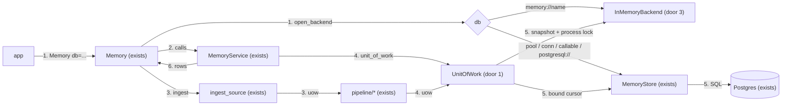
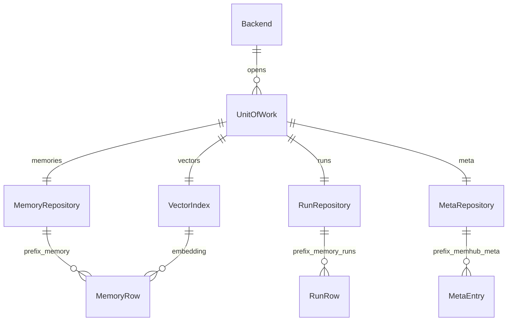

# Storage ports and an in-memory backend (PR 3 of #1)

**Approved**: 2026-11-11 - user: "aprproved. Implement from the branch, we are using stacked PRs later"

## Problem

Every ledger read and write in memhub goes through a psycopg cursor that callers open and pass by
hand: `service.py` opens `store.connect()` / `conn.cursor()` in every method, the ingest pipeline
threads `cur` through `ingest.py`, `score.py`, `areas.py`, `reconcile.py`, `route.py` and
`summarize.py`, and `memory.py` and `cli.py` do the same (about 140 references). The only ledger is
Postgres with pgvector, so an app that adopts memhub cannot run its own unit tests without Docker
and a pgvector container, and a second database (SQLite, PR 4) would need its own copy of every
caller. Evidence: PRD R10, R11 and the TDD's *Storage ports and capabilities* section (83 cursor
references in `service.py`, about 55 in the pipeline); the PRD user row "Developer testing locally:
Postgres + pgvector required".

When this ships, an app's tests run `Memory(db="memory://", llm=fake, embedder=fake)` with no
Docker and get the same review, versioning and search behaviour as on Postgres. A backend that
cannot do something says which capability is missing and how to fix it. Postgres behaves exactly as
today.

## Shape

This reuses `MemoryStore` unchanged as the Postgres SQL layer (AD-011): it keeps its cursor methods
and gains `capabilities`, `unit_of_work()` and `bind(cur)`, and the in-memory backend reimplements
those same methods over dicts. No rule moves out of `MemoryService` or the pipeline. The rules that
change an outcome stay in `MemoryService`, `pipeline/*` and the two backends' repository methods,
all reachable from pytest: the in-memory backend with fake models and no Docker, Postgres through
the Docker fixture in `tests/conftest.py`.

1. app calls `Memory(db=..., config=...)` -> `Memory` (exists) - asks `open_backend` for a backend: `memory://[name]` -> `InMemoryBackend` (door 3), anything else -> `MemoryStore(connection_source(db), prefix, schema)`; then checks the capabilities the config needs (door 2) and runs no SQL (AD-002)
2. `Memory` -> `MemoryService` (exists) - `store` is now any `Backend` (door 1); each method opens `with self.store.unit_of_work() as uow` where it opened a cursor before
3. `MemoryService` / `ingest_source` (exists) -> `pipeline/*` (exists) - `score`, `areas`, `reconcile`, `route`, `summarize` take `uow` in place of `cur, store`; ingest keeps one unit of work per segment and `thread_lock` per thread
4. `UnitOfWork` (door 1) - `memories`, `runs`, `meta`, `vectors` repositories: today's `MemoryStore` method names and keywords, without `cur`
5. Postgres: `MemoryStore` (exists) under `storage/postgres.py`, its unit of work binds one cursor; `store.py` re-exports it (door 4). In-memory: `InMemoryBackend` (new) - a snapshot copied on begin, swapped in on commit, under a process lock
6. out: the same rows (dicts with the same keys) to `Memory`, which returns `AddResult` / `MemoryEvent` / dicts as in PR 1

**Changes underneath**

| Front | What changes |
| --- | --- |
| domain | new term: `UnitOfWork` - one transaction with four repositories; replaces "a cursor from `store.connect()`" in `service.py`, `pipeline/*`, `memory.py`, `cli.py` |
| domain | new term: `Capability` - `transactions`, `vector_search`, `json_lookup`, `parallel_ingest`, `schemas`; nothing branches on it before this PR |
| domain | `MemoryService.store` meant a `MemoryStore`, now means any `Backend`; `ingest_source(store=)` likewise. Tests reach `service.store.connect()` and `store._t(...)` for raw SQL: still there on Postgres |
| stored data | nothing to migrate: Postgres tables, indexes and SQL are unchanged; the in-memory backend keeps the same three tables in process memory, gone with the process |
| readers | `memhub` CLI (exists) builds the Postgres backend as today and checks the embedding config through a unit of work; `MemoryMiddleware` and `MemoryToolkit` go through `MemoryService` and see no change |

New: the ports (`Backend`, `UnitOfWork`, four repositories) and the in-memory store of the same
three tables. One-way constraints: an active row is unique per `memory_id` and per keyed slot on
both backends (door 1).

## Surface

None - no route: memhub adds no HTTP endpoint. The consumed contract is the Python API in Landing: the ports and `Capability` (door 1), the capability error (door 2), the in-memory URL `memory:` / `memory:<name>` written with `//` (door 3), `MemoryStore.bind(cur)` and the `memhub.store` shim (door 4); its errors are criteria 3, 10, 11, 15 and 19.

## Landing

| One-way door | Literal shape | Alternative rejected |
| --- | --- | --- |
| 1. Storage ports (`memhub/storage/base.py`) | `class Capability(str, Enum): TRANSACTIONS="transactions"; VECTOR_SEARCH="vector_search"; JSON_LOOKUP="json_lookup"; PARALLEL_INGEST="parallel_ingest"; SCHEMAS="schemas"`; `@runtime_checkable class Backend(Protocol): name: str; capabilities: frozenset[Capability]; def unit_of_work(self) -> ContextManager[UnitOfWork]; def thread_lock(self, source: str, thread_id: str) -> ContextManager[bool]; def init(self, *, embedding_model: str, dims: int) -> None`; `class UnitOfWork(Protocol): memories: MemoryRepository; runs: RunRepository; meta: MetaRepository; vectors: VectorIndex`. Repository methods keep `MemoryStore`'s names and keywords: `memories` = add_memory, edit_memory, amend_row, archive, reject, approve, merge_evidence, merge_evidence_row, delete_row, delete_user, get_by_id, get_active, history, list_memories, count_active, queue, owner_areas, linked_rows, move_area_links, areas_by_memory_id, add_link; `runs` = get_watermark, upsert_run, list_run_summaries, run_detail, dropped_by_reason, purge_dropped, has_final_pass; `meta` = get_meta, set_meta, check_embedding_config; `vectors` = search, top_similar, nearest_area, iter_for_reembed, update_embedding, set_embedding_dims | a SQL dialect layer under the cursor - the in-memory backend speaks no SQL, and SQLite (PR 4) would re-parse Postgres-specific JSONB and vector operators |
| 2. Capability error | `NotImplementedError(f"{capability.value} is not available on {backend.name}: {fix}")`, backend names `postgres` and `memory`; raised by `require(backend, capability, fix)` in `storage/base.py`; `Memory.__init__` requires `transactions`, `vector_search`, `json_lookup` always and `schemas` when `database_schema` is set | a silent fallback (ignore `database_schema` on memory) - the app believes its rows are in a schema they are not in (PRD D8) |
| 3. `memory://` URL (AD-012) | `memory://` -> a new `InMemoryBackend` per `Memory`; `memory://<name>` -> one backend per name per process, from a module-level `dict[str, InMemoryBackend]`; capabilities: all but `schemas` | one shared store per process - tests leak rows into each other |
| 4. `memhub.store` as a shim | `store.py` holds only `from memhub.storage.postgres import *` plus the pure helpers re-exported from `memhub.storage.rules`; `MemoryStore` keeps its cursor methods (AD-011) | dropping the cursor methods - breaks every external caller and about 200 test lines (N1) |

- Nothing else in this change is hard to reverse

## Criteria

### S1: Postgres behind the ports, nothing changes (P1)

The full existing suite stays green on Postgres while every caller uses a `UnitOfWork`.

**Acceptance Criteria**

1. The system SHALL define `Capability` with exactly the values `transactions`, `vector_search`, `json_lookup`, `parallel_ingest`, `schemas`, and `Backend` / `UnitOfWork` such that `isinstance(MemoryStore(...), Backend)` and `isinstance(InMemoryBackend(), Backend)` are both `True`
2. The `memories`, `runs`, `meta` and `vectors` repositories SHALL each expose the methods door 1 lists, with the same keyword parameters as the `MemoryStore` method of that name minus `cur`
3. WHEN a unit of work exits without an exception THEN the next unit of work SHALL see its writes; IF an exception escapes it THEN none of its writes SHALL be visible and the same exception SHALL propagate - on both backends
   - add one row and exit -> next `get_by_id` returns it; add one row, `upsert_run`, then raise `RuntimeError` -> `get_by_id` is `None`, `get_watermark` is `None`, `RuntimeError` reaches the caller
4. The system SHALL give `MemoryStore.capabilities` all five capabilities, for every kind of `db` PR 1 accepts (pool, connection, callable, URL)
5. WHEN `MemoryStore.bind(cur)` is used inside an open cursor's transaction THEN its writes SHALL be visible to that cursor before commit, and `bind` SHALL neither commit nor roll back
6. The modules `service.py`, `memory.py`, `cli.py`, `middleware.py`, `toolkit.py` and every `pipeline/*.py` SHALL NOT import `psycopg`, take a parameter named `cur`, or call `.cursor(` or `.connect(`
7. The system SHALL keep `memhub.store` exporting every public name it exported at `2a58e6c`, each the same object as in its new module; `newest_observed_at`, `fresh_evidence`, `area_link`, `area_ids`, `as_vector_list`, `Actor`, `StoreError`, `NotFound`, `Conflict`, `EmbeddingMismatch` SHALL live in a module that imports no psycopg
8. The full test suite SHALL pass on Postgres, and test files SHALL differ from `2a58e6c` only where a pipeline call passed `cur=cur, store=store` and now passes `uow=store.bind(cur)` (AD-011)
9. WHEN `service.search` runs on Postgres THEN it SHALL issue the same SQL statements, in the same order (table prefix normalized), as recorded at `2a58e6c`, the last commit before the ports (AD-014)

### S2: A backend says what it cannot do (P1)

A missing capability fails loudly at startup, naming the capability and the fix.

**Acceptance Criteria**

10. IF code calls something that needs a capability the backend lacks THEN the system SHALL raise `NotImplementedError` whose message is exactly `<capability> is not available on <backend>: <fix>`
    - `InMemoryBackend` asked for schema `tenant` -> `schemas is not available on memory: remove database_schema from the config, or use Postgres`
11. WHEN `Memory(db=MEM, embedder=e, config={"database_schema": "tenant"})` is built THEN `__init__` SHALL raise the error of criterion 10 before any method is called; with no `database_schema` it SHALL build
12. WHERE the contract suite runs on a backend that lacks a capability, the test for that capability SHALL assert the `NotImplementedError` of criterion 10 and SHALL NOT skip: `pytest -rs tests/test_contract_memory.py` reports 0 skipped

### S3: In-memory backend for app tests with no Docker (P1)

In this slice `MEM` is the in-memory URL with no name: the scheme `memory`, a colon and two slashes (door 3).

An app test builds `Memory(db=MEM)` and gets Postgres's behaviour, with nothing to install.

**Acceptance Criteria**

13. WHEN an app test with `psycopg.connect` patched to raise runs `Memory(db=MEM, llm=fake, embedder=fake)`, `init`, `add` (user) -> `search` (it ranks first) -> `promote` -> `approve` as admin -> `get_all` (the workspace row is active) -> `delete_all` THEN every step SHALL succeed and `delete_all` SHALL return `{"deleted": 1, "runs": 0}` (the user's one row; the workspace copy stays)
14. WHEN two `Memory` objects are built THEN two on `MEM` SHALL NOT see each other's rows, two on `MEM + "shared"` SHALL, and two on `MEM + "a"` and `MEM + "b"` SHALL NOT (AD-012)
    - add on the first `MEM` -> the second's `get_all` is `[]`; add on one `MEM + "shared"` -> the other's `get` returns it
15. IF a call reaches an in-memory backend before `init()` THEN it SHALL raise `EmbeddingMismatch` whose message contains `init()`; IF a second `Memory` on the same named in-memory URL has an embedder of other dims THEN its calls SHALL raise `EmbeddingMismatch` (AD-013)
16. The in-memory backend SHALL return rows with exactly the keys of a Postgres row of the same table (plus `stale` from `list_memories`, `similarity` from `search` / `top_similar`), with `id` / `memory_id` as `uuid.UUID` and timestamps as timezone-aware `datetime`
17. IF a caller mutates a row the in-memory backend returned THEN the stored row SHALL be unchanged
    - set `row["content"] = "x"` and `row["evidence"].append({})` on a `get_by_id` result -> the next `get_by_id` has the old content and evidence
18. WHILE a unit of work is open in one thread, a unit of work on the same in-memory backend in another thread SHALL wait until it ends, then see only what it committed
    - thread A adds a row and sleeps 0.2 s then commits -> B, started during the sleep, finds the row; A adds and raises -> B finds nothing
19. IF a write would leave two active rows for one `memory_id`, or for one keyed slot (`workspace_id`, `scope`, `user_id`, `type`, `payload.key`), THEN the in-memory backend SHALL raise `Conflict` and keep one active row (Postgres keeps raising `psycopg.errors.UniqueViolation`, as `test_store.py` asserts today)
20. WHILE one `thread_lock(source, thread_id)` is held on a backend, a second one with the same pair SHALL yield `False`, and SHALL yield `True` after the first exits or for another `thread_id` - on both backends
21. The in-memory `vectors.search` and `top_similar` SHALL return the same rows in the same order as Postgres for the same data, with `similarity` equal to cosine similarity within 1e-6, and the same filters: status `active`, the user's own rows plus the workspace's rows of that `workspace_id`, stale rows out unless `include_stale`, `area` rows out unless `type="area"`, the `type` filter, the first `k`, and the area / text / entity boosts of +0.05 capped at 1.0
    - vectors at similarity 0.95, 0.86 and 0.50 -> that order; a stale 0.99 row -> left out, and first with `include_stale=True`; another user's 0.99 row -> never returned
22. WHEN `ingest_source` runs on each backend over the same JSONL fixture with the same fake models THEN both SHALL write the same memory rows (type, scope, status, content) and the same run rows (thread, `candidates_proposed`, `created`, `dropped` reasons)
23. IF a segment's unit of work raises on either backend THEN that segment SHALL leave no memory row and no run row, and the next ingest SHALL process it again
24. WHEN `set_embedding_dims` then `reembed` run on either backend THEN every row, candidates and superseded ones included, SHALL carry a vector of the new dims and `meta` `embedding` SHALL hold the new model and dims

## Out of scope

| Excluded | Why |
| --- | --- |
| SQLite backend | PR 4; this PR leaves the ports it plugs into |
| `memory://` in the `memhub` CLI | each CLI command is its own process, so an in-memory store is gone before the next command; the CLI stays on `database_url` |
| `sources/sql.py` using psycopg | it reads the app's source table, not the ledger, so it is not storage |
| Moving `connection.py` under `storage/` | it is the Postgres connection layer already; moving it is churn with no behaviour change |
| Schema version in `meta` | PR 6 |
| Persisting `memory://` across processes | the PRD's in-memory backend is for tests: "nothing persisted" |
| A latency gate in CI | AD-014: the bench script reports it, and criterion 9 gates the mechanism |

## Assumptions

| Assumption | Chosen default | Rationale | Confirmed? |
| --- | --- | --- | --- |
| Test call sites vs N1 | `MemoryStore` keeps its cursor API and is the Postgres backend; only pipeline call sites in tests change, to `uow=store.bind(cur)` | user: "Edit call sites" (AD-011) | y |
| `memory://` sharing | fresh per `Memory`; shared by `<name>` within the process | user: "Fresh, or shared by name" (AD-012) | y |
| `init()` on `memory://` | required, as on Postgres | user: "Require init()" (AD-013) | y |
| N4 proof | same SQL as `2a58e6c` in a test; median latency from a bench script, not a gate | user: "Same SQL + bench" (AD-014) | y |
| `parallel_ingest` on a borrowed `psycopg.Connection` | Postgres declares it for every `db` kind; PR 1's advisory lock on the borrowed connection stays as it is | user: "Keep the flag" (AD-015) | y |
| Which capabilities `Memory.__init__` checks | `transactions`, `vector_search`, `json_lookup` always; `schemas` when `database_schema` is set; `parallel_ingest` when `thread_lock` is called | no config key asks for several ingest workers, so nothing at startup needs it | n |
| Repository method names | identical to today's `MemoryStore` names (`add_memory`, `list_memories`, ...), not renamed to `add` / `list` | TDD: "the move is mechanical"; renames would double the diff for no behaviour | n |
| In-memory ordering ties | rows with the same `created_at` come back in insertion order | Postgres `now()` is fixed per transaction, so tie order there is unspecified; contract tests do not depend on ties | n |
| The bench script | `scripts/bench_search.py` runs `service.search` 200 times on the test data at `2a58e6c` and at `HEAD` and prints both medians and the ratio; the result goes in the PR description | N4 asks for the number; AD-014 keeps it out of CI | n |

**Open questions:** none - all resolved or logged above.

## Differences from the source

| Source shows | Product shows | Confirmed |
| --- | --- | --- |
| TDD testing strategy: "PR 3 only swaps fixtures to build a `UnitOfWork`" | fixtures unchanged; about 12 pipeline call sites in tests change from `cur=cur, store=store` to `uow=store.bind(cur)` | y - AD-011 |
| PRD N4: "Postgres search latency stays within 10% of today" as a requirement of PR 3 | a test gates the same SQL statements; the latency ratio comes from a bench script in the PR description | y - AD-014 |
| PRD connection table: borrowed `psycopg.Connection` - "parallel ingest disabled" | Postgres declares `parallel_ingest` for every `db` kind; the advisory lock on the borrowed connection stays | y - AD-015 |

## Sources

- PRD + TDD, *Storage ports and capabilities* and *Backends* (https://app.notion.com/p/jooaobrum/memhub-Pluggable-memory-package-Integration-41517e87bbcc802eab1ac766dd797a07, read 2026-11-11) - binding - ports, capability table, error format, in-memory semantics, PR 3 files and tests
- Issue #1, PR 3 brief (this request) - binding - Delivers, Files, Acceptance, depends on PR 1 (#2)
