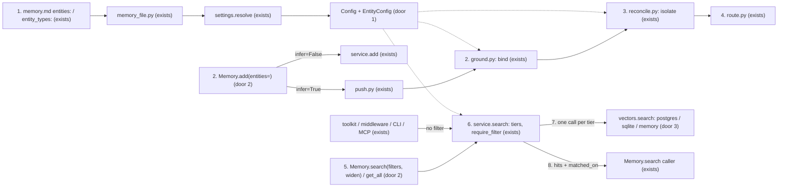
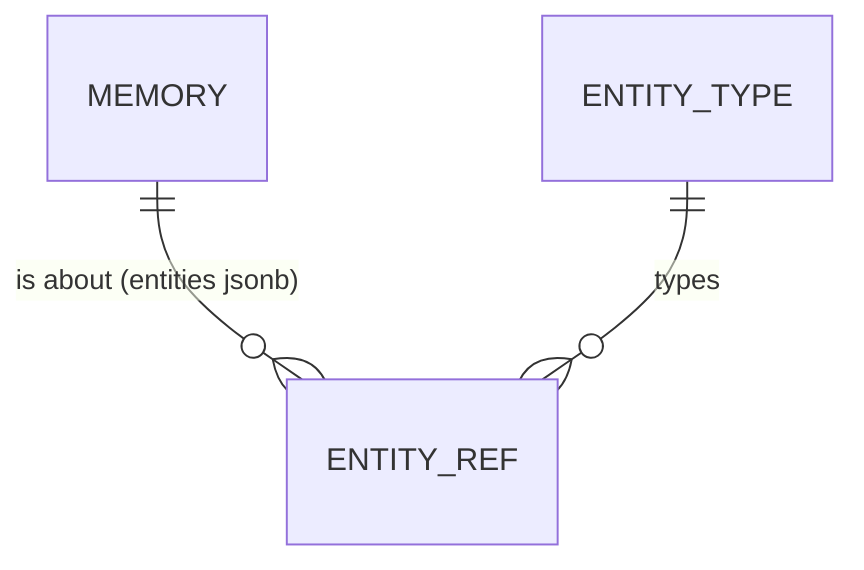

# Subject-scoped memory: memories about different subjects never merge, and search filters by subject

**Approved**: 2026-11-12 - user: "since you have the plan. Take the most updated code and implement it considering the current work that is finishing"

## Problem

A memory can be about a subject: a machine, a customer, a patient, a repo. memhub has entities (`{"type": "machine", "id": "P-101"}`) but treats them as a hint, not as identity:

- Reconcile merges two memories with the same text, or with similarity >= `reconcile.duplicate` (0.92), before it looks at entities (`pipeline/reconcile.py:259-265`). "Pump P-101 vibrates above 7 mm/s" and "Pump P-102 vibrates above 7 mm/s" embed above 0.92, so the second machine's memory is merged into the first's and is lost as its own fact.
- The entity rule that does exist (`_comparable`, `reconcile.py:40`) treats every entity type alike, so a plain label (`topic`) blocks comparison just as a subject does.
- With `infer=True`, the model picks the entities. The caller usually already knows the subject (a work order names its machine, a ticket its customer) but cannot say so.
- `Memory.search` cannot filter by subject. A question about P-101 can return P-102's memories ranked above P-101's. In healthcare that is one patient's memory in another patient's answer.

Who pays: any project with many similar subjects. Evidence: the user's maintenance case ("I cannot merge memories because some machines may have different, despite they are similar in name"), and the same shape in support, healthcare and software ("maintenance was just an example").

When this ships, a project declares its subject types in `memory.md`. Memories about different subjects of an isolated type never merge, whatever their text. The caller binds the subject when writing, and search returns only that subject's memories, or widens on request to broader subjects and general memories, saying which level each hit came from.

## Shape

This reuses the `entities` column every backend already stores (Postgres `jsonb` with a GIN index, SQLite `TEXT`, the in-memory rows), `EntityRef`, the layered `settings.resolve` with the memory file, and the reconcile and search pipelines; no table changes. The rules that change an outcome run in `config.py` (entity config and short forms), `pipeline/reconcile.py` (isolation), `pipeline/ground.py` (binding), `service.search` (tiers, `require_filter`) and each backend's `vectors.search` (the filter), all reachable by pytest with no model, and by the storage contract tests on every backend.

**Writing**

1. `memory.md` frontmatter `entities:` (or `entity_types:` in memhub.yaml) -> `memory_file.py` (exists) accepts the new key -> `settings.resolve` (exists) -> `Config` (exists) expands the short forms into one `EntityConfig` per type: `isolate`, `require_filter` (door 1).
2. `Memory.add(data, entities=[...], ...)` (exists, door 2) validates each entity against the config.
   - `infer=False`: the bound entities replace those of the same type in `data`, then `service.add` (exists) writes the row.
   - `infer=True`: `pipeline/push.py` (exists) carries the bound entities to `pipeline/ground.py` (exists), which stamps them on every proposal and drops extracted entities of a bound type (AD-032).
3. `pipeline/reconcile.py` (exists) compares a proposal only with rows whose isolated subjects are the same set as its own, in every path: same text, duplicate, judge and keyed slot.
4. `pipeline/route.py` (exists) writes the decision, unchanged.

**Searching**

5. `Memory.search(q, filters={...}, widen=...)` and `Memory.get_all(filters={...})` (exists, door 2) validate `filters` and hand them to `service.search` / `service.list` (exists).
6. `service.search` (exists) builds the tiers: one per listed entity in the order given, plus `general` (no isolated subject) when `widen=True` (AD-030). It also applies `require_filter` (AD-033).
7. `vectors.search` on each backend (exists, door 3) takes the entity filter and returns the nearest rows matching it. `service.search` merges the tiers in order, then by similarity, and cuts to `top_k`.
8. out: each hit carries `matched_on` (`"machine:P-101"` or `"general"`). `MemoryToolkit`, `MemoryMiddleware`, `memhub search` and MCP call `service.search` with no filter, so they get the `require_filter` guard and nothing else changes for them.

**Changes underneath**

| Front | What changes |
| --- | --- |
| domain | `entity_types` meant "entity types the model may use". It now also means "isolated subjects": every listed type gets `isolate: true`. Today's readers: `service._validate` (`service.py:108`), `pipeline/ground.py:78-80`, `pipeline/extract.py:152` (prompt), `reconcile._comparable` |
| domain | `_comparable` meant "shares any entity, or neither has one". It now means "the same set of isolated subjects". Non-isolated types (`isolate: false`) no longer gate comparison |
| domain | the same-text and duplicate merges, and the keyed-slot path, now honour isolation. Before, they ignored entities |
| stored data | nothing to migrate: rows already store `entities`. Rows written before this keep their tags, and from now on they are isolated by them |
| readers | `Memory.search` / `get_all` gain `filters`; hits gain `matched_on` only when `filters` is given. Toolkit, middleware, CLI and MCP get the `require_filter` guard (criterion 15). `docs/integration.md` §7.2 and the memory.md guide teach the pattern |

New: nothing stored. `ENTITY_TYPE` is config (`EntityConfig`), not a table. `ENTITY_REF` stays inside the `entities` column.

## Surface

Python API (no HTTP route):

| Call | In | Out | Status | Who |
| --- | --- | --- | --- | --- |
| `Memory.add(data, *, entities=None, ...)` | `entities: list[{"type", "id"}]` | `AddResult` as today | `ok`; `ValidationError` for an unknown type or a malformed entity | any caller with ids, as today (AD-001) |
| `Memory.search(query, *, filters=None, widen=False, ...)` | `filters: {"entities"?: list[{type,id}], "entity_type"?: str, "types"?: list[str]}` | `list[dict]`, each with `matched_on` when `filters` is given | `ok`; `ValidationError` for an unknown key, unknown type, `types` given both as a parameter and in `filters`, or `widen=True` without `filters["entities"]` | as today |
| `Memory.get_all(*, filters=None, ...)` | same `filters`, `widen` not taken | `list[dict]` | `ok`; `ValidationError` as `search` | as today |

## Landing

| One-way door | Literal shape | Alternative rejected |
| --- | --- | --- |
| 1. Entity config in `memory.md` | `entities: {machine: isolate, topic: tag, patient: {isolate: true, require_filter: true}}`; a list `entities: [machine, model]` means all `isolate`; memhub.yaml `entity_types: [a]` is the same as `entities: [a]`; one type set in both places raises `ConfigError` | a `broader: [model]` key with relations learnt from co-tagged rows - stores a relation a wrong tag corrupts (AD-030) |
| 2. Public API | `add(..., entities=)`, `search(..., filters=, widen=)`, `get_all(..., filters=)`; the hit key `matched_on` = `"<type>:<id>"` or `"general"` | `search(..., entity=P101)` single kwarg - cannot express an order to widen in, nor a fleet search by type |
| 3. Storage port | `vectors.search(..., entities: EntityFilter \| None = None)` and `vectors.top_similar(..., entities=...)`; `EntityFilter(any_of=((type, id), ...), of_type=str \| None, none_of_types=(type, ...))` in `storage/rules.py`, every part given must hold; `None` = today's SQL | filter in Python after `vectors.search` - top-k is cut before the filter, so a subject's rows below other subjects' never come back |

- Nothing else in this change is hard to reverse.

## Criteria

### S1: memories about different subjects never merge (P1)

Writing about P-101 never changes a memory about P-102.

**Acceptance Criteria**

1. WHEN `memory.md` sets `entities: {machine: isolate, topic: tag}` THEN `Config.entities` SHALL hold `machine` with `isolate=True, require_filter=False` and `topic` with `isolate=False`
   - `entities: [machine]` → `isolate=True`; `entity_types: [machine]` in memhub.yaml with no `entities:` → `isolate=True`; `{patient: {isolate: true, require_filter: true}}` → both true
2. IF `machine` is declared both in `entities:` and in `entity_types:` THEN `settings.resolve` SHALL raise `ConfigError` "entity type 'machine' is declared in both entity_types and entities: keep one"
3. IF a short form is neither `isolate`, `tag` nor a mapping of `isolate`/`require_filter` THEN `settings.resolve` SHALL raise `ConfigError` naming the type and the value
   - `machine: strict` → error; `machine: {broader: [model]}` → error naming `broader`
4. WHEN a stored row is about `machine:P-102` and a proposal is about `machine:P-101` with the same text THEN reconcile SHALL decide `create`, not `merge`
5. WHEN they differ only by subject and have similarity >= `reconcile.duplicate` THEN reconcile SHALL decide `create`
   - similarity 0.99, P-101 vs P-102 → `create`; same subject, similarity 0.95 → `merge` (unchanged)
6. WHEN the isolated subject sets differ THEN reconcile SHALL not send the stored row to the judge
   - `{P-101}` vs `{P-101, P-102}` → not sent; `{P-101}` vs `{}` (untagged) → not sent; `{P-101, topic:noise}` vs `{P-101}` → sent (topic is a tag)
7. IF a keyed candidate's isolated subjects differ from the active row in its slot THEN reconcile SHALL decide `conflict`, never `supersede`
8. WHEN `Memory.add({"content": ..., "entities": [machine:P-9, topic:x]}, entities=[machine:P-101])` (infer=False) THEN the stored row SHALL have entities `[machine:P-101, topic:x]`
9. WHEN `Memory.add(messages, infer=True, entities=[machine:P-101])` and the model extracts `[machine:P-102, part:6205]` THEN every written memory SHALL carry `[machine:P-101, part:6205]` (AD-032)
10. IF `entities` names a type the config does not declare, or an item lacks `type` or `id` THEN `Memory.add` SHALL raise `ValidationError` naming the item before any model or database call

### S2: search filters by subject and widens on request (P1)

A search about P-101 returns P-101's memories, and with `widen` the broader ones after them.

**Acceptance Criteria**

11. WHEN `search(q, filters={"entities": [machine:P-101]})` THEN every hit SHALL carry `machine:P-101` and `matched_on == "machine:P-101"`
    - P-102's memory with similarity 0.99 → absent; P-101's with similarity 0.31 → present
12. WHEN `search(q, filters={"entities": [machine:P-101, model:CR-32]}, widen=True)` THEN hits SHALL come in tier order, P-101's, then CR-32's, then memories with no isolated subject (`matched_on == "general"`), by similarity within a tier, cut to `top_k` (AD-030)
    - a general hit at 0.95 ranks after a P-101 hit at 0.40; a memory tagged both P-101 and CR-32 appears once, as `machine:P-101`; P-102's memory never appears
13. WHEN `search(q, filters={"entity_type": "machine"})` THEN hits SHALL be the memories carrying any `machine`, each with `matched_on` = its first `machine` entity
14. WHEN `search(q)` with no `filters` and no type declares `require_filter` THEN the results SHALL be today's (no `matched_on` key)
15. WHILE `patient` declares `require_filter: true`, WHEN `service.search` runs without a filter naming `patient` (via `Memory.search`, `MemoryToolkit`, `MemoryMiddleware`, `memhub search` or MCP) THEN no memory tagged with a `patient` SHALL be returned (AD-033)
    - `filters={"entities": [patient:7]}` → patient 7 only; `filters={"entity_type": "patient"}` → all patients; untagged memories → returned either way
16. WHEN `get_all(filters={"entities": [machine:P-101]})` THEN it SHALL return only memories carrying P-101, newest first
17. IF `filters` has a key other than `entities`, `entity_type`, `types`, or `widen=True` comes without `filters["entities"]`, or `types` is given both as a parameter and in `filters` THEN `search` SHALL raise `ValidationError` naming the cause
18. WHEN the storage contract suite runs THEN `vectors.search` with `entities_any`, `entity_type`, `untagged_only` and `exclude_entity_types` SHALL return the same rows on Postgres, SQLite (both legs, AD-017) and the in-memory backend

### S3: the pattern is documented for any domain (P2)

19. WHEN a reader opens `docs/integration.md` THEN the custom-types section SHALL replace the `Machine` example with the subject pattern: declare, bind on write, filter and widen on search, with one example each for industrial (machine/model), support (customer/account), healthcare (patient, `require_filter`) and software (repo/org), and state that name-to-id resolution is the caller's

## Out of scope

| Excluded | Why |
| --- | --- |
| Name or alias resolution ("Pump 1" -> `P-101`) | the caller's registry owns canonical ids; memhub would guess |
| Stored relations between subjects (`broader`) | AD-030: the caller passes the widen order |
| A filter or `entities` argument on `MemoryToolkit`, `MemoryMiddleware`, `memhub search`, MCP tools | separate surfaces with their own contracts; they get the `require_filter` guard now and filters in a follow-up |
| Binding entities on `ScopedMemory` (`m.scope(..., entities=)`) | convenience over door 2; follow-up once the API settles |
| More than one active value per keyed slot per owner (P-101's and P-102's `profile.model`) | the unique index is per owner (tdd.md:63); changing it is a schema migration. Criterion 7 makes the clash a `conflict` instead of an overwrite |
| Re-splitting memories merged across subjects before this ships | history is kept; no way to tell a wrong merge from a right one without a person |

## Assumptions

| Assumption | Chosen default | Rationale | Confirmed? |
| --- | --- | --- | --- |
| How isolation compares two subject sets | equal sets of isolated subjects (untagged = empty set) | the strictest rule that never merges across subjects; intersection would let a memory about P-101+P-102 merge into one about P-101 | n |
| `entity_types:` shorthand | every listed type is `isolate: true` | entities already gated the judge; the safe reading for existing projects | n |
| `filters["entities"]` with several items | any-of, and the order is the widen order | one list serves both the filter and the ranking | n |
| `filters["types"]` | accepted, same as the `types` parameter | the user asked for filters in a dict | n |
| `matched_on` when no `filters` | key absent | keeps today's hit shape for every current caller | n |

**Open questions:** none - all resolved or logged above.

## Differences from the source

None - the product matches the source

## Sources

- Conversation 2026-11-12: "I cannot merge memories because some machines may have different, despite they are similar in name"; "I need an industrial pattern here. For writing and for searching."; "this needs also to work to other cases, maintenance was just an example" - binding - the problem and the domain-neutral requirement
- `src/memhub/pipeline/reconcile.py:40,259-265` - the merge paths that ignore entities
- AD-030..AD-033 in `.specs/STATE.md`
